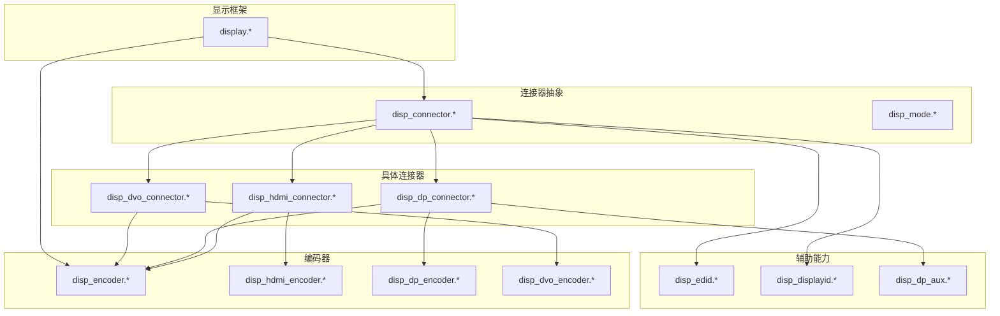
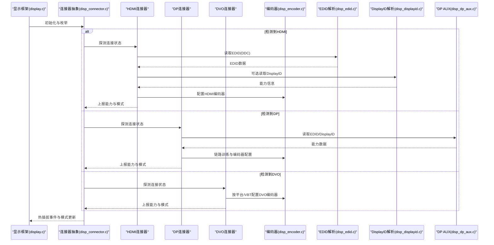
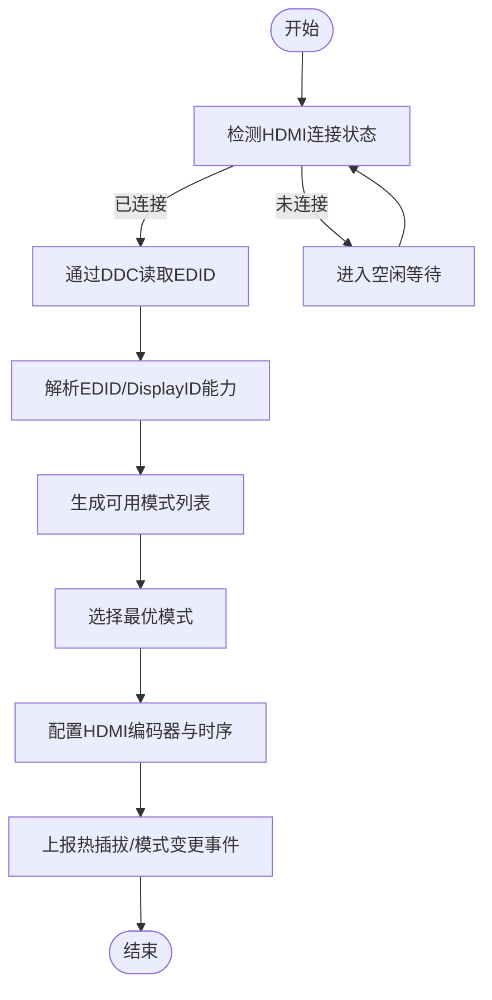
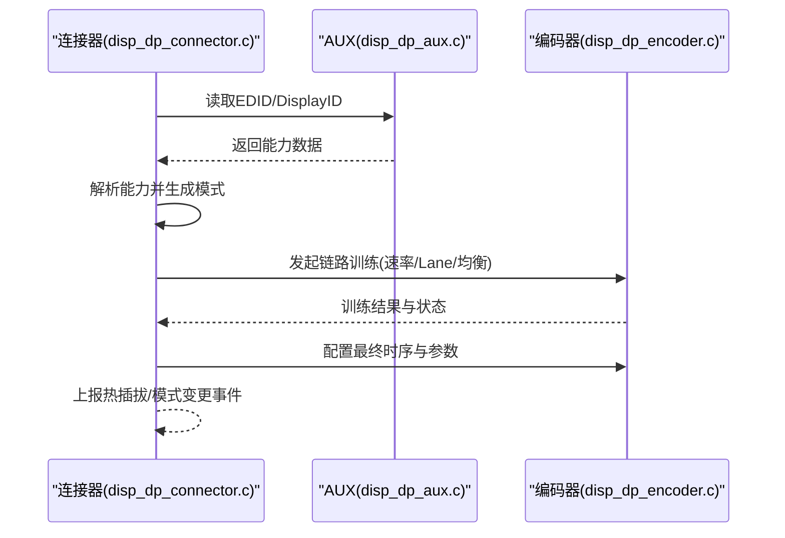
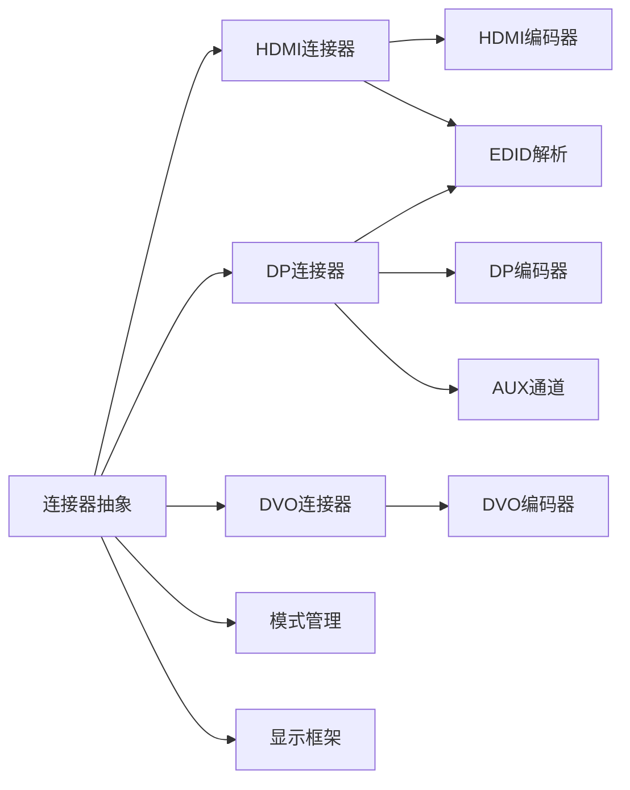

# 连接器管理

<cite>
**本文引用的文件**   
- [disp_connector.c](file://_work/src/usr/src/lisuangpu-dkms-262.2.0.56/display/connector/disp_connector.c)
- [disp_connector.h](file://_work/src/usr/src/lisuangpu-dkms-262.2.0.56/display/connector/disp_connector.h)
- [disp_hdmi_connector.c](file://_work/src/usr/src/lisuangpu-dkms-262.2.0.56/display/connector/disp_hdmi_connector.c)
- [disp_hdmi_connector.h](file://_work/src/usr/src/lisuangpu-dkms-262.2.0.56/display/connector/disp_hdmi_connector.h)
- [disp_dp_connector.c](file://_work/src/usr/src/lisuangpu-dkms-262.2.0.56/display/connector/disp_dp_connector.c)
- [disp_dp_connector.h](file://_work/src/usr/src/lisuangpu-dkms-262.2.0.56/display/connector/disp_dp_connector.h)
- [disp_dvo_connector.c](file://_work/src/usr/src/lisuangpu-dkms-262.2.0.56/display/connector/disp_dvo_connector.c)
- [disp_dvo_connector.h](file://_work/src/usr/src/lisuangpu-dkms-262.2.0.56/display/connector/disp_dvo_connector.h)
- [disp_edid.c](file://_work/src/usr/src/lisuangpu-dkms-262.2.0.56/display/connector/disp_edid.c)
- [disp_edid.h](file://_work/src/usr/src/lisuangpu-dkms-262.2.0.56/display/connector/disp_edid.h)
- [disp_displayid.c](file://_work/src/usr/src/lisuangpu-dkms-262.2.0.56/display/connector/disp_displayid.c)
- [disp_displayid.h](file://_work/src/usr/src/lisuangpu-dkms-262.2.0.56/display/connector/disp_displayid.h)
- [disp_dp_aux.c](file://_work/src/usr/src/lisuangpu-dkms-262.2.0.56/display/connector/disp_dp_aux.c)
- [disp_dp_aux.h](file://_work/src/usr/src/lisuangpu-dkms-262.2.0.56/display/connector/disp_dp_aux.h)
- [disp_mode.c](file://_work/src/usr/src/lisuangpu-dkms-262.2.0.56/display/connector/disp_mode.c)
- [disp_mode.h](file://_work/src/usr/src/lisuangpu-dkms-262.2.0.56/display/connector/disp_mode.h)
- [disp_encoder.c](file://_work/src/usr/src/lisuangpu-dkms-262.2.0.56/display/encoder/disp_encoder.c)
- [disp_encoder.h](file://_work/src/usr/src/lisuangpu-dkms-262.2.0.56/display/encoder/disp_encoder.h)
- [disp_hdmi_encoder.c](file://_work/src/usr/src/lisuangpu-dkms-262.2.0.56/display/encoder/disp_hdmi_encoder.c)
- [disp_hdmi_encoder.h](file://_work/src/usr/src/lisuangpu-dkms-262.2.0.56/display/encoder/disp_hdmi_encoder.h)
- [disp_dp_encoder.c](file://_work/src/usr/src/lisuangpu-dkms-262.2.0.56/display/encoder/disp_dp_encoder.c)
- [disp_dp_encoder.h](file://_work/src/usr/src/lisuangpu-dkms-262.2.0.56/display/encoder/disp_dp_encoder.h)
- [disp_dvo_encoder.c](file://_work/src/usr/src/lisuangpu-dkms-262.2.0.56/display/encoder/disp_dvo_encoder.c)
- [disp_dvo_encoder.h](file://_work/src/usr/src/lisuangpu-dkms-262.2.0.56/display/encoder/disp_dvo_encoder.h)
- [display.c](file://_work/src/usr/src/lisuangpu-dkms-262.2.0.56/display/display.c)
- [display.h](file://_work/src/usr/src/lisuangpu-dkms-262.2.0.56/display/display.h)
</cite>

## 目录
1. [简介](#简介)
2. [项目结构](#项目结构)
3. [核心组件](#核心组件)
4. [架构总览](#架构总览)
5. [详细组件分析](#详细组件分析)
6. [依赖关系分析](#依赖关系分析)
7. [性能考量](#性能考量)
8. [故障排查指南](#故障排查指南)
9. [结论](#结论)
10. [附录：API使用示例与最佳实践](#附录api使用示例与最佳实践)

## 简介
本文件面向丽山GPU连接器管理系统，聚焦HDMI、DisplayPort（DP）和DVO三种连接器的实现原理与接口规范。文档涵盖EDID解析流程、显示器能力检测、热插拔处理机制、DisplayID支持、DDC通信协议以及连接器状态管理，并提供面向开发者的API使用示例与最佳实践，帮助快速集成与调试不同接口的参数配置与事件处理。

## 项目结构
连接器子系统位于 display/connector 目录，围绕“连接器抽象 + 具体接口实现”的层次化设计组织代码：
- 抽象层：定义通用连接器模型、枚举、回调与状态机
- 具体实现：分别实现 HDMI、DP、DVO 的连接逻辑、EDID/DisplayID读取、DDC/AUX通道访问、模式生成与热插拔事件
- 编码器协同：连接器与 encoder 层协作完成信号编码与时序配置
- 显示框架：display 模块负责整体初始化、设备发现与生命周期管理

图表来源
- [disp_connector.c:1-200](file://_work/src/usr/src/lisuangpu-dkms-262.2.0.56/display/connector/disp_connector.c#L1-L200)
- [disp_hdmi_connector.c:1-200](file://_work/src/usr/src/lisuangpu-dkms-262.2.0.56/display/connector/disp_hdmi_connector.c#L1-L200)
- [disp_dp_connector.c:1-200](file://_work/src/usr/src/lisuangpu-dkms-262.2.0.56/display/connector/disp_dp_connector.c#L1-L200)
- [disp_dvo_connector.c:1-200](file://_work/src/usr/src/lisuangpu-dkms-262.2.0.56/display/connector/disp_dvo_connector.c#L1-L200)
- [disp_edid.c:1-200](file://_work/src/usr/src/lisuangpu-dkms-262.2.0.56/display/connector/disp_edid.c#L1-L200)
- [disp_displayid.c:1-200](file://_work/src/usr/src/lisuangpu-dkms-262.2.0.56/display/connector/disp_displayid.c#L1-L200)
- [disp_dp_aux.c:1-200](file://_work/src/usr/src/lisuangpu-dkms-262.2.0.56/display/connector/disp_dp_aux.c#L1-L200)
- [disp_encoder.c:1-200](file://_work/src/usr/src/lisuangpu-dkms-262.2.0.56/display/encoder/disp_encoder.c#L1-L200)
- [disp_hdmi_encoder.c:1-200](file://_work/src/usr/src/lisuangpu-dkms-262.2.0.56/display/encoder/disp_hdmi_encoder.c#L1-L200)
- [disp_dp_encoder.c:1-200](file://_work/src/usr/src/lisuangpu-dkms-262.2.0.56/display/encoder/disp_dp_encoder.c#L1-L200)
- [disp_dvo_encoder.c:1-200](file://_work/src/usr/src/lisuangpu-dkms-262.2.0.56/display/encoder/disp_dvo_encoder.c#L1-L200)
- [display.c:1-200](file://_work/src/usr/src/lisuangpu-dkms-262.2.0.56/display/display.c#L1-L200)

章节来源
- [disp_connector.c:1-200](file://_work/src/usr/src/lisuangpu-dkms-262.2.0.56/display/connector/disp_connector.c#L1-L200)
- [disp_hdmi_connector.c:1-200](file://_work/src/usr/src/lisuangpu-dkms-262.2.0.56/display/connector/disp_hdmi_connector.c#L1-L200)
- [disp_dp_connector.c:1-200](file://_work/src/usr/src/lisuangpu-dkms-262.2.0.56/display/connector/disp_dp_connector.c#L1-L200)
- [disp_dvo_connector.c:1-200](file://_work/src/usr/src/lisuangpu-dkms-262.2.0.56/display/connector/disp_dvo_connector.c#L1-L200)
- [disp_edid.c:1-200](file://_work/src/usr/src/lisuangpu-dkms-262.2.0.56/display/connector/disp_edid.c#L1-L200)
- [disp_displayid.c:1-200](file://_work/src/usr/src/lisuangpu-dkms-262.2.0.56/display/connector/disp_displayid.c#L1-L200)
- [disp_dp_aux.c:1-200](file://_work/src/usr/src/lisuangpu-dkms-262.2.0.56/display/connector/disp_dp_aux.c#L1-L200)
- [disp_encoder.c:1-200](file://_work/src/usr/src/lisuangpu-dkms-262.2.0.56/display/encoder/disp_encoder.c#L1-L200)
- [disp_hdmi_encoder.c:1-200](file://_work/src/usr/src/lisuangpu-dkms-262.2.0.56/display/encoder/disp_hdmi_encoder.c#L1-L200)
- [disp_dp_encoder.c:1-200](file://_work/src/usr/src/lisuangpu-dkms-262.2.0.56/display/encoder/disp_dp_encoder.c#L1-L200)
- [disp_dvo_encoder.c:1-200](file://_work/src/usr/src/lisuangpu-dkms-262.2.0.56/display/encoder/disp_dvo_encoder.c#L1-L200)
- [display.c:1-200](file://_work/src/usr/src/lisuangpu-dkms-262.2.0.56/display/display.c#L1-L200)

## 核心组件
- 连接器抽象（disp_connector.*）
  - 定义连接器类型、状态机、能力查询接口、热插拔回调、模式枚举与EDID/DisplayID获取入口
  - 提供统一的枚举能力、模式匹配、连接状态同步与上层通知机制
- HDMI连接器（disp_hdmi_connector.*）
  - 基于DDC/CEA扩展读取EDID，解析音视频能力、HDR、音频格式等
  - 驱动HDMI编码器进行链路训练与时序配置
- DisplayPort连接器（disp_dp_connector.*）
  - 通过AUX通道执行EDID/DisplayID读取、链路训练、带宽协商与MST/分支管理器交互
  - 驱动DP编码器完成时钟、lane数、速率等参数设置
- DVO连接器（disp_dvo_connector.*）
  - 传统数字视频输出，通常用于LVDS/eDP或自定义桥接芯片
  - 以固定时序或VBT/平台配置为基础生成模式并驱动DVO编码器
- EDID与DisplayID（disp_edid.*, disp_displayid.*）
  - EDID解析：基础块、扩展块、CEA-861/DAT、VCP等字段提取
  - DisplayID解析：扩展能力、面板特性、时序增强、HDR元数据等
- DDC/AUX（disp_dp_aux.*）
  - I2C/DDC与DP AUX通道的底层读写封装，含重试、超时与错误恢复
- 模式与能力（disp_mode.*）
  - 标准时序、CVT、GTF、自定义模式的生成与校验
- 编码器（disp_encoder.* 及具体实现）
  - 将连接器能力映射为物理信号与时序，协调PLL、PHY、DSC等子模块

章节来源
- [disp_connector.h:1-200](file://_work/src/usr/src/lisuangpu-dkms-262.2.0.56/display/connector/disp_connector.h#L1-L200)
- [disp_hdmi_connector.h:1-200](file://_work/src/usr/src/lisuangpu-dkms-262.2.0.56/display/connector/disp_hdmi_connector.h#L1-L200)
- [disp_dp_connector.h:1-200](file://_work/src/usr/src/lisuangpu-dkms-262.2.0.56/display/connector/disp_dp_connector.h#L1-L200)
- [disp_dvo_connector.h:1-200](file://_work/src/usr/src/lisuangpu-dkms-262.2.0.56/display/connector/disp_dvo_connector.h#L1-L200)
- [disp_edid.h:1-200](file://_work/src/usr/src/lisuangpu-dkms-262.2.0.56/display/connector/disp_edid.h#L1-L200)
- [disp_displayid.h:1-200](file://_work/src/usr/src/lisuangpu-dkms-262.2.0.56/display/connector/disp_displayid.h#L1-L200)
- [disp_dp_aux.h:1-200](file://_work/src/usr/src/lisuangpu-dkms-262.2.0.56/display/connector/disp_dp_aux.h#L1-L200)
- [disp_mode.h:1-200](file://_work/src/usr/src/lisuangpu-dkms-262.2.0.56/display/connector/disp_mode.h#L1-L200)
- [disp_encoder.h:1-200](file://_work/src/usr/src/lisuangpu-dkms-262.2.0.56/display/encoder/disp_encoder.h#L1-L200)

## 架构总览
连接器子系统采用分层架构：
- 抽象层统一接口，屏蔽HDMI/DP/DVO差异
- 具体连接器负责能力探测、EDID/DisplayID解析、链路训练与事件上报
- 编码器层根据连接器能力配置物理层与时序
- 显示框架负责设备枚举、生命周期管理与全局事件分发

图表来源
- [display.c:1-200](file://_work/src/usr/src/lisuangpu-dkms-262.2.0.56/display/display.c#L1-L200)
- [disp_connector.c:1-200](file://_work/src/usr/src/lisuangpu-dkms-262.2.0.56/display/connector/disp_connector.c#L1-L200)
- [disp_hdmi_connector.c:1-200](file://_work/src/usr/src/lisuangpu-dkms-262.2.0.56/display/connector/disp_hdmi_connector.c#L1-L200)
- [disp_dp_connector.c:1-200](file://_work/src/usr/src/lisuangpu-dkms-262.2.0.56/display/connector/disp_dp_connector.c#L1-L200)
- [disp_dvo_connector.c:1-200](file://_work/src/usr/src/lisuangpu-dkms-262.2.0.56/display/connector/disp_dvo_connector.c#L1-L200)
- [disp_edid.c:1-200](file://_work/src/usr/src/lisuangpu-dkms-262.2.0.56/display/connector/disp_edid.c#L1-L200)
- [disp_displayid.c:1-200](file://_work/src/usr/src/lisuangpu-dkms-262.2.0.56/display/connector/disp_displayid.c#L1-L200)
- [disp_dp_aux.c:1-200](file://_work/src/usr/src/lisuangpu-dkms-262.2.0.56/display/connector/disp_dp_aux.c#L1-L200)
- [disp_encoder.c:1-200](file://_work/src/usr/src/lisuangpu-dkms-262.2.0.56/display/encoder/disp_encoder.c#L1-L200)

## 详细组件分析

### HDMI连接器
- 功能要点
  - 通过DDC读取EDID，解析CEA-861扩展，提取分辨率、刷新率、色彩空间、HDR、音频能力
  - 根据能力生成模式列表，选择最优模式并与HDMI编码器协同配置
  - 支持热插拔检测与HPD中断，触发重新枚举与模式重选
- 关键流程
  - 连接检测 -> EDID读取 -> 能力解析 -> 模式生成 -> 编码器配置 -> 事件上报
- 典型API调用路径
  - 连接器初始化与注册
  - 读取EDID与DisplayID（可选）
  - 模式枚举与选择
  - 编码器参数下发（像素时钟、极性、扫描方式、颜色深度）
  - HPD事件处理与重连

图表来源
- [disp_hdmi_connector.c:1-200](file://_work/src/usr/src/lisuangpu-dkms-262.2.0.56/display/connector/disp_hdmi_connector.c#L1-L200)
- [disp_edid.c:1-200](file://_work/src/usr/src/lisuangpu-dkms-262.2.0.56/display/connector/disp_edid.c#L1-L200)
- [disp_displayid.c:1-200](file://_work/src/usr/src/lisuangpu-dkms-262.2.0.56/display/connector/disp_displayid.c#L1-L200)
- [disp_encoder.c:1-200](file://_work/src/usr/src/lisuangpu-dkms-262.2.0.56/display/encoder/disp_encoder.c#L1-L200)

章节来源
- [disp_hdmi_connector.c:1-200](file://_work/src/usr/src/lisuangpu-dkms-262.2.0.56/display/connector/disp_hdmi_connector.c#L1-L200)
- [disp_hdmi_connector.h:1-200](file://_work/src/usr/src/lisuangpu-dkms-262.2.0.56/display/connector/disp_hdmi_connector.h#L1-L200)
- [disp_edid.c:1-200](file://_work/src/usr/src/lisuangpu-dkms-262.2.0.56/display/connector/disp_edid.c#L1-L200)
- [disp_displayid.c:1-200](file://_work/src/usr/src/lisuangpu-dkms-262.2.0.56/display/connector/disp_displayid.c#L1-L200)
- [disp_encoder.c:1-200](file://_work/src/usr/src/lisuangpu-dkms-262.2.0.56/display/encoder/disp_encoder.c#L1-L200)

### DisplayPort连接器
- 功能要点
  - 通过AUX通道读取EDID与DisplayID，支持MST与分支管理器
  - 执行链路训练（速率、Lane数、预加重、去加重），协商最大带宽
  - 动态调整模式与时序，支持自适应刷新率与可变刷新率
- 关键流程
  - 连接检测 -> AUX读取EDID/DisplayID -> 链路训练 -> 模式协商 -> 编码器配置 -> 事件上报
- 典型API调用路径
  - 连接器初始化与AUX通道准备
  - EDID/DisplayID读取与解析
  - 链路训练与带宽协商
  - 模式选择与编码器参数下发
  - HPD/Link Status变化事件处理

图表来源
- [disp_dp_connector.c:1-200](file://_work/src/usr/src/lisuangpu-dkms-262.2.0.56/display/connector/disp_dp_connector.c#L1-L200)
- [disp_dp_aux.c:1-200](file://_work/src/usr/src/lisuangpu-dkms-262.2.0.56/display/connector/disp_dp_aux.c#L1-L200)
- [disp_dp_encoder.c:1-200](file://_work/src/usr/src/lisuangpu-dkms-262.2.0.56/display/encoder/disp_dp_encoder.c#L1-L200)

章节来源
- [disp_dp_connector.c:1-200](file://_work/src/usr/src/lisuangpu-dkms-262.2.0.56/display/connector/disp_dp_connector.c#L1-L200)
- [disp_dp_connector.h:1-200](file://_work/src/usr/src/lisuangpu-dkms-262.2.0.56/display/connector/disp_dp_connector.h#L1-L200)
- [disp_dp_aux.c:1-200](file://_work/src/usr/src/lisuangpu-dkms-262.2.0.56/display/connector/disp_dp_aux.c#L1-L200)
- [disp_dp_encoder.c:1-200](file://_work/src/usr/src/lisuangpu-dkms-262.2.0.56/display/encoder/disp_dp_encoder.c#L1-L200)

### DVO连接器
- 功能要点
  - 适用于传统数字视频输出（如LVDS/eDP或桥接芯片）
  - 通常依据平台VBT或固定时序表生成模式，较少依赖EDID
  - 与DVO编码器协同完成像素时钟、极性与扫描方式配置
- 关键流程
  - 连接检测 -> 模式生成（VBT/固定表） -> 编码器配置 -> 事件上报
- 典型API调用路径
  - 连接器初始化与模式表加载
  - 模式选择与编码器参数下发
  - 热插拔事件处理（如有）

章节来源
- [disp_dvo_connector.c:1-200](file://_work/src/usr/src/lisuangpu-dkms-262.2.0.56/display/connector/disp_dvo_connector.c#L1-L200)
- [disp_dvo_connector.h:1-200](file://_work/src/usr/src/lisuangpu-dkms-262.2.0.56/display/connector/disp_dvo_connector.h#L1-L200)
- [disp_dvo_encoder.c:1-200](file://_work/src/usr/src/lisuangpu-dkms-262.2.0.56/display/encoder/disp_dvo_encoder.c#L1-L200)

### EDID与DisplayID解析
- EDID解析
  - 读取基础块与扩展块，解析制造商、产品ID、序列号
  - 解析CEA-861扩展：支持的分辨率、刷新率、色彩空间、音频格式、HDR元数据
  - 解析VCP与厂商私有扩展（可选）
- DisplayID解析
  - 读取扩展标识与版本，解析面板特性、时序增强、可调节范围
  - 结合EDID能力生成更精确的模式集
- 错误处理
  - 校验块校验和、扩展块数量限制、字段有效性检查
  - 失败回退策略：仅使用基础块或保守模式

章节来源
- [disp_edid.c:1-200](file://_work/src/usr/src/lisuangpu-dkms-262.2.0.56/display/connector/disp_edid.c#L1-L200)
- [disp_edid.h:1-200](file://_work/src/usr/src/lisuangpu-dkms-262.2.0.56/display/connector/disp_edid.h#L1-L200)
- [disp_displayid.c:1-200](file://_work/src/usr/src/lisuangpu-dkms-262.2.0.56/display/connector/disp_displayid.c#L1-L200)
- [disp_displayid.h:1-200](file://_work/src/usr/src/lisuangpu-dkms-262.2.0.56/display/connector/disp_displayid.h#L1-L200)

### DDC与AUX通信
- DDC（I2C）
  - 用于HDMI/部分DP设备的EDID读取
  - 包含地址寻址、数据块读取、重试与超时控制
- DP AUX
  - 用于DP设备的EDID/DisplayID读取、链路训练、寄存器读写
  - 支持事务包、ACK/NACK、重试与错误恢复
- 性能与稳定性
  - 合理设置重试次数与超时阈值
  - 对不稳定链路进行降级与回退策略

章节来源
- [disp_dp_aux.c:1-200](file://_work/src/usr/src/lisuangpu-dkms-262.2.0.56/display/connector/disp_dp_aux.c#L1-L200)
- [disp_dp_aux.h:1-200](file://_work/src/usr/src/lisuangpu-dkms-262.2.0.56/display/connector/disp_dp_aux.h#L1-L200)

### 模式与能力管理
- 模式生成
  - 标准时序（CVT/GTF）、CEA-861模式、自定义模式
  - 考虑带宽限制、像素时钟上限、压缩（DSC）支持
- 能力匹配
  - 根据EDID/DisplayID能力筛选可用模式
  - 优先级排序（分辨率、刷新率、色彩深度、HDR）
- 动态调整
  - 支持可变刷新率、自适应带宽、实时模式切换

章节来源
- [disp_mode.c:1-200](file://_work/src/usr/src/lisuangpu-dkms-262.2.0.56/display/connector/disp_mode.c#L1-L200)
- [disp_mode.h:1-200](file://_work/src/usr/src/lisuangpu-dkms-262.2.0.56/display/connector/disp_mode.h#L1-L200)

### 连接器状态机与热插拔
- 状态机
  - 未连接 -> 探测中 -> 已连接 -> 配置中 -> 运行中
  - 异常状态：链路失败、EDID读取失败、模式不匹配
- 热插拔处理
  - HPD中断触发重新枚举
  - 清理旧模式与编码器配置，重新执行能力检测与链路训练
  - 事件上报至显示框架与应用层

章节来源
- [disp_connector.c:1-200](file://_work/src/usr/src/lisuangpu-dkms-262.2.0.56/display/connector/disp_connector.c#L1-L200)
- [disp_connector.h:1-200](file://_work/src/usr/src/lisuangpu-dkms-262.2.0.56/display/connector/disp_connector.h#L1-L200)

## 依赖关系分析
- 连接器与编码器耦合
  - 连接器负责能力与模式，编码器负责物理层与时序配置
  - 两者通过统一接口解耦，便于扩展新接口类型
- 外部依赖
  - DDC/AUX通道驱动
  - 平台VBT/固件能力表
  - 中断控制器（HPD/链路状态）
- 潜在循环依赖
  - 避免连接器直接依赖编码器内部实现，应通过公共接口调用
  - 显示框架统一管理生命周期，降低模块间耦合

图表来源
- [disp_connector.c:1-200](file://_work/src/usr/src/lisuangpu-dkms-262.2.0.56/display/connector/disp_connector.c#L1-L200)
- [disp_hdmi_connector.c:1-200](file://_work/src/usr/src/lisuangpu-dkms-262.2.0.56/display/connector/disp_hdmi_connector.c#L1-L200)
- [disp_dp_connector.c:1-200](file://_work/src/usr/src/lisuangpu-dkms-262.2.0.56/display/connector/disp_dp_connector.c#L1-L200)
- [disp_dvo_connector.c:1-200](file://_work/src/usr/src/lisuangpu-dkms-262.2.0.56/display/connector/disp_dvo_connector.c#L1-L200)
- [disp_encoder.c:1-200](file://_work/src/usr/src/lisuangpu-dkms-262.2.0.56/display/encoder/disp_encoder.c#L1-L200)
- [disp_edid.c:1-200](file://_work/src/usr/src/lisuangpu-dkms-262.2.0.56/display/connector/disp_edid.c#L1-L200)
- [disp_dp_aux.c:1-200](file://_work/src/usr/src/lisuangpu-dkms-262.2.0.56/display/connector/disp_dp_aux.c#L1-L200)
- [display.c:1-200](file://_work/src/usr/src/lisuangpu-dkms-262.2.0.56/display/display.c#L1-L200)

章节来源
- [disp_connector.c:1-200](file://_work/src/usr/src/lisuangpu-dkms-262.2.0.56/display/connector/disp_connector.c#L1-L200)
- [disp_encoder.c:1-200](file://_work/src/usr/src/lisuangpu-dkms-262.2.0.56/display/encoder/disp_encoder.c#L1-L200)
- [display.c:1-200](file://_work/src/usr/src/lisuangpu-dkms-262.2.0.56/display/display.c#L1-L200)

## 性能考量
- EDID/DisplayID读取优化
  - 缓存已解析的能力，避免重复读取
  - 分块读取与并行处理，减少阻塞时间
- 链路训练与带宽协商
  - 优先尝试高带宽配置，失败时自动降级
  - 合理设置重试与超时，避免长时间卡死
- 模式选择与切换
  - 预计算常用模式集合，缩短启动时间
  - 支持按需切换，避免频繁重建上下文
- 资源管理
  - 及时释放不再使用的缓冲区与句柄
  - 避免在热插拔路径中进行重型操作

[本节为通用指导，不直接分析具体文件]

## 故障排查指南
- 常见问题
  - EDID读取失败：检查DDC/AUX通道连通性、线缆质量、设备供电
  - 链路训练失败：确认线缆规格、端口能力、显示器固件版本
  - 模式不匹配：核对EDID能力与实际需求，启用兼容模式
  - 热插拔无响应：检查HPD中断配置与驱动注册
- 诊断步骤
  - 启用调试日志，查看EDID/DisplayID解析过程
  - 单独测试AUX/DDC读写，验证底层通信
  - 逐步降级链路参数，定位瓶颈
  - 对比已知正常设备的模式与参数

章节来源
- [disp_edid.c:1-200](file://_work/src/usr/src/lisuangpu-dkms-262.2.0.56/display/connector/disp_edid.c#L1-L200)
- [disp_dp_aux.c:1-200](file://_work/src/usr/src/lisuangpu-dkms-262.2.0.56/display/connector/disp_dp_aux.c#L1-L200)
- [disp_connector.c:1-200](file://_work/src/usr/src/lisuangpu-dkms-262.2.0.56/display/connector/disp_connector.c#L1-L200)

## 结论
丽山GPU连接器管理系统通过清晰的抽象与分层设计，实现了HDMI、DP、DVO三种接口的统一管理与高效协作。EDID/DisplayID解析、DDC/AUX通信、模式生成与热插拔处理形成完整闭环，为上层应用提供稳定可靠的显示能力。遵循本文档的API使用建议与最佳实践，可有效提升集成效率与系统稳定性。

[本节为总结性内容，不直接分析具体文件]

## 附录：API使用示例与最佳实践
- 初始化与枚举
  - 调用连接器初始化接口，注册回调函数
  - 遍历连接器列表，识别接口类型与连接状态
- 能力检测与模式选择
  - 读取EDID/DisplayID，解析能力并生成模式列表
  - 根据需求选择最优模式，必要时启用兼容模式
- 编码器配置
  - 将选择的模式参数下发至对应编码器
  - 验证链路状态与时序正确性
- 热插拔事件处理
  - 在回调中处理HPD中断，触发重新枚举与模式重选
  - 清理旧资源，避免内存泄漏
- 调试与日志
  - 开启详细日志，记录EDID/DisplayID解析过程
  - 捕获AUX/DDC读写错误，定位通信问题

章节来源
- [disp_connector.c:1-200](file://_work/src/usr/src/lisuangpu-dkms-262.2.0.56/display/connector/disp_connector.c#L1-L200)
- [disp_hdmi_connector.c:1-200](file://_work/src/usr/src/lisuangpu-dkms-262.2.0.56/display/connector/disp_hdmi_connector.c#L1-L200)
- [disp_dp_connector.c:1-200](file://_work/src/usr/src/lisuangpu-dkms-262.2.0.56/display/connector/disp_dp_connector.c#L1-L200)
- [disp_dvo_connector.c:1-200](file://_work/src/usr/src/lisuangpu-dkms-262.2.0.56/display/connector/disp_dvo_connector.c#L1-L200)
- [disp_edid.c:1-200](file://_work/src/usr/src/lisuangpu-dkms-262.2.0.56/display/connector/disp_edid.c#L1-L200)
- [disp_displayid.c:1-200](file://_work/src/usr/src/lisuangpu-dkms-262.2.0.56/display/connector/disp_displayid.c#L1-L200)
- [disp_dp_aux.c:1-200](file://_work/src/usr/src/lisuangpu-dkms-262.2.0.56/display/connector/disp_dp_aux.c#L1-L200)
- [display.c:1-200](file://_work/src/usr/src/lisuangpu-dkms-262.2.0.56/display/display.c#L1-L200)