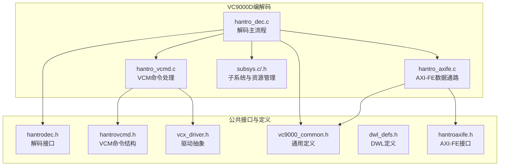
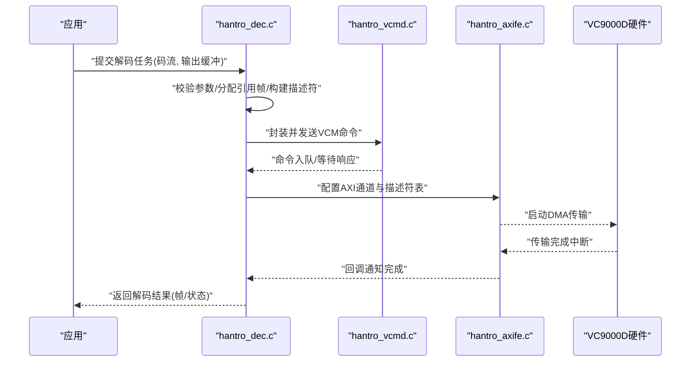
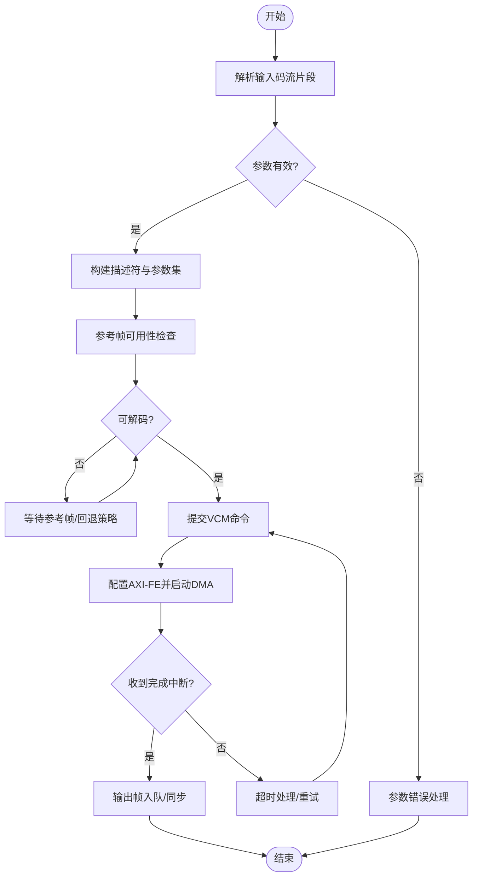
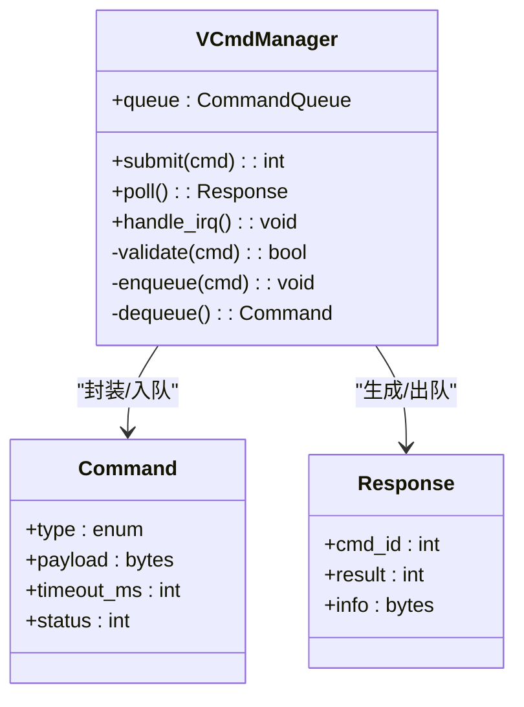
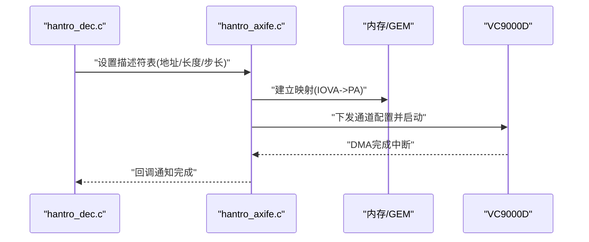
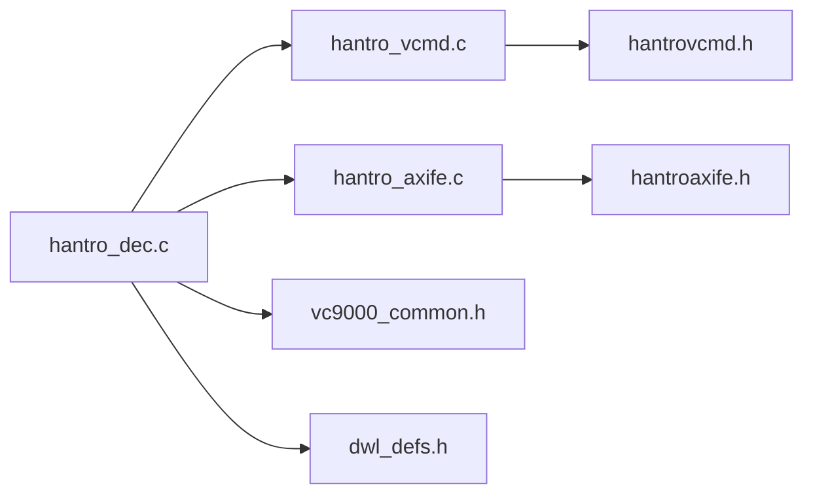

# VC9000D编解码器

<cite>
**本文档引用的文件**   
- [hantro_dec.c](file://_work/src/usr/src/lisuangpu-dkms-262.2.0.56/video_codec/VC9000D/hantro_dec.c)
- [hantro_vcmd.c](file://_work/src/usr/src/lisuangpu-dkms-262.2.0.56/video_codec/VC9000D/hantro_vcmd.c)
- [hantro_axife.c](file://_work/src/usr/src/lisuangpu-dkms-262.2.0.56/video_codec/VC9000D/hantro_axife.c)
- [hantroaxife.h](file://_work/src/usr/src/lisuangpu-dkms-262.2.0.56/video_codec/VC9000D/hantroaxife.h)
- [vcx_driver.h](file://_work/src/usr/src/lisuangpu-dkms-262.2.0.56/include/video/vcx_driver.h)
- [hantrodec.h](file://_work/src/usr/src/lisuangpu-dkms-262.2.0.56/include/video/hantrodec.h)
- [hantrovcmd.h](file://_work/src/usr/src/lisuangpu-dkms-262.2.0.56/include/video/hantrovcmd.h)
- [vc9000_common.h](file://_work/src/usr/src/lisuangpu-dkms-262.2.0.56/include/video/vc9000_common.h)
- [dwl_defs.h](file://_work/src/usr/src/lisuangpu-dkms-262.2.0.56/video_codec/VC9000D/dwl_defs.h)
- [subsys.c](file://_work/src/usr/src/lisuangpu-dkms-262.2.0.56/video_codec/VC9000D/subsys.c)
- [subsys.h](file://_work/src/usr/src/lisuangpu-dkms-262.2.0.56/video_codec/VC9000D/subsys.h)
- [subsys_cfg.h](file://_work/src/usr/src/lisuangpu-dkms-262.2.0.56/video_codec/VC9000D/subsys_cfg.h)
</cite>

## 目录
1. [简介](#简介)
2. [项目结构](#项目结构)
3. [核心组件](#核心组件)
4. [架构总览](#架构总览)
5. [详细组件分析](#详细组件分析)
6. [依赖关系分析](#依赖关系分析)
7. [性能考虑](#性能考虑)
8. [故障排查指南](#故障排查指南)
9. [结论](#结论)
10. [附录](#附录)

## 简介
本技术文档围绕VC9000D硬件编解码器，聚焦以下目标：
- 深入解析解码实现（hantro_dec.c）
- 说明命令处理机制（hantro_vcmd.c）
- 阐述AXI-FE功能与数据通路（hantro_axife.c）
- 梳理支持的视频格式、帧缓冲管理、内存映射与DMA操作
- 解释VCM通信协议、错误处理策略与性能优化技巧
- 提供API使用示例与调试方法

该文档面向驱动开发者与系统集成工程师，兼顾可理解性与工程实践。

## 项目结构
VC9000D相关代码位于video_codec/VC9000D目录，配合include/video下的头文件定义公共接口与数据结构。关键文件包括：
- hantro_dec.c：解码主流程、格式适配、状态机与队列管理
- hantro_vcmd.c：VCM命令封装、发送与响应处理
- hantro_axife.c：AXI前端引擎的数据搬运、通道配置与中断协同
- subsys.*：子系统初始化、资源管理与配置
- 头文件：定义设备能力、寄存器枚举、命令结构与共享内存布局

图表来源
- [hantro_dec.c](file://_work/src/usr/src/lisuangpu-dkms-262.2.0.56/video_codec/VC9000D/hantro_dec.c)
- [hantro_vcmd.c](file://_work/src/usr/src/lisuangpu-dkms-262.2.0.56/video_codec/VC9000D/hantro_vcmd.c)
- [hantro_axife.c](file://_work/src/usr/src/lisuangpu-dkms-262.2.0.56/video_codec/VC9000D/hantro_axife.c)
- [subsys.c](file://_work/src/usr/src/lisuangpu-dkms-262.2.0.56/video_codec/VC9000D/subsys.c)
- [hantrodec.h](file://_work/src/usr/src/lisuangpu-dkms-262.2.0.56/include/video/hantrodec.h)
- [hantrovcmd.h](file://_work/src/usr/src/lisuangpu-dkms-262.2.0.56/include/video/hantrovcmd.h)
- [vcx_driver.h](file://_work/src/usr/src/lisuangpu-dkms-262.2.0.56/include/video/vcx_driver.h)
- [vc9000_common.h](file://_work/src/usr/src/lisuangpu-dkms-262.2.0.56/include/video/vc9000_common.h)
- [dwl_defs.h](file://_work/src/usr/src/lisuangpu-dkms-262.2.0.56/video_codec/VC9000D/dwl_defs.h)
- [hantroaxife.h](file://_work/src/usr/src/lisuangpu-dkms-262.2.0.56/video_codec/VC9000D/hantroaxife.h)

章节来源
- [hantro_dec.c](file://_work/src/usr/src/lisuangpu-dkms-262.2.0.56/video_codec/VC9000D/hantro_dec.c)
- [hantro_vcmd.c](file://_work/src/usr/src/lisuangpu-dkms-262.2.0.56/video_codec/VC9000D/hantro_vcmd.c)
- [hantro_axife.c](file://_work/src/usr/src/lisuangpu-dkms-262.2.0.56/video_codec/VC9000D/hantro_axife.c)
- [subsys.c](file://_work/src/usr/src/lisuangpu-dkms-262.2.0.56/video_codec/VC9000D/subsys.c)
- [hantrodec.h](file://_work/src/usr/src/lisuangpu-dkms-262.2.0.56/include/video/hantrodec.h)
- [hantrovcmd.h](file://_work/src/usr/src/lisuangpu-dkms-262.2.0.56/include/video/hantrovcmd.h)
- [vcx_driver.h](file://_work/src/usr/src/lisuangpu-dkms-262.2.0.56/include/video/vcx_driver.h)
- [vc9000_common.h](file://_work/src/usr/src/lisuangpu-dkms-262.2.0.56/include/video/vc9000_common.h)
- [dwl_defs.h](file://_work/src/usr/src/lisuangpu-dkms-262.2.0.56/video_codec/VC9000D/dwl_defs.h)
- [hantroaxife.h](file://_work/src/usr/src/lisuangpu-dkms-262.2.0.56/video_codec/VC9000D/hantroaxife.h)

## 核心组件
- 解码主流程（hantro_dec.c）
  - 负责输入码流解析、格式识别、参数下发、参考帧管理、输出帧队列与同步
  - 与VCM交互以触发解码任务，与AXI-FE协作完成数据搬运
- VCM命令处理（hantro_vcmd.c）
  - 封装VCM命令结构，维护命令队列，处理响应与中断回调
  - 提供幂等重试、超时与错误上报机制
- AXI-FE数据通路（hantro_axife.c）
  - 配置AXI通道、描述符表、地址映射与缓存一致性
  - 与中断系统联动，完成批量数据传输的完成通知

章节来源
- [hantro_dec.c](file://_work/src/usr/src/lisuangpu-dkms-262.2.0.56/video_codec/VC9000D/hantro_dec.c)
- [hantro_vcmd.c](file://_work/src/usr/src/lisuangpu-dkms-262.2.0.56/video_codec/VC9000D/hantro_vcmd.c)
- [hantro_axife.c](file://_work/src/usr/src/lisuangpu-dkms-262.2.0.56/video_codec/VC9000D/hantro_axife.c)

## 架构总览
VC9000D解码路径由“应用层API—驱动—VCM—AXI-FE—硬件”构成。典型调用序列如下：

图表来源
- [hantro_dec.c](file://_work/src/usr/src/lisuangpu-dkms-262.2.0.56/video_codec/VC9000D/hantro_dec.c)
- [hantro_vcmd.c](file://_work/src/usr/src/lisuangpu-dkms-262.2.0.56/video_codec/VC9000D/hantro_vcmd.c)
- [hantro_axife.c](file://_work/src/usr/src/lisuangpu-dkms-262.2.0.56/video_codec/VC9000D/hantro_axife.c)

## 详细组件分析

### 解码主流程（hantro_dec.c）
- 功能要点
  - 输入码流分片接收与边界检测
  - 视频格式识别（H.264/H.265等）与参数集解析
  - 参考帧列表维护与复用策略
  - 输出帧队列、时间戳与同步原语
  - 与VCM和AXI-FE的协调调度
- 数据结构与复杂度
  - 帧描述符数组：O(n)插入/删除；参考帧哈希或索引表加速查找
  - 队列管理：环形缓冲+锁/信号量保证并发安全
- 错误处理
  - 非法参数快速失败
  - 码流损坏恢复与丢弃策略
  - 超时重试与降级路径
- 性能优化
  - 零拷贝路径（GEM/DMABUF）减少内存复制
  - 批量化命令下发与描述符合并
  - 中断合并与延迟唤醒降低CPU占用

图表来源
- [hantro_dec.c](file://_work/src/usr/src/lisuangpu-dkms-262.2.0.56/video_codec/VC9000D/hantro_dec.c)

章节来源
- [hantro_dec.c](file://_work/src/usr/src/lisuangpu-dkms-262.2.0.56/video_codec/VC9000D/hantro_dec.c)

### VCM命令处理（hantro_vcmd.c）
- 功能要点
  - 命令结构封装与校验
  - 命令队列与优先级管理
  - 与硬件中断/事件驱动的响应处理
  - 错误码映射与诊断信息收集
- 协议与接口
  - 命令类型、字段语义与长度约束
  - 请求-响应时序与超时控制
  - 多命令流水线与乱序完成处理
- 错误处理
  - 无效命令拒绝与日志记录
  - 重试次数上限与指数退避
  - 异常路径的资源清理与复位
- 性能优化
  - 批量命令聚合与最小化总线访问
  - 无锁队列与RCU读路径提升吞吐

图表来源
- [hantro_vcmd.c](file://_work/src/usr/src/lisuangpu-dkms-262.2.0.56/video_codec/VC9000D/hantro_vcmd.c)
- [hantrovcmd.h](file://_work/src/usr/src/lisuangpu-dkms-262.2.0.56/include/video/hantrovcmd.h)

章节来源
- [hantro_vcmd.c](file://_work/src/usr/src/lisuangpu-dkms-262.2.0.56/video_codec/VC9000D/hantro_vcmd.c)
- [hantrovcmd.h](file://_work/src/usr/src/lisuangpu-dkms-262.2.0.56/include/video/hantrovcmd.h)

### AXI-FE数据通路（hantro_axife.c）
- 功能要点
  - AXI通道配置（源/目的地址、步长、长度、对齐）
  - 描述符表维护与更新
  - 缓存一致性与屏障指令
  - 中断合并与完成回调
- 内存映射与DMA
  - GEM/DMABUF映射与IOVA转换
  - 页表构建与碎片合并
  - 大页与连续物理内存优先策略
- 错误处理
  - 地址越界/对齐错误检测
  - DMA传输失败重试与回退到PIO
  - 资源泄漏防护与复位
- 性能优化
  - 描述符批量化与链式传输
  - 预取与写合并
  - 中断节流与软中断处理

图表来源
- [hantro_axife.c](file://_work/src/usr/src/lisuangpu-dkms-262.2.0.56/video_codec/VC9000D/hantro_axife.c)
- [hantroaxife.h](file://_work/src/usr/src/lisuangpu-dkms-262.2.0.56/video_codec/VC9000D/hantroaxife.h)

章节来源
- [hantro_axife.c](file://_work/src/usr/src/lisuangpu-dkms-262.2.0.56/video_codec/VC9000D/hantro_axife.c)
- [hantroaxife.h](file://_work/src/usr/src/lisuangpu-dkms-262.2.0.56/video_codec/VC9000D/hantroaxife.h)

### 子系统与资源管理（subsys.c/.h）
- 功能要点
  - 设备初始化、时钟/电源域管理
  - 寄存器基址与能力探测
  - 共享内存池与句柄管理
- 配置项
  - 缓冲区大小、队列深度、超时阈值
  - 调试开关与日志级别

章节来源
- [subsys.c](file://_work/src/usr/src/lisuangpu-dkms-262.2.0.56/video_codec/VC9000D/subsys.c)
- [subsys.h](file://_work/src/usr/src/lisuangpu-dkms-262.2.0.56/video_codec/VC9000D/subsys.h)
- [subsys_cfg.h](file://_work/src/usr/src/lisuangpu-dkms-262.2.0.56/video_codec/VC9000D/subsys_cfg.h)

## 依赖关系分析
- 模块耦合
  - hantro_dec.c依赖hantro_vcmd.c与hantro_axife.c
  - hantro_vcmd.c依赖公共命令结构定义（hantrovcmd.h）
  - hantro_axife.c依赖内存映射与DMA抽象（hantroaxife.h）
- 外部依赖
  - 内核GEM/DMABUF子系统
  - 中断与定时器框架
  - 设备树/平台配置

图表来源
- [hantro_dec.c](file://_work/src/usr/src/lisuangpu-dkms-262.2.0.56/video_codec/VC9000D/hantro_dec.c)
- [hantro_vcmd.c](file://_work/src/usr/src/lisuangpu-dkms-262.2.0.56/video_codec/VC9000D/hantro_vcmd.c)
- [hantro_axife.c](file://_work/src/usr/src/lisuangpu-dkms-262.2.0.56/video_codec/VC9000D/hantro_axife.c)
- [hantrovcmd.h](file://_work/src/usr/src/lisuangpu-dkms-262.2.0.56/include/video/hantrovcmd.h)
- [hantroaxife.h](file://_work/src/usr/src/lisuangpu-dkms-262.2.0.56/video_codec/VC9000D/hantroaxife.h)
- [vc9000_common.h](file://_work/src/usr/src/lisuangpu-dkms-262.2.0.56/include/video/vc9000_common.h)
- [dwl_defs.h](file://_work/src/usr/src/lisuangpu-dkms-262.2.0.56/video_codec/VC9000D/dwl_defs.h)

章节来源
- [hantro_dec.c](file://_work/src/usr/src/lisuangpu-dkms-262.2.0.56/video_codec/VC9000D/hantro_dec.c)
- [hantro_vcmd.c](file://_work/src/usr/src/lisuangpu-dkms-262.2.0.56/video_codec/VC9000D/hantro_vcmd.c)
- [hantro_axife.c](file://_work/src/usr/src/lisuangpu-dkms-262.2.0.56/video_codec/VC9000D/hantro_axife.c)
- [hantrovcmd.h](file://_work/src/usr/src/lisuangpu-dkms-262.2.0.56/include/video/hantrovcmd.h)
- [hantroaxife.h](file://_work/src/usr/src/lisuangpu-dkms-262.2.0.56/video_codec/VC9000D/hantroaxife.h)
- [vc9000_common.h](file://_work/src/usr/src/lisuangpu-dkms-262.2.0.56/include/video/vc9000_common.h)
- [dwl_defs.h](file://_work/src/usr/src/lisuangpu-dkms-262.2.0.56/video_codec/VC9000D/dwl_defs.h)

## 性能考虑
- 内存与DMA
  - 优先使用连续物理内存与大页以降低TLB压力
  - 合并小传输为批量描述符，减少总线事务
  - 启用写合并与缓存一致性按需刷新
- 命令与中断
  - 聚合VCM命令，减少上下文切换
  - 中断合并与软中断处理降低CPU开销
- 解码管线
  - 参考帧复用与延迟释放避免抖动
  - 输出队列深度自适应调节背压
- 调试与观测
  - 开启关键路径trace点与perf计数
  - 监控DMA带宽、中断频率与队列水位

[本节为通用指导，不直接分析具体文件]

## 故障排查指南
- 常见问题定位
  - 参数错误：检查输入码流边界与参数集完整性
  - 参考帧缺失：确认参考帧生命周期与同步原语
  - DMA失败：验证地址对齐、IOVA映射与权限
  - 超时：调整超时阈值与重试策略
- 调试手段
  - 启用详细日志与dump关键结构体
  - 使用内核trace与ftrace观察调用链
  - 通过debugfs导出VCM命令队列与状态
- 恢复策略
  - 自动复位VCM与AXI通道
  - 清空队列并重建描述符表
  - 回退至低分辨率或单线程模式

章节来源
- [hantro_vcmd.c](file://_work/src/usr/src/lisuangpu-dkms-262.2.0.56/video_codec/VC9000D/hantro_vcmd.c)
- [hantro_axife.c](file://_work/src/usr/src/lisuangpu-dkms-262.2.0.56/video_codec/VC9000D/hantro_axife.c)
- [subsys.c](file://_work/src/usr/src/lisuangpu-dkms-262.2.0.56/video_codec/VC9000D/subsys.c)

## 结论
VC9000D编解码器通过清晰的模块划分与高效的DMA/VCM通路，实现了高吞吐、低延迟的解码能力。合理设计参考帧管理、命令队列与AXI描述符表是性能与稳定性的关键。建议在生产环境中结合trace与性能计数器持续优化，并完善错误恢复与降级策略。

[本节为总结性内容，不直接分析具体文件]

## 附录
- API使用示例（概念性）
  - 初始化：创建上下文、分配缓冲区、注册回调
  - 解码循环：提交码流片段、等待输出帧、释放引用帧
  - 资源清理：停止通道、释放内存、注销回调
- 支持的格式
  - H.264、H.265（依据设备能力与参数集支持）
- 调试清单
  - 日志级别、trace点、debugfs节点
  - 常用命令与状态查询

[本节为概念性内容，不直接分析具体文件]