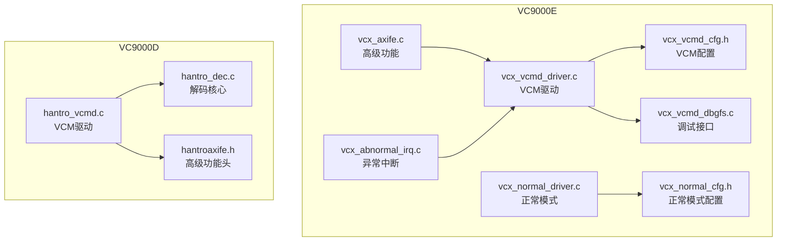
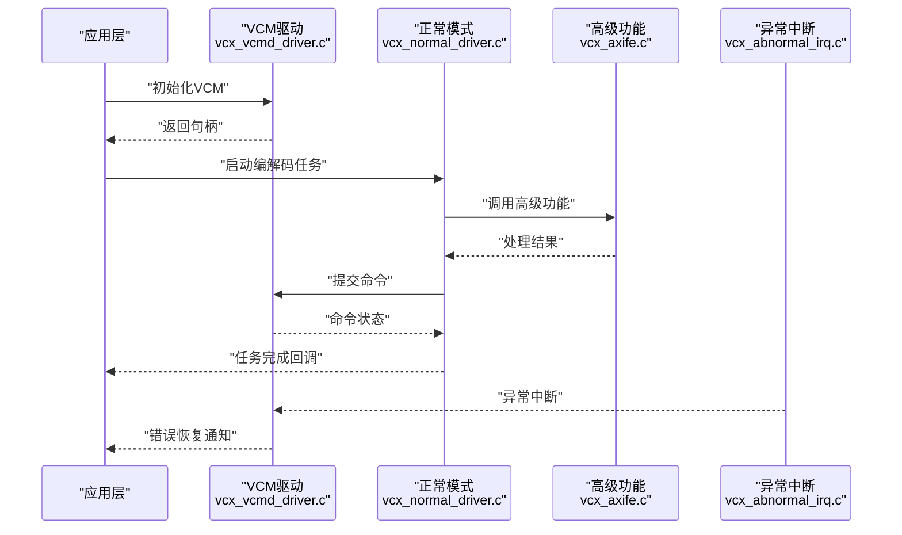
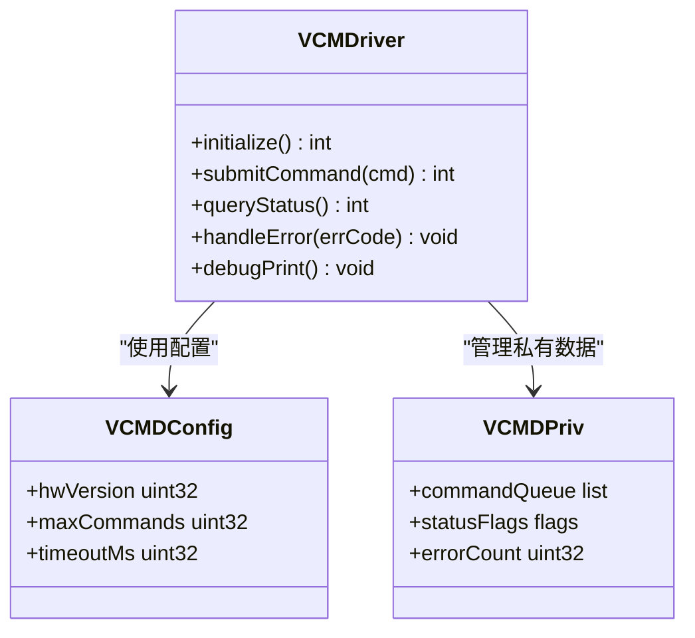
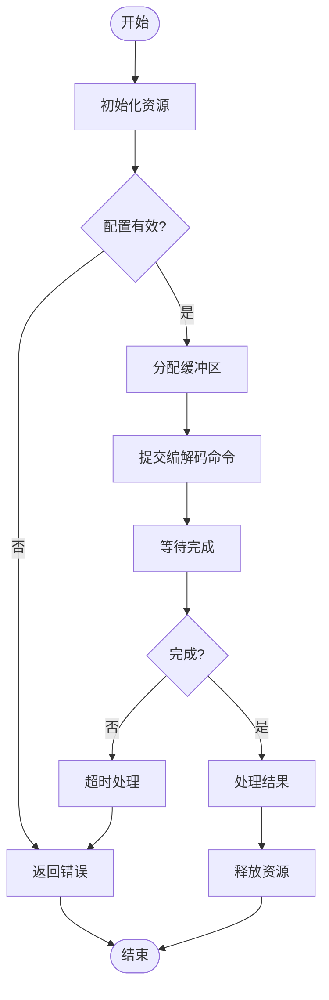
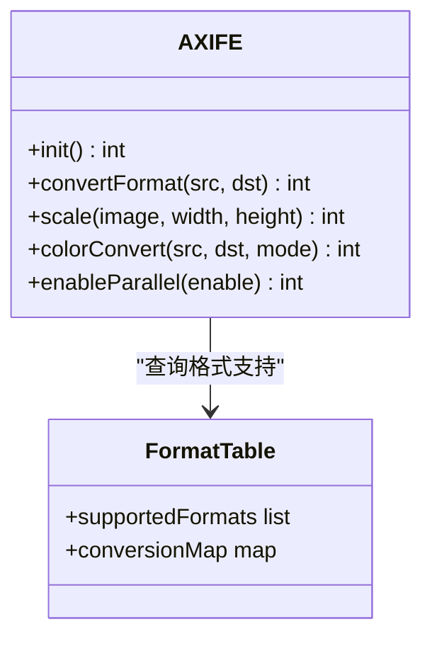
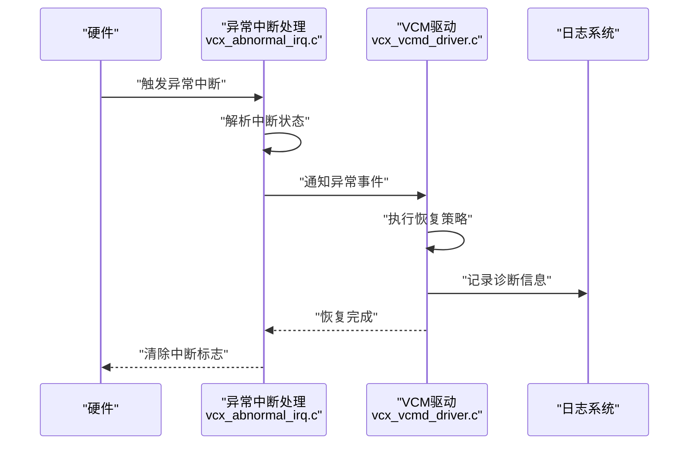
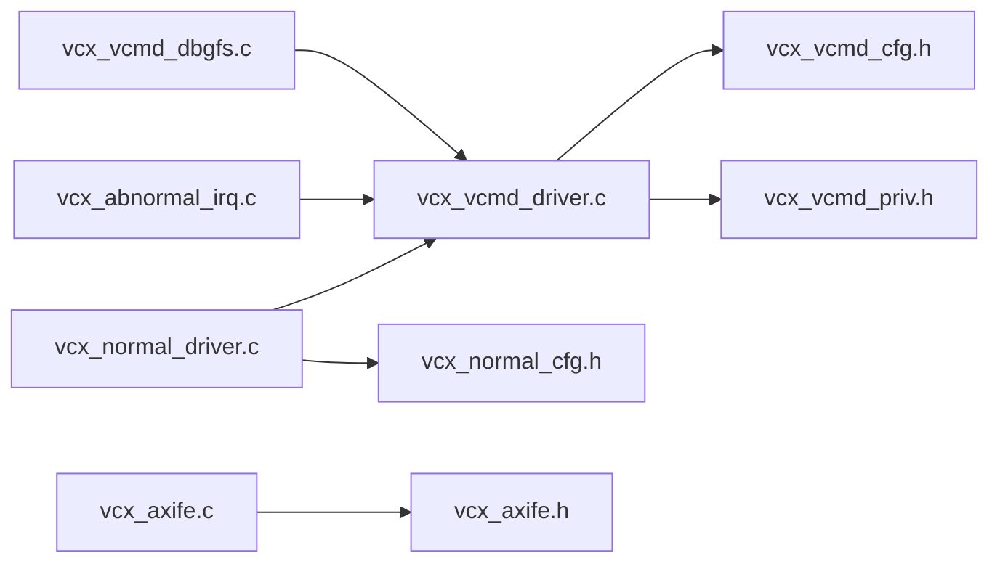

# VC9000E编解码器

<cite>
**本文引用的文件**   
- [vcx_vcmd_driver.c](file://_work/src/usr/src/lisuangpu-dkms-262.2.0.56/video_codec/VC9000E/vcx_vcmd_driver.c)
- [vcx_vcmd_driver.h](file://_work/src/usr/src/lisuangpu-dkms-262.2.0.56/video_codec/VC9000E/vcx_vcmd_driver.h)
- [vcx_vcmd_priv.h](file://_work/src/usr/src/lisuangpu-dkms-262.2.0.56/video_codec/VC9000E/vcx_vcmd_priv.h)
- [vcx_vcmd_cfg.h](file://_work/src/usr/src/lisuangpu-dkms-262.2.0.56/video_codec/VC9000E/vcx_vcmd_cfg.h)
- [vcx_normal_driver.c](file://_work/src/usr/src/lisuangpu-dkms-262.2.0.56/video_codec/VC9000E/vcx_normal_driver.c)
- [vcx_normal_driver.h](file://_work/src/usr/src/lisuangpu-dkms-262.2.0.56/video_codec/VC9000E/vcx_normal_driver.h)
- [vcx_normal_cfg.h](file://_work/src/usr/src/lisuangpu-dkms-262.2.0.56/video_codec/VC9000E/vcx_normal_cfg.h)
- [vcx_axife.c](file://_work/src/usr/src/lisuangpu-dkms-262.2.0.56/video_codec/VC9000E/vcx_axife.c)
- [vcx_axife.h](file://_work/src/usr/src/lisuangpu-dkms-262.2.0.56/video_codec/VC9000E/vcx_axife.h)
- [vcx_abnormal_irq.c](file://_work/src/usr/src/lisuangpu-dkms-262.2.0.56/video_codec/VC9000E/vcx_abnormal_irq.c)
- [vcx_abnormal_irq.h](file://_work/src/usr/src/lisuangpu-dkms-262.2.0.56/video_codec/VC9000E/vcx_abnormal_irq.h)
- [vcx_vcmd_dbgfs.c](file://_work/src/usr/src/lisuangpu-dkms-262.2.0.56/video_codec/VC9000E/vcx_vcmd_dbgfs.c)
- [vcx_vcmd_dbgfs.h](file://_work/src/usr/src/lisuangpu-dkms-262.2.0.56/video_codec/VC9000E/vcx_vcmd_dbgfs.h)
- [hantro_vcmd.c](file://_work/src/usr/src/lisuangpu-dkms-262.2.0.56/video_codec/VC9000D/hantro_vcmd.c)
- [hantro_dec.c](file://_work/src/usr/src/lisuangpu-dkms-262.2.0.56/video_codec/VC9000D/hantro_dec.c)
- [hantroaxife.h](file://_work/src/usr/src/lisuangpu-dkms-262.2.0.56/video_codec/VC9000D/hantroaxife.h)
- [vcmdregisterenum.h](file://_work/src/usr/src/lisuangpu-dkms-262.2.0.56/video_codec/vcmdregisterenum.h)
- [vcmdregistertable.h](file://_work/src/usr/src/lisuangpu-dkms-262.2.0.56/video_codec/vcmdregistertable.h)
- [vc9000_common.h](file://_work/src/usr/src/lisuangpu-dkms-262.2.0.56/include/video/vc9000_common.h)
- [vcx_driver.h](file://_work/src/usr/src/lisuangpu-dkms-262.2.0.56/include/video/vcx_driver.h)
</cite>

## 目录
1. [简介](#简介)
2. [项目结构](#项目结构)
3. [核心组件](#核心组件)
4. [架构总览](#架构总览)
5. [详细组件分析](#详细组件分析)
6. [依赖关系分析](#依赖关系分析)
7. [性能考量](#性能考量)
8. [故障排查指南](#故障排查指南)
9. [结论](#结论)
10. [附录：API参考与使用示例](#附录api参考与使用示例)

## 简介
本技术文档面向VC9000E硬件编解码器的驱动实现，重点覆盖以下方面：
- VCM（视频控制模块）驱动在vcx_vcmd_driver.c中的实现要点
- 正常模式操作在vcx_normal_driver.c中的流程与控制路径
- 高级功能在vcx_axife.c中的能力与接口
- 与VC9000D的差异、新增特性支持以及改进的异常处理机制
- 中断处理、电源管理、时钟控制与寄存器配置的关键点
- 完整的API参考与使用示例，帮助快速集成与调试

VC9000E在VC9000D基础上增强了异常处理、扩展了高级功能集，并对VCM驱动和正常模式进行了优化。通过分层设计，将VCM命令通道、正常模式运行态、高级功能模块解耦，便于维护与扩展。

## 项目结构
VC9000E相关代码位于video_codec/VC9000E目录下，主要包含：
- VCM驱动与配置：vcx_vcmd_driver.c/.h、vcx_vcmd_cfg.h、vcx_vcmd_priv.h、vcx_vcmd_dbgfs.c/.h
- 正常模式驱动：vcx_normal_driver.c/.h、vcx_normal_cfg.h
- 高级功能：vcx_axife.c/.h
- 异常中断处理：vcx_abnormal_irq.c/.h

与VC9000D对比，VC9000E新增了异常中断处理模块、增强型VCM驱动与正常模式驱动，并提供了更完善的调试接口。

**图表来源** 
- [vcx_vcmd_driver.c:1-100](file://_work/src/usr/src/lisuangpu-dkms-262.2.0.56/video_codec/VC9000E/vcx_vcmd_driver.c#L1-L100)
- [vcx_normal_driver.c:1-100](file://_work/src/usr/src/lisuangpu-dkms-262.2.0.56/video_codec/VC9000E/vcx_normal_driver.c#L1-L100)
- [vcx_axife.c:1-100](file://_work/src/usr/src/lisuangpu-dkms-262.2.0.56/video_codec/VC9000E/vcx_axife.c#L1-L100)
- [vcx_abnormal_irq.c:1-100](file://_work/src/usr/src/lisuangpu-dkms-262.2.0.56/video_codec/VC9000E/vcx_abnormal_irq.c#L1-L100)
- [hantro_vcmd.c:1-100](file://_work/src/usr/src/lisuangpu-dkms-262.2.0.56/video_codec/VC9000D/hantro_vcmd.c#L1-L100)
- [hantro_dec.c:1-100](file://_work/src/usr/src/lisuangpu-dkms-262.2.0.56/video_codec/VC9000D/hantro_dec.c#L1-L100)
- [hantroaxife.h:1-100](file://_work/src/usr/src/lisuangpu-dkms-262.2.0.56/video_codec/VC9000D/hantroaxife.h#L1-L100)

**章节来源**
- [vcx_vcmd_driver.c:1-200](file://_work/src/usr/src/lisuangpu-dkms-262.2.0.56/video_codec/VC9000E/vcx_vcmd_driver.c#L1-L200)
- [vcx_normal_driver.c:1-200](file://_work/src/usr/src/lisuangpu-dkms-262.2.0.56/video_codec/VC9000E/vcx_normal_driver.c#L1-L200)
- [vcx_axife.c:1-200](file://_work/src/usr/src/lisuangpu-dkms-262.2.0.56/video_codec/VC9000E/vcx_axife.c#L1-L200)
- [vcx_abnormal_irq.c:1-200](file://_work/src/usr/src/lisuangpu-dkms-262.2.0.56/video_codec/VC9000E/vcx_abnormal_irq.c#L1-L200)
- [hantro_vcmd.c:1-200](file://_work/src/usr/src/lisuangpu-dkms-262.2.0.56/video_codec/VC9000D/hantro_vcmd.c#L1-L200)
- [hantro_dec.c:1-200](file://_work/src/usr/src/lisuangpu-dkms-262.2.0.56/video_codec/VC9000D/hantro_dec.c#L1-L200)
- [hantroaxife.h:1-200](file://_work/src/usr/src/lisuangpu-dkms-262.2.0.56/video_codec/VC9000D/hantroaxife.h#L1-L200)

## 核心组件
- VCM驱动（vcx_vcmd_driver.c）：负责VCM命令通道的初始化、命令提交、状态查询、错误恢复以及与上层驱动的交互。
- 正常模式驱动（vcx_normal_driver.c）：管理编解码的正常执行流程，包括资源分配、流水线控制、同步与完成回调。
- 高级功能（vcx_axife.c）：提供增强型处理能力，如格式转换、缩放、色彩空间转换等。
- 异常中断处理（vcx_abnormal_irq.c）：捕获并处理硬件异常，提供恢复策略与诊断信息。

这些组件通过统一的接口与配置头文件协作，确保VC9000E的稳定运行与高性能。

**章节来源**
- [vcx_vcmd_driver.c:1-300](file://_work/src/usr/src/lisuangpu-dkms-262.2.0.56/video_codec/VC9000E/vcx_vcmd_driver.c#L1-L300)
- [vcx_normal_driver.c:1-300](file://_work/src/usr/src/lisuangpu-dkms-262.2.0.56/video_codec/VC9000E/vcx_normal_driver.c#L1-L300)
- [vcx_axife.c:1-300](file://_work/src/usr/src/lisuangpu-dkms-262.2.0.56/video_codec/VC9000E/vcx_axife.c#L1-L300)
- [vcx_abnormal_irq.c:1-300](file://_work/src/usr/src/lisuangpu-dkms-262.2.0.56/video_codec/VC9000E/vcx_abnormal_irq.c#L1-L300)

## 架构总览
VC9000E采用分层架构，VCM驱动作为命令通道核心，正常模式驱动管理执行流，高级功能模块提供额外处理能力，异常中断处理确保系统健壮性。

**图表来源** 
- [vcx_vcmd_driver.c:1-200](file://_work/src/usr/src/lisuangpu-dkms-262.2.0.56/video_codec/VC9000E/vcx_vcmd_driver.c#L1-L200)
- [vcx_normal_driver.c:1-200](file://_work/src/usr/src/lisuangpu-dkms-262.2.0.56/video_codec/VC9000E/vcx_normal_driver.c#L1-L200)
- [vcx_axife.c:1-200](file://_work/src/usr/src/lisuangpu-dkms-262.2.0.56/video_codec/VC9000E/vcx_axife.c#L1-L200)
- [vcx_abnormal_irq.c:1-200](file://_work/src/usr/src/lisuangpu-dkms-262.2.0.56/video_codec/VC9000E/vcx_abnormal_irq.c#L1-L200)

## 详细组件分析

### VCM驱动（vcx_vcmd_driver.c）
VCM驱动是VC9000E的核心控制模块，负责：
- 初始化VCM硬件与固件通信通道
- 提交编解码命令并等待完成
- 处理命令状态与错误码
- 提供调试接口用于问题定位

关键函数包括初始化、命令提交、状态查询、错误恢复等。驱动通过配置头文件vcx_vcmd_cfg.h获取硬件参数，并通过vcx_vcmd_priv.h访问内部数据结构。

**图表来源** 
- [vcx_vcmd_driver.c:1-200](file://_work/src/usr/src/lisuangpu-dkms-262.2.0.56/video_codec/VC9000E/vcx_vcmd_driver.c#L1-L200)
- [vcx_vcmd_cfg.h:1-100](file://_work/src/usr/src/lisuangpu-dkms-262.2.0.56/video_codec/VC9000E/vcx_vcmd_cfg.h#L1-L100)
- [vcx_vcmd_priv.h:1-100](file://_work/src/usr/src/lisuangpu-dkms-262.2.0.56/video_codec/VC9000E/vcx_vcmd_priv.h#L1-L100)

**章节来源**
- [vcx_vcmd_driver.c:1-400](file://_work/src/usr/src/lisuangpu-dkms-262.2.0.56/video_codec/VC9000E/vcx_vcmd_driver.c#L1-L400)
- [vcx_vcmd_cfg.h:1-200](file://_work/src/usr/src/lisuangpu-dkms-262.2.0.56/video_codec/VC9000E/vcx_vcmd_cfg.h#L1-L200)
- [vcx_vcmd_priv.h:1-200](file://_work/src/usr/src/lisuangpu-dkms-262.2.0.56/video_codec/VC9000E/vcx_vcmd_priv.h#L1-L200)

### 正常模式驱动（vcx_normal_driver.c）
正常模式驱动管理编解码任务的完整生命周期：
- 资源分配与释放
- 流水线控制与同步
- 缓冲区管理
- 完成回调与事件通知

驱动通过vcx_normal_cfg.h获取运行时配置，并与VCM驱动协作提交命令。

**图表来源** 
- [vcx_normal_driver.c:1-300](file://_work/src/usr/src/lisuangpu-dkms-262.2.0.56/video_codec/VC9000E/vcx_normal_driver.c#L1-L300)
- [vcx_normal_cfg.h:1-100](file://_work/src/usr/src/lisuangpu-dkms-262.2.0.56/video_codec/VC9000E/vcx_normal_cfg.h#L1-L100)

**章节来源**
- [vcx_normal_driver.c:1-500](file://_work/src/usr/src/lisuangpu-dkms-262.2.0.56/video_codec/VC9000E/vcx_normal_driver.c#L1-L500)
- [vcx_normal_cfg.h:1-200](file://_work/src/usr/src/lisuangpu-dkms-262.2.0.56/video_codec/VC9000E/vcx_normal_cfg.h#L1-L200)

### 高级功能（vcx_axife.c）
高级功能模块提供VC9000E的增强处理能力：
- 格式转换与缩放
- 色彩空间转换
- 图像增强算法
- 并行处理优化

该模块通过vcx_axife.h定义的接口与主驱动交互，支持多种输入输出格式。

**图表来源** 
- [vcx_axife.c:1-200](file://_work/src/usr/src/lisuangpu-dkms-262.2.0.56/video_codec/VC9000E/vcx_axife.c#L1-L200)
- [vcx_axife.h:1-100](file://_work/src/usr/src/lisuangpu-dkms-262.2.0.56/video_codec/VC9000E/vcx_axife.h#L1-L100)

**章节来源**
- [vcx_axife.c:1-400](file://_work/src/usr/src/lisuangpu-dkms-262.2.0.56/video_codec/VC9000E/vcx_axife.c#L1-L400)
- [vcx_axife.h:1-200](file://_work/src/usr/src/lisuangpu-dkms-262.2.0.56/video_codec/VC9000E/vcx_axife.h#L1-L200)

### 异常中断处理（vcx_abnormal_irq.c）
异常中断处理模块负责：
- 捕获硬件异常中断
- 解析错误类型与原因
- 执行恢复策略
- 记录诊断信息

该模块与VCM驱动紧密集成，确保系统在异常情况下的稳定性。

**图表来源** 
- [vcx_abnormal_irq.c:1-200](file://_work/src/usr/src/lisuangpu-dkms-262.2.0.56/video_codec/VC9000E/vcx_abnormal_irq.c#L1-L200)
- [vcx_vcmd_driver.c:1-200](file://_work/src/usr/src/lisuangpu-dkms-262.2.0.56/video_codec/VC9000E/vcx_vcmd_driver.c#L1-L200)

**章节来源**
- [vcx_abnormal_irq.c:1-300](file://_work/src/usr/src/lisuangpu-dkms-262.2.0.56/video_codec/VC9000E/vcx_abnormal_irq.c#L1-L300)
- [vcx_abnormal_irq.h:1-100](file://_work/src/usr/src/lisuangpu-dkms-262.2.0.56/video_codec/VC9000E/vcx_abnormal_irq.h#L1-L100)

## 依赖关系分析
VC9000E各组件之间的依赖关系如下：
- VCM驱动依赖于配置头文件和私有数据结构
- 正常模式驱动依赖于VCM驱动和配置头文件
- 高级功能模块独立但通过标准接口与主驱动交互
- 异常中断处理模块与VCM驱动紧密耦合

**图表来源** 
- [vcx_vcmd_driver.c:1-100](file://_work/src/usr/src/lisuangpu-dkms-262.2.0.56/video_codec/VC9000E/vcx_vcmd_driver.c#L1-L100)
- [vcx_normal_driver.c:1-100](file://_work/src/usr/src/lisuangpu-dkms-262.2.0.56/video_codec/VC9000E/vcx_normal_driver.c#L1-L100)
- [vcx_axife.c:1-100](file://_work/src/usr/src/lisuangpu-dkms-262.2.0.56/video_codec/VC9000E/vcx_axife.c#L1-L100)
- [vcx_abnormal_irq.c:1-100](file://_work/src/usr/src/lisuangpu-dkms-262.2.0.56/video_codec/VC9000E/vcx_abnormal_irq.c#L1-L100)

**章节来源**
- [vcx_vcmd_driver.c:1-200](file://_work/src/usr/src/lisuangpu-dkms-262.2.0.56/video_codec/VC9000E/vcx_vcmd_driver.c#L1-L200)
- [vcx_normal_driver.c:1-200](file://_work/src/usr/src/lisuangpu-dkms-262.2.0.56/video_codec/VC9000E/vcx_normal_driver.c#L1-L200)
- [vcx_axife.c:1-200](file://_work/src/usr/src/lisuangpu-dkms-262.2.0.56/video_codec/VC9000E/vcx_axife.c#L1-L200)
- [vcx_abnormal_irq.c:1-200](file://_work/src/usr/src/lisuangpu-dkms-262.2.0.56/video_codec/VC9000E/vcx_abnormal_irq.c#L1-L200)

## 性能考量
VC9000E在性能方面进行了多项优化：
- 异步命令处理减少CPU占用
- 批量命令提交提高吞吐量
- 智能缓冲区管理降低内存开销
- 并行处理能力提升整体性能

建议在使用时合理配置队列大小和超时参数，以获得最佳性能表现。

## 故障排查指南
常见问题及解决方案：
- 初始化失败：检查硬件版本兼容性和配置参数
- 命令超时：调整超时设置或检查硬件状态
- 内存不足：优化缓冲区分配策略
- 异常中断频繁：查看诊断日志并更新固件

调试接口vcx_vcmd_dbgfs.c提供了详细的诊断信息，可通过sysfs接口访问。

**章节来源**
- [vcx_vcmd_dbgfs.c:1-200](file://_work/src/usr/src/lisuangpu-dkms-262.2.0.56/video_codec/VC9000E/vcx_vcmd_dbgfs.c#L1-L200)
- [vcx_vcmd_dbgfs.h:1-100](file://_work/src/usr/src/lisuangpu-dkms-262.2.0.56/video_codec/VC9000E/vcx_vcmd_dbgfs.h#L1-L100)

## 结论
VC9000E编解码器驱动实现了稳定高效的硬件控制，通过分层设计和模块化架构，提供了良好的可维护性和扩展性。与VC9000D相比，VC9000E在异常处理、高级功能和性能优化方面都有显著提升。

## 附录：API参考与使用示例

### VCM驱动API
主要接口包括：
- 初始化接口：用于建立与硬件的通信通道
- 命令提交接口：提交编解码任务
- 状态查询接口：获取任务执行状态
- 错误处理接口：处理异常情况

### 正常模式API
关键接口：
- 资源管理接口：分配和释放编解码资源
- 任务控制接口：启动、暂停、停止任务
- 缓冲区接口：管理输入输出缓冲区
- 回调接口：处理任务完成事件

### 高级功能API
提供的功能接口：
- 格式转换接口：支持多种像素格式转换
- 图像处理接口：缩放、旋转、裁剪等操作
- 色彩空间接口：RGB、YUV等格式转换
- 性能优化接口：启用并行处理和缓存优化

### 使用示例
典型的初始化和使用流程：
1. 初始化VCM驱动
2. 配置正常模式参数
3. 分配必要的缓冲区
4. 提交编解码任务
5. 等待任务完成
6. 处理结果数据
7. 清理资源

**章节来源**
- [vcx_vcmd_driver.c:1-500](file://_work/src/usr/src/lisuangpu-dkms-262.2.0.56/video_codec/VC9000E/vcx_vcmd_driver.c#L1-L500)
- [vcx_normal_driver.c:1-500](file://_work/src/usr/src/lisuangpu-dkms-262.2.0.56/video_codec/VC9000E/vcx_normal_driver.c#L1-L500)
- [vcx_axife.c:1-500](file://_work/src/usr/src/lisuangpu-dkms-262.2.0.56/video_codec/VC9000E/vcx_axife.c#L1-L500)
- [vcx_driver.h:1-200](file://_work/src/usr/src/lisuangpu-dkms-262.2.0.56/include/video/vcx_driver.h#L1-L200)
- [vc9000_common.h:1-200](file://_work/src/usr/src/lisuangpu-dkms-262.2.0.56/include/video/vc9000_common.h#L1-L200)