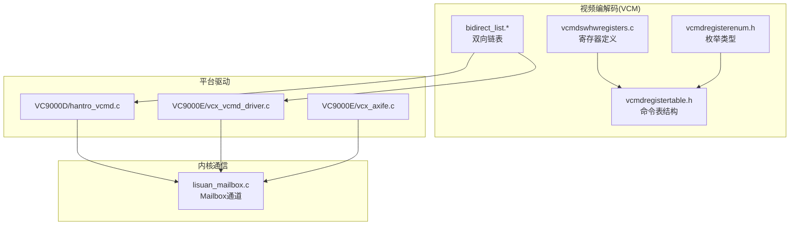
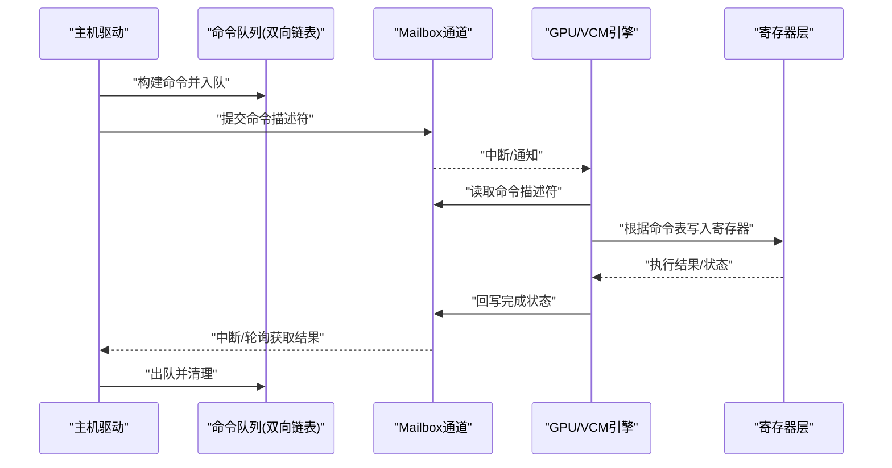
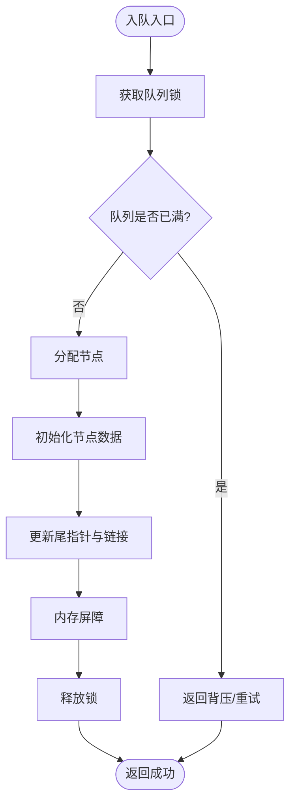
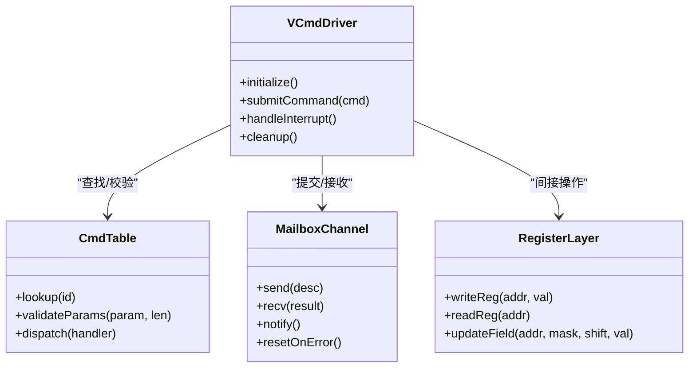
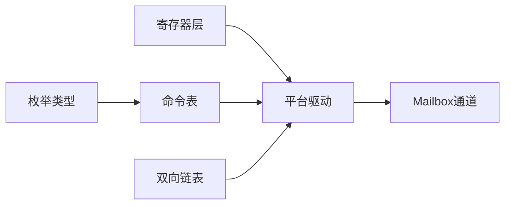

# VCM通信机制

<cite>
**本文档引用的文件**   
- [vcmdswhwregisters.c](file://_work/src/usr/src/lisuangpu-dkms-262.2.0.56/video_codec/vcmdswhwregisters.c)
- [vcmdregisterenum.h](file://_work/src/usr/src/lisuangpu-dkms-262.2.0.56/video_codec/vcmdregisterenum.h)
- [vcmdregistertable.h](file://_work/src/usr/src/lisuangpu-dkms-262.2.0.56/video_codec/vcmdregistertable.h)
- [bidirect_list.c](file://_work/src/usr/src/lisuangpu-dkms-262.2.0.56/video_codec/bidirect_list.c)
- [bidirect_list.h](file://_work/src/usr/src/lisuangpu-dkms-262.2.0.56/video_codec/bidirect_list.h)
- [hantro_vcmd.c](file://_work/src/usr/src/lisuangpu-dkms-262.2.0.56/video_codec/VC9000D/hantro_vcmd.c)
- [vcx_vcmd_driver.c](file://_work/src/usr/src/lisuangpu-dkms-262.2.0.56/video_codec/VC9000E/vcx_vcmd_driver.c)
- [vcx_vcmd_priv.h](file://_work/src/usr/src/lisuangpu-dkms-262.2.0.56/video_codec/VC9000E/vcx_vcmd_priv.h)
- [vcx_vcmd_cfg.h](file://_work/src/usr/src/lisuangpu-dkms-262.2.0.56/video_codec/VC9000E/vcx_vcmd_cfg.h)
- [vcx_axife.c](file://_work/src/usr/src/lisuangpu-dkms-262.2.0.56/video_codec/VC9000E/vcx_axife.c)
- [vcx_axife.h](file://_work/src/usr/src/lisuangpu-dkms-262.2.0.56/video_codec/VC9000E/vcx_axife.h)
- [lisuan_mailbox.c](file://_work/src/usr/src/lisuangpu-dkms-262.2.0.56/lisuan_mailbox.c)
- [lisuan_mailbox.h](file://_work/src/usr/src/lisuangpu-dkms-262.2.0.56/lisuan_mailbox.h)
</cite>

## 目录
1. [简介](#简介)
2. [项目结构](#项目结构)
3. [核心组件](#核心组件)
4. [架构总览](#架构总览)
5. [详细组件分析](#详细组件分析)
6. [依赖关系分析](#依赖关系分析)
7. [性能考虑](#性能考虑)
8. [故障排查指南](#故障排查指南)
9. [结论](#结论)
10. [附录](#附录)

## 简介
本文件系统性阐述VCM（Video Command Manager）在主机与GPU之间的命令传递协议、消息队列管理与同步机制。重点覆盖以下方面：
- vcmdswhwregisters.c中的寄存器定义与访问约定
- vcmdregisterenum.h中的枚举类型与命令分类
- vcmdregistertable.h中的命令表结构与映射关系
- 双向链表实现与内存屏障使用
- 错误恢复策略与健壮性设计
- 命令发送与接收的完整示例流程
- 面向吞吐与时延的性能调优建议

## 项目结构
VCM相关代码主要位于video_codec目录下，并与KMS/Mailbox子系统交互完成跨域通信。关键路径如下：
- video_codec: VCM命令表、枚举、寄存器、双向链表等基础能力
- VC9000D/hantro_vcmd.c: D系列平台的VCM驱动入口
- VC9000E/vcx_*: E系列平台的VCM驱动与配置
- lisuan_mailbox.*: 主机与GPU间Mailbox通道（用于命令投递与通知）

图表来源
- [vcmdswhwregisters.c](file://_work/src/usr/src/lisuangpu-dkms-262.2.0.56/video_codec/vcmdswhwregisters.c)
- [vcmdregisterenum.h](file://_work/src/usr/src/lisuangpu-dkms-262.2.0.56/video_codec/vcmdregisterenum.h)
- [vcmdregistertable.h](file://_work/src/usr/src/lisuangpu-dkms-262.2.0.56/video_codec/vcmdregistertable.h)
- [bidirect_list.c](file://_work/src/usr/src/lisuangpu-dkms-262.2.0.56/video_codec/bidirect_list.c)
- [hantro_vcmd.c](file://_work/src/usr/src/lisuangpu-dkms-262.2.0.56/video_codec/VC9000D/hantro_vcmd.c)
- [vcx_vcmd_driver.c](file://_work/src/usr/src/lisuangpu-dkms-262.2.0.56/video_codec/VC9000E/vcx_vcmd_driver.c)
- [vcx_axife.c](file://_work/src/usr/src/lisuangpu-dkms-262.2.0.56/video_codec/VC9000E/vcx_axife.c)
- [lisuan_mailbox.c](file://_work/src/usr/src/lisuangpu-dkms-262.2.0.56/lisuan_mailbox.c)

章节来源
- [vcmdswhwregisters.c](file://_work/src/usr/src/lisuangpu-dkms-262.2.0.56/video_codec/vcmdswhwregisters.c)
- [vcmdregisterenum.h](file://_work/src/usr/src/lisuangpu-dkms-262.2.0.56/video_codec/vcmdregisterenum.h)
- [vcmdregistertable.h](file://_work/src/usr/src/lisuangpu-dkms-262.2.0.56/video_codec/vcmdregistertable.h)
- [bidirect_list.c](file://_work/src/usr/src/lisuangpu-dkms-262.2.0.56/video_codec/bidirect_list.c)
- [hantro_vcmd.c](file://_work/src/usr/src/lisuangpu-dkms-262.2.0.56/video_codec/VC9000D/hantro_vcmd.c)
- [vcx_vcmd_driver.c](file://_work/src/usr/src/lisuangpu-dkms-262.2.0.56/video_codec/VC9000E/vcx_vcmd_driver.c)
- [vcx_axife.c](file://_work/src/usr/src/lisuangpu-dkms-262.2.0.56/video_codec/VC9000E/vcx_axife.c)
- [lisuan_mailbox.c](file://_work/src/usr/src/lisuangpu-dkms-262.2.0.56/lisuan_mailbox.c)

## 核心组件
- 寄存器定义层（vcmdswhwregisters.c）
  - 提供VCM相关的硬件寄存器基址、偏移、位域宏与读写封装，确保主机侧对GPU寄存器的安全访问。
  - 典型职责：地址计算、掩码构造、字段提取、原子写保护。
- 枚举类型（vcmdregisterenum.h）
  - 统一定义VCM命令类别、状态码、事件类型等枚举，保证主机与固件/驱动之间语义一致。
- 命令表结构（vcmdregistertable.h）
  - 以表格形式将“命令ID -> 参数结构/长度 -> 处理函数”进行映射，便于扩展与维护。
- 双向链表（bidirect_list.*）
  - 提供线程安全的入队/出队、遍历、销毁等操作，支撑命令队列管理。
- 平台驱动（hantro_vcmd.c / vcx_vcmd_driver.c）
  - 负责将上层请求转换为VCM命令，通过Mailbox投递到GPU，并处理响应/中断。
- Mailbox通道（lisuan_mailbox.*）
  - 提供共享内存+中断/轮询的通知机制，承载命令与数据缓冲的跨域传输。

章节来源
- [vcmdswhwregisters.c](file://_work/src/usr/src/lisuangpu-dkms-262.2.0.56/video_codec/vcmdswhwregisters.c)
- [vcmdregisterenum.h](file://_work/src/usr/src/lisuangpu-dkms-262.2.0.56/video_codec/vcmdregisterenum.h)
- [vcmdregistertable.h](file://_work/src/usr/src/lisuangpu-dkms-262.2.0.56/video_codec/vcmdregistertable.h)
- [bidirect_list.c](file://_work/src/usr/src/lisuangpu-dkms-262.2.0.56/video_codec/bidirect_list.c)
- [bidirect_list.h](file://_work/src/usr/src/lisuangpu-dkms-262.2.0.56/video_codec/bidirect_list.h)
- [hantro_vcmd.c](file://_work/src/usr/src/lisuangpu-dkms-262.2.0.56/video_codec/VC9000D/hantro_vcmd.c)
- [vcx_vcmd_driver.c](file://_work/src/usr/src/lisuangpu-dkms-262.2.0.56/video_codec/VC9000E/vcx_vcmd_driver.c)
- [lisuan_mailbox.c](file://_work/src/usr/src/lisuangpu-dkms-262.2.0.56/lisuan_mailbox.c)
- [lisuan_mailbox.h](file://_work/src/usr/src/lisuangpu-dkms-262.2.0.56/lisuan_mailbox.h)

## 架构总览
VCM通信采用“命令表 + 队列 + Mailbox + 寄存器”的分层架构：
- 应用/上层驱动构建命令对象，查表生成可执行描述
- 命令入队至双向链表队列
- 通过Mailbox将命令指针/句柄写入共享缓冲区，并触发中断
- GPU侧按序消费命令，操作对应寄存器，完成后回写状态
- 主机侧等待或轮询结果，进入回调/唤醒流程

图表来源
- [hantro_vcmd.c](file://_work/src/usr/src/lisuangpu-dkms-262.2.0.56/video_codec/VC9000D/hantro_vcmd.c)
- [vcx_vcmd_driver.c](file://_work/src/usr/src/lisuangpu-dkms-262.2.0.56/video_codec/VC9000E/vcx_vcmd_driver.c)
- [vcx_axife.c](file://_work/src/usr/src/lisuangpu-dkms-262.2.0.56/video_codec/VC9000E/vcx_axife.c)
- [lisuan_mailbox.c](file://_work/src/usr/src/lisuangpu-dkms-262.2.0.56/lisuan_mailbox.c)
- [vcmdswhwregisters.c](file://_work/src/usr/src/lisuangpu-dkms-262.2.0.56/video_codec/vcmdswhwregisters.c)

## 详细组件分析

### 寄存器定义（vcmdswhwregisters.c）
- 作用：集中定义VCM相关寄存器基址、偏移、位域与读写宏，屏蔽底层总线差异
- 关键点：
  - 地址对齐与边界检查，避免越界访问
  - 位域掩码与位移宏，提高可读性与可维护性
  - 原子写保护与读-改-写序列，防止并发竞争
  - 可选的调试打印与校验和验证

章节来源
- [vcmdswhwregisters.c](file://_work/src/usr/src/lisuangpu-dkms-262.2.0.56/video_codec/vcmdswhwregisters.c)

### 枚举类型（vcmdregisterenum.h）
- 作用：统一命令类别、状态码、事件类型等枚举，确保跨模块一致性
- 关键点：
  - 命令分类（如初始化、配置、启动、停止、查询等）
  - 错误码分级（参数错误、资源不足、超时、硬件异常）
  - 事件类型（完成、错误、中断源）

章节来源
- [vcmdregisterenum.h](file://_work/src/usr/src/lisuangpu-dkms-262.2.0.56/video_codec/vcmdregisterenum.h)

### 命令表结构（vcmdregistertable.h）
- 作用：将“命令ID -> 参数结构/长度 -> 处理函数”进行映射，支持动态扩展
- 关键点：
  - 命令ID唯一性约束与版本兼容
  - 参数结构体大小校验，防止溢出
  - 处理函数的注册/注销接口，便于热插拔或按需加载

章节来源
- [vcmdregistertable.h](file://_work/src/usr/src/lisuangpu-dkms-262.2.0.56/video_codec/vcmdregistertable.h)

### 双向链表实现（bidirect_list.*）
- 作用：提供线程安全的命令队列，支持多生产者/多消费者场景
- 关键点：
  - 自旋锁/互斥锁保护临界区
  - 头尾指针更新顺序与内存屏障，避免重排序导致的数据不一致
  - 空队列/满队列检测与背压策略
  - 批量入队/出队优化，减少锁竞争

图表来源
- [bidirect_list.c](file://_work/src/usr/src/lisuangpu-dkms-262.2.0.56/video_codec/bidirect_list.c)
- [bidirect_list.h](file://_work/src/usr/src/lisuangpu-dkms-262.2.0.56/video_codec/bidirect_list.h)

章节来源
- [bidirect_list.c](file://_work/src/usr/src/lisuangpu-dkms-262.2.0.56/video_codec/bidirect_list.c)
- [bidirect_list.h](file://_work/src/usr/src/lisuangpu-dkms-262.2.0.56/video_codec/bidirect_list.h)

### 平台驱动与Mailbox集成（hantro_vcmd.c / vcx_vcmd_driver.c / vcx_axife.c / lisuan_mailbox.*）
- hantro_vcmd.c（D系列）
  - 负责将上层请求转换为VCM命令，调用命令表查找处理函数，并通过Mailbox提交
- vcx_vcmd_driver.c（E系列）
  - 提供VCM驱动的初始化、命令分发、中断处理与资源管理
- vcx_axife.c
  - 抽象硬件加速接口，封装寄存器操作与DMA/内存管理
- lisuan_mailbox.c
  - 实现共享缓冲区管理、中断/轮询通知、超时与错误恢复

图表来源
- [hantro_vcmd.c](file://_work/src/usr/src/lisuangpu-dkms-262.2.0.56/video_codec/VC9000D/hantro_vcmd.c)
- [vcx_vcmd_driver.c](file://_work/src/usr/src/lisuangpu-dkms-262.2.0.56/video_codec/VC9000E/vcx_vcmd_driver.c)
- [vcx_axife.c](file://_work/src/usr/src/lisuangpu-dkms-262.2.0.56/video_codec/VC9000E/vcx_axife.c)
- [lisuan_mailbox.c](file://_work/src/usr/src/lisuangpu-dkms-262.2.0.56/lisuan_mailbox.c)
- [vcmdregistertable.h](file://_work/src/usr/src/lisuangpu-dkms-262.2.0.56/video_codec/vcmdregistertable.h)
- [vcmdswhwregisters.c](file://_work/src/usr/src/lisuangpu-dkms-262.2.0.56/video_codec/vcmdswhwregisters.c)

章节来源
- [hantro_vcmd.c](file://_work/src/usr/src/lisuangpu-dkms-262.2.0.56/video_codec/VC9000D/hantro_vcmd.c)
- [vcx_vcmd_driver.c](file://_work/src/usr/src/lisuangpu-dkms-262.2.0.56/video_codec/VC9000E/vcx_vcmd_driver.c)
- [vcx_axife.c](file://_work/src/usr/src/lisuangpu-dkms-262.2.0.56/video_codec/VC9000E/vcx_axife.c)
- [lisuan_mailbox.c](file://_work/src/usr/src/lisuangpu-dkms-262.2.0.56/lisuan_mailbox.c)
- [vcmdregistertable.h](file://_work/src/usr/src/lisuangpu-dkms-262.2.0.56/video_codec/vcmdregistertable.h)
- [vcmdswhwregisters.c](file://_work/src/usr/src/lisuangpu-dkms-262.2.0.56/video_codec/vcmdswhwregisters.c)

## 依赖关系分析
- 低耦合分层：寄存器层独立于平台驱动；命令表解耦具体处理逻辑；Mailbox作为通用通信通道
- 直接依赖：
  - 平台驱动依赖命令表与寄存器层
  - 平台驱动依赖Mailbox通道
  - 双向链表被平台驱动用于队列管理
- 潜在循环依赖：应避免在寄存器层反向包含平台驱动头文件

图表来源
- [vcmdswhwregisters.c](file://_work/src/usr/src/lisuangpu-dkms-262.2.0.56/video_codec/vcmdswhwregisters.c)
- [vcmdregisterenum.h](file://_work/src/usr/src/lisuangpu-dkms-262.2.0.56/video_codec/vcmdregisterenum.h)
- [vcmdregistertable.h](file://_work/src/usr/src/lisuangpu-dkms-262.2.0.56/video_codec/vcmdregistertable.h)
- [bidirect_list.c](file://_work/src/usr/src/lisuangpu-dkms-262.2.0.56/video_codec/bidirect_list.c)
- [hantro_vcmd.c](file://_work/src/usr/src/lisuangpu-dkms-262.2.0.56/video_codec/VC9000D/hantro_vcmd.c)
- [vcx_vcmd_driver.c](file://_work/src/usr/src/lisuangpu-dkms-262.2.0.56/video_codec/VC9000E/vcx_vcmd_driver.c)
- [lisuan_mailbox.c](file://_work/src/usr/src/lisuangpu-dkms-262.2.0.56/lisuan_mailbox.c)

章节来源
- [vcmdswhwregisters.c](file://_work/src/usr/src/lisuangpu-dkms-262.2.0.56/video_codec/vcmdswhwregisters.c)
- [vcmdregisterenum.h](file://_work/src/usr/src/lisuangpu-dkms-262.2.0.56/video_codec/vcmdregisterenum.h)
- [vcmdregistertable.h](file://_work/src/usr/src/lisuangpu-dkms-262.2.0.56/video_codec/vcmdregistertable.h)
- [bidirect_list.c](file://_work/src/usr/src/lisuangpu-dkms-262.2.0.56/video_codec/bidirect_list.c)
- [hantro_vcmd.c](file://_work/src/usr/src/lisuangpu-dkms-262.2.0.56/video_codec/VC9000D/hantro_vcmd.c)
- [vcx_vcmd_driver.c](file://_work/src/usr/src/lisuangpu-dkms-262.2.0.56/video_codec/VC9000E/vcx_vcmd_driver.c)
- [lisuan_mailbox.c](file://_work/src/usr/src/lisuangpu-dkms-262.2.0.56/lisuan_mailbox.c)

## 性能考虑
- 命令批量化：合并多个小命令为一次提交，降低Mailbox中断开销
- 队列深度与背压：合理设置队列长度，避免OOM与抖动；满队列时快速失败并重试
- 内存屏障与缓存：仅在必要位置插入屏障，减少不必要的内存刷新
- 零拷贝路径：尽量复用共享缓冲区，避免频繁分配/释放
- 中断与轮询混合：高负载时使用轮询，低负载切换中断以降低功耗
- 并行度控制：限制并发命令数，避免GPU资源争用

[本节为通用指导，不直接分析具体文件]

## 故障排查指南
- 常见错误码与定位
  - 参数错误：检查命令表参数长度与字段范围
  - 资源不足：查看队列长度与共享缓冲区占用
  - 超时：确认Mailbox通知是否丢失，调整超时阈值
  - 硬件异常：检查寄存器状态位与中断标志
- 日志与调试
  - 启用命令追踪点，记录入队/出队时序
  - 打印寄存器快照，对比期望值与实际值
- 恢复策略
  - 重置Mailbox通道，清空队列
  - 重新初始化VCM引擎，恢复默认寄存器状态
  - 降级模式：禁用部分功能，保障基本运行

章节来源
- [vcmdregisterenum.h](file://_work/src/usr/src/lisuangpu-dkms-262.2.0.56/video_codec/vcmdregisterenum.h)
- [vcmdswhwregisters.c](file://_work/src/usr/src/lisuangpu-dkms-262.2.0.56/video_codec/vcmdswhwregisters.c)
- [lisuan_mailbox.c](file://_work/src/usr/src/lisuangpu-dkms-262.2.0.56/lisuan_mailbox.c)

## 结论
VCM通信机制通过清晰的层次划分与标准化接口，实现了主机与GPU之间高效、可靠的命令传递。寄存器层、枚举与命令表提供了稳定的契约；双向链表与Mailbox保障了队列管理与跨域传输；结合内存屏障与错误恢复策略，系统具备良好健壮性与可扩展性。在实际部署中，应结合负载特征进行性能调优，确保吞吐与时延达到预期目标。

[本节为总结性内容，不直接分析具体文件]

## 附录

### 命令发送与接收完整示例（步骤说明）
- 准备阶段
  - 初始化VCM驱动与Mailbox通道
  - 分配共享缓冲区与命令节点
- 发送命令
  - 构建命令对象，填充参数
  - 查表校验参数长度与合法性
  - 入队至双向链表
  - 通过Mailbox提交描述符并触发通知
- 接收结果
  - 等待中断或轮询状态
  - 从Mailbox读取结果并校验
  - 出队并释放资源
- 错误处理
  - 捕获超时/参数错误/硬件异常
  - 执行恢复流程（重置通道/队列）

章节来源
- [hantro_vcmd.c](file://_work/src/usr/src/lisuangpu-dkms-262.2.0.56/video_codec/VC9000D/hantro_vcmd.c)
- [vcx_vcmd_driver.c](file://_work/src/usr/src/lisuangpu-dkms-262.2.0.56/video_codec/VC9000E/vcx_vcmd_driver.c)
- [vcx_axife.c](file://_work/src/usr/src/lisuangpu-dkms-262.2.0.56/video_codec/VC9000E/vcx_axife.c)
- [lisuan_mailbox.c](file://_work/src/usr/src/lisuangpu-dkms-262.2.0.56/lisuan_mailbox.c)
- [vcmdregistertable.h](file://_work/src/usr/src/lisuangpu-dkms-262.2.0.56/video_codec/vcmdregistertable.h)
- [vcmdswhwregisters.c](file://_work/src/usr/src/lisuangpu-dkms-262.2.0.56/video_codec/vcmdswhwregisters.c)

### 内存屏障使用要点
- 入队/出队后更新头尾指针需插入屏障，确保可见性
- Mailbox提交前后需屏障，避免指令重排导致的状态不一致
- 中断处理中读取共享状态前需屏障，保证数据完整性

章节来源
- [bidirect_list.c](file://_work/src/usr/src/lisuangpu-dkms-262.2.0.56/video_codec/bidirect_list.c)
- [lisuan_mailbox.c](file://_work/src/usr/src/lisuangpu-dkms-262.2.0.56/lisuan_mailbox.c)

### 错误恢复策略清单
- 参数校验失败：返回错误码，记录日志，丢弃命令
- 队列满：触发背压，延迟提交或拒绝新命令
- 超时未响应：重置Mailbox，清空队列，重试有限次数
- 硬件异常：复位VCM引擎，恢复默认寄存器，上报告警

章节来源
- [vcmdregisterenum.h](file://_work/src/usr/src/lisuangpu-dkms-262.2.0.56/video_codec/vcmdregisterenum.h)
- [vcmdswhwregisters.c](file://_work/src/usr/src/lisuangpu-dkms-262.2.0.56/video_codec/vcmdswhwregisters.c)
- [lisuan_mailbox.c](file://_work/src/usr/src/lisuangpu-dkms-262.2.0.56/lisuan_mailbox.c)