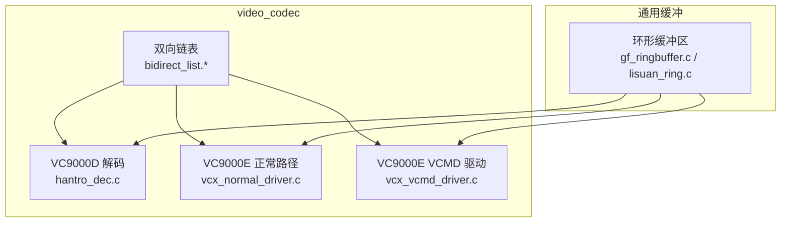
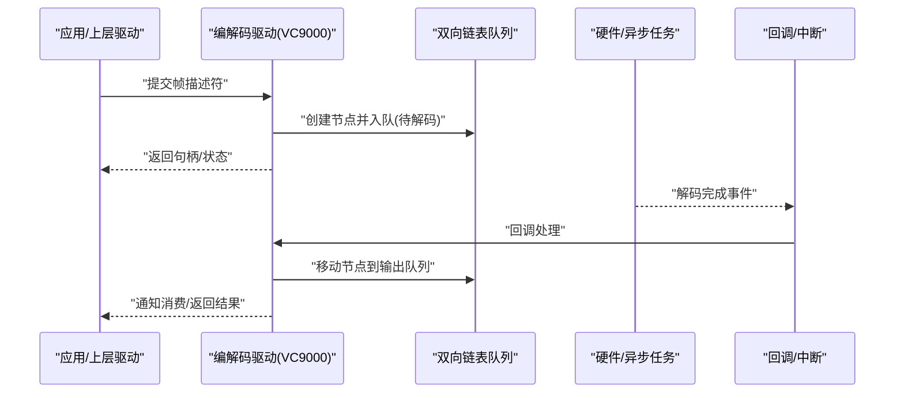
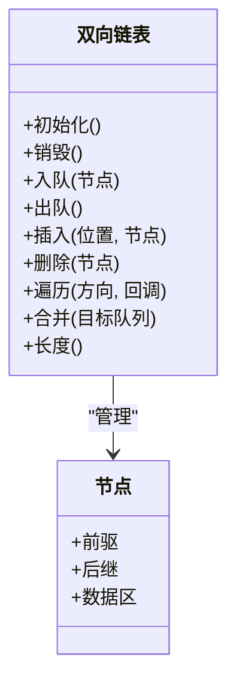
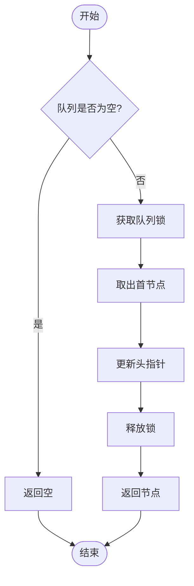
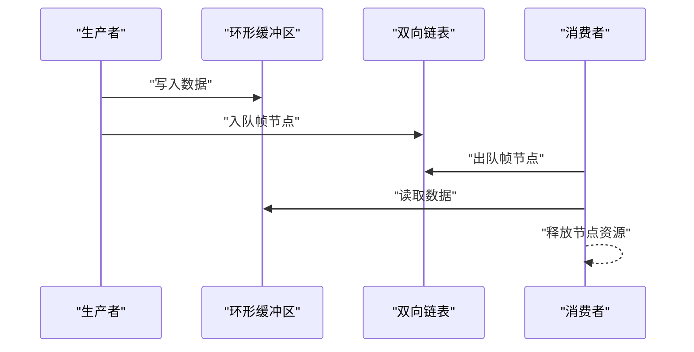
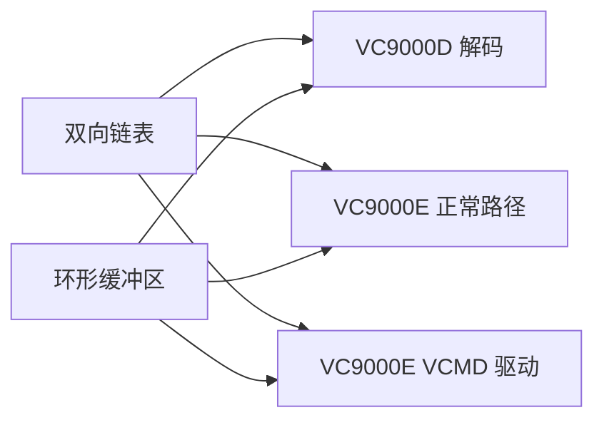

# 编解码通用组件

<cite>
**本文引用的文件**   
- [bidirect_list.c](file://_work/src/usr/src/lisuangpu-dkms-262.2.0.56/video_codec/bidirect_list.c)
- [bidirect_list.h](file://_work/src/usr/src/lisuangpu-dkms-262.2.0.56/video_codec/bidirect_list.h)
- [hantro_dec.c](file://_work/src/usr/src/lisuangpu-dkms-262.2.0.56/video_codec/VC9000D/hantro_dec.c)
- [vcx_normal_driver.c](file://_work/src/usr/src/lisuangpu-dkms-262.2.0.56/video_codec/VC9000E/vcx_normal_driver.c)
- [vcx_vcmd_driver.c](file://_work/src/usr/src/lisuangpu-dkms-262.2.0.56/video_codec/VC9000E/vcx_vcmd_driver.c)
- [gf_ringbuffer.c](file://_work/src/usr/src/lisuangpu-dkms-262.2.0.56/gf_ringbuffer.c)
- [lisuan_ring.c](file://_work/src/usr/src/lisuangpu-dkms-262.2.0.56/lisuan_ring.c)
</cite>

## 目录
1. [简介](#简介)
2. [项目结构](#项目结构)
3. [核心组件](#核心组件)
4. [架构总览](#架构总览)
5. [详细组件分析](#详细组件分析)
6. [依赖分析](#依赖分析)
7. [性能考虑](#性能考虑)
8. [故障排查指南](#故障排查指南)
9. [结论](#结论)
10. [附录](#附录)

## 简介
本技术文档面向视频编解码通用组件，重点围绕双向链表的实现原理、内存管理策略与线程安全机制展开。同时梳理节点操作、遍历算法与性能特征，并说明与其他编解码器模块的集成方式与扩展点设计。文档提供使用示例与最佳实践，帮助读者在驱动与用户态编解码路径中正确、高效地使用通用链表与相关数据结构。

## 项目结构
该仓库包含显示与视频编解码相关的内核/用户态代码。与“编解码通用组件”直接相关的核心目录为 video_codec 及其子模块（VC9000D、VC9000E），以及通用的 ring buffer 实现。双向链表位于 video_codec 根目录，被 VC9000D 与 VC9000E 两类编解码驱动复用。

图表来源
- [bidirect_list.c](file://_work/src/usr/src/lisuangpu-dkms-262.2.0.56/video_codec/bidirect_list.c)
- [bidirect_list.h](file://_work/src/usr/src/lisuangpu-dkms-262.2.0.56/video_codec/bidirect_list.h)
- [hantro_dec.c](file://_work/src/usr/src/lisuangpu-dkms-262.2.0.56/video_codec/VC9000D/hantro_dec.c)
- [vcx_normal_driver.c](file://_work/src/usr/src/lisuangpu-dkms-262.2.0.56/video_codec/VC9000E/vcx_normal_driver.c)
- [vcx_vcmd_driver.c](file://_work/src/usr/src/lisuangpu-dkms-262.2.0.56/video_codec/VC9000E/vcx_vcmd_driver.c)
- [gf_ringbuffer.c](file://_work/src/usr/src/lisuangpu-dkms-262.2.0.56/gf_ringbuffer.c)
- [lisuan_ring.c](file://_work/src/usr/src/lisuangpu-dkms-262.2.0.56/lisuan_ring.c)

章节来源
- [bidirect_list.h](file://_work/src/usr/src/lisuangpu-dkms-262.2.0.56/video_codec/bidirect_list.h)
- [bidirect_list.c](file://_work/src/usr/src/lisuangpu-dkms-262.2.0.56/video_codec/bidirect_list.c)

## 核心组件
- 双向链表：提供头节点、插入、删除、遍历、合并等基础操作，作为编解码任务队列、帧描述符队列、命令列表等的通用容器。
- 编解码驱动：VC9000D 与 VC9000E 两类驱动通过双向链表组织待处理帧、已解码帧、错误帧等，配合环形缓冲区进行数据搬运。
- 环形缓冲区：用于零拷贝或低拷贝的数据通道，与双向链表协同完成生产者-消费者模型。

章节来源
- [bidirect_list.h](file://_work/src/usr/src/lisuangpu-dkms-262.2.0.56/video_codec/bidirect_list.h)
- [bidirect_list.c](file://_work/src/usr/src/lisuangpu-dkms-262.2.0.56/video_codec/bidirect_list.c)
- [hantro_dec.c](file://_work/src/usr/src/lisuangpu-dkms-262.2.0.56/video_codec/VC9000D/hantro_dec.c)
- [vcx_normal_driver.c](file://_work/src/usr/src/lisuangpu-dkms-262.2.0.56/video_codec/VC9000E/vcx_normal_driver.c)
- [vcx_vcmd_driver.c](file://_work/src/usr/src/lisuangpu-dkms-262.2.0.56/video_codec/VC9000E/vcx_vcmd_driver.c)
- [gf_ringbuffer.c](file://_work/src/usr/src/lisuangpu-dkms-262.2.0.56/gf_ringbuffer.c)
- [lisuan_ring.c](file://_work/src/usr/src/lisuangpu-dkms-262.2.0.56/lisuan_ring.c)

## 架构总览
下图展示双向链表在编解码流程中的位置与作用：上层驱动将输入帧封装为链表节点，入队到待解码队列；硬件或异步任务完成后，回调将结果节点移动到输出队列；消费者从输出队列取走节点并释放资源。

图表来源
- [hantro_dec.c](file://_work/src/usr/src/lisuangpu-dkms-262.2.0.56/video_codec/VC9000D/hantro_dec.c)
- [vcx_normal_driver.c](file://_work/src/usr/src/lisuangpu-dkms-262.2.0.56/video_codec/VC9000E/vcx_normal_driver.c)
- [vcx_vcmd_driver.c](file://_work/src/usr/src/lisuangpu-dkms-262.2.0.56/video_codec/VC9000E/vcx_vcmd_driver.c)
- [bidirect_list.c](file://_work/src/usr/src/lisuangpu-dkms-262.2.0.56/video_codec/bidirect_list.c)

## 详细组件分析

### 双向链表设计与实现
- 节点结构：通常包含前后指针与业务数据区（如帧描述符、命令块）。节点由编解码驱动分配，生命周期与队列绑定。
- 头节点：维护队列长度、首尾指针，便于 O(1) 入队出队。
- 插入/删除：支持头部、尾部、指定位置插入与按条件删除，保证前后指针一致性。
- 遍历：提供正向/反向遍历接口，支持在遍历过程中安全删除当前节点。
- 合并/拆分：支持两个队列的合并与拆分，便于批量调度与优先级切换。

图表来源
- [bidirect_list.h](file://_work/src/usr/src/lisuangpu-dkms-262.2.0.56/video_codec/bidirect_list.h)
- [bidirect_list.c](file://_work/src/usr/src/lisuangpu-dkms-262.2.0.56/video_codec/bidirect_list.c)

章节来源
- [bidirect_list.h](file://_work/src/usr/src/lisuangpu-dkms-262.2.0.56/video_codec/bidirect_list.h)
- [bidirect_list.c](file://_work/src/usr/src/lisuangpu-dkms-262.2.0.56/video_codec/bidirect_list.c)

### 内存管理策略
- 分配策略：节点采用统一分配器或 slab/kmalloc（内核）/malloc（用户态）分配，避免频繁碎片化。建议对高频小对象使用池化分配。
- 生命周期：节点随队列存在而存在，出队后由调用方负责释放；队列销毁时确保所有节点被释放。
- 引用计数：若节点被多队列或多上下文共享，需引入引用计数与所有权转移语义，防止悬空指针。
- 失败回退：分配失败时应回滚已修改的链表状态，保持链表一致性。

章节来源
- [bidirect_list.c](file://_work/src/usr/src/lisuangpu-dkms-262.2.0.56/video_codec/bidirect_list.c)

### 线程安全机制
- 锁粒度：以队列为单位加锁（自旋锁/互斥锁），避免跨队列竞争。
- 临界区：入队、出队、遍历、合并/拆分等操作必须进入临界区。
- 无锁优化：仅在单生产者-单消费者场景下可考虑无锁队列；通用双向链表不建议无锁实现。
- 中断上下文：中断回调仅做最小化处理（如移动节点、唤醒等待者），避免长时间持有锁。

章节来源
- [bidirect_list.c](file://_work/src/usr/src/lisuangpu-dkms-262.2.0.56/video_codec/bidirect_list.c)

### 节点操作与遍历算法
- 插入：O(1) 头/尾插；指定位置插入需定位，最坏 O(n)。
- 删除：已知节点指针 O(1)；按条件删除需遍历 O(n)。
- 遍历：正向/反向 O(n)，支持在回调中安全删除当前节点。
- 合并：两队列合并 O(1)（拼接首尾指针）或 O(k)（排序合并）。

图表来源
- [bidirect_list.c](file://_work/src/usr/src/lisuangpu-dkms-262.2.0.56/video_codec/bidirect_list.c)

章节来源
- [bidirect_list.c](file://_work/src/usr/src/lisuangpu-dkms-262.2.0.56/video_codec/bidirect_list.c)

### 与编解码模块的集成与扩展点
- 队列抽象：将不同阶段的队列（待解码、已解码、错误帧）抽象为双向链表实例，便于统一管理与统计。
- 回调接口：硬件/异步任务完成后通过回调将节点从工作队列移动到完成队列，解耦生产与消费。
- 扩展点：
  - 节点数据区扩展：增加元数据字段（时间戳、优先级、编码格式）。
  - 排序策略：在合并/插入时按优先级或时间戳排序，提升吞吐与时延特性。
  - 监控指标：在关键操作处埋点，统计队列长度、延迟、丢帧率。

章节来源
- [hantro_dec.c](file://_work/src/usr/src/lisuangpu-dkms-262.2.0.56/video_codec/VC9000D/hantro_dec.c)
- [vcx_normal_driver.c](file://_work/src/usr/src/lisuangpu-dkms-262.2.0.56/video_codec/VC9000E/vcx_normal_driver.c)
- [vcx_vcmd_driver.c](file://_work/src/usr/src/lisuangpu-dkms-262.2.0.56/video_codec/VC9000E/vcx_vcmd_driver.c)
- [bidirect_list.h](file://_work/src/usr/src/lisuangpu-dkms-262.2.0.56/video_codec/bidirect_list.h)

### 与环形缓冲区的协作
- 数据面：环形缓冲区承载原始码流或重建后的像素数据，双向链表承载控制面（帧描述符、状态）。
- 同步：生产者写入缓冲区后，将对应节点入队；消费者取走节点并读取缓冲区数据，注意读写指针边界。
- 背压：当缓冲区满时，生产者应阻塞或丢弃低优先级帧；当缓冲区空时，消费者应等待或返回重试。

图表来源
- [gf_ringbuffer.c](file://_work/src/usr/src/lisuangpu-dkms-262.2.0.56/gf_ringbuffer.c)
- [lisuan_ring.c](file://_work/src/usr/src/lisuangpu-dkms-262.2.0.56/lisuan_ring.c)
- [bidirect_list.c](file://_work/src/usr/src/lisuangpu-dkms-262.2.0.56/video_codec/bidirect_list.c)

章节来源
- [gf_ringbuffer.c](file://_work/src/usr/src/lisuangpu-dkms-262.2.0.56/gf_ringbuffer.c)
- [lisuan_ring.c](file://_work/src/usr/src/lisuangpu-dkms-262.2.0.56/lisuan_ring.c)
- [bidirect_list.c](file://_work/src/usr/src/lisuangpu-dkms-262.2.0.56/video_codec/bidirect_list.c)

## 依赖分析
双向链表作为通用基础设施，被多个编解码模块依赖。其耦合度低、内聚性高，适合作为独立库使用。

图表来源
- [bidirect_list.c](file://_work/src/usr/src/lisuangpu-dkms-262.2.0.56/video_codec/bidirect_list.c)
- [hantro_dec.c](file://_work/src/usr/src/lisuangpu-dkms-262.2.0.56/video_codec/VC9000D/hantro_dec.c)
- [vcx_normal_driver.c](file://_work/src/usr/src/lisuangpu-dkms-262.2.0.56/video_codec/VC9000E/vcx_normal_driver.c)
- [vcx_vcmd_driver.c](file://_work/src/usr/src/lisuangpu-dkms-262.2.0.56/video_codec/VC9000E/vcx_vcmd_driver.c)
- [gf_ringbuffer.c](file://_work/src/usr/src/lisuangpu-dkms-262.2.0.56/gf_ringbuffer.c)
- [lisuan_ring.c](file://_work/src/usr/src/lisuangpu-dkms-262.2.0.56/lisuan_ring.c)

章节来源
- [bidirect_list.c](file://_work/src/usr/src/lisuangpu-dkms-262.2.0.56/video_codec/bidirect_list.c)
- [hantro_dec.c](file://_work/src/usr/src/lisuangpu-dkms-262.2.0.56/video_codec/VC9000D/hantro_dec.c)
- [vcx_normal_driver.c](file://_work/src/usr/src/lisuangpu-dkms-262.2.0.56/video_codec/VC9000E/vcx_normal_driver.c)
- [vcx_vcmd_driver.c](file://_work/src/usr/src/lisuangpu-dkms-262.2.0.56/video_codec/VC9000E/vcx_vcmd_driver.c)
- [gf_ringbuffer.c](file://_work/src/usr/src/lisuangpu-dkms-262.2.0.56/gf_ringbuffer.c)
- [lisuan_ring.c](file://_work/src/usr/src/lisuangpu-dkms-262.2.0.56/lisuan_ring.c)

## 性能考虑
- 时间复杂度：入队/出队 O(1)，随机插入/删除 O(n)，遍历 O(n)。
- 空间开销：每个节点额外存储前后指针；建议池化分配减少碎片。
- 缓存友好：顺序遍历与连续分配的节点能提升缓存命中率。
- 并发影响：锁粒度与持有时间直接影响吞吐；尽量缩短临界区。
- 背压与限流：结合环形缓冲区容量与队列长度动态调节生产者速率。

[本节为通用指导，不直接分析具体文件]

## 故障排查指南
- 常见症状
  - 死锁/竞态：检查是否在所有访问点加锁，是否存在锁顺序不一致。
  - 内存泄漏：确认出队节点是否释放，队列销毁是否清理全部节点。
  - 数据损坏：检查插入/删除时前后指针更新是否正确，遍历中删除是否安全。
- 诊断手段
  - 打印队列长度与节点地址，观察异常增长或断链。
  - 在关键路径添加日志与断言，捕获非法状态。
  - 使用静态分析与工具（如 KASAN/UBSAN）检测越界与悬挂指针。
- 恢复策略
  - 遇到不可恢复错误时，清空队列并重建状态，避免污染后续流程。
  - 记录错误上下文（时间戳、源地址、调用栈）以便复现。

章节来源
- [bidirect_list.c](file://_work/src/usr/src/lisuangpu-dkms-262.2.0.56/video_codec/bidirect_list.c)

## 结论
双向链表作为编解码通用组件的核心数据结构，提供了高效、灵活的队列管理能力。通过合理的内存管理、严格的线程安全策略以及与环形缓冲区的协作，能够在高吞吐、低时延的视频处理场景中稳定运行。建议在扩展时遵循统一的接口约定与生命周期管理，确保系统整体的可维护性与可观测性。

[本节为总结，不直接分析具体文件]

## 附录
- 使用示例（步骤）
  - 初始化队列与分配节点池。
  - 生产者创建节点并填充数据，入队至待处理队列。
  - 消费者从队列出队，处理完成后释放节点。
  - 在回调中将节点从工作队列移动到完成队列。
- 最佳实践
  - 明确节点所有权与生命周期，避免重复释放。
  - 使用短临界区与细粒度锁，降低锁竞争。
  - 对高频路径进行基准测试，关注队列长度与延迟分布。
  - 增加监控指标与告警，及时发现异常。

[本节为通用指导，不直接分析具体文件]