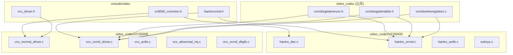
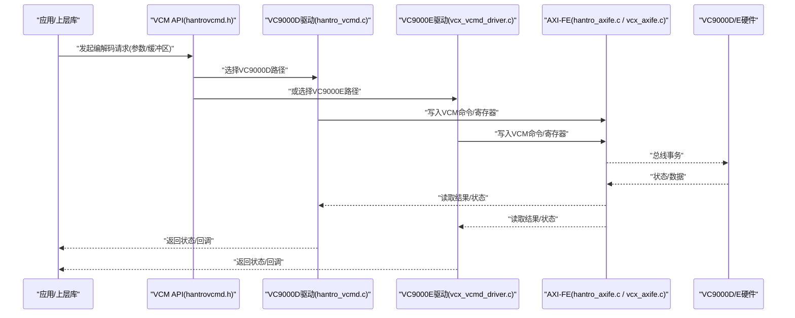
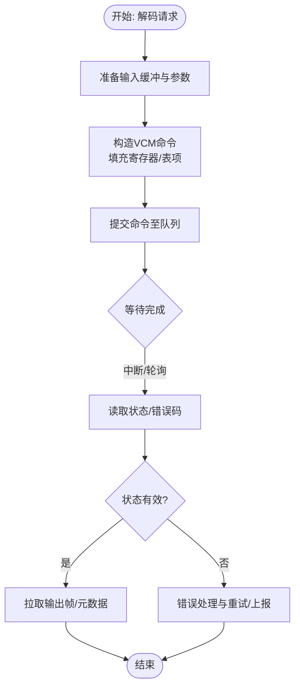
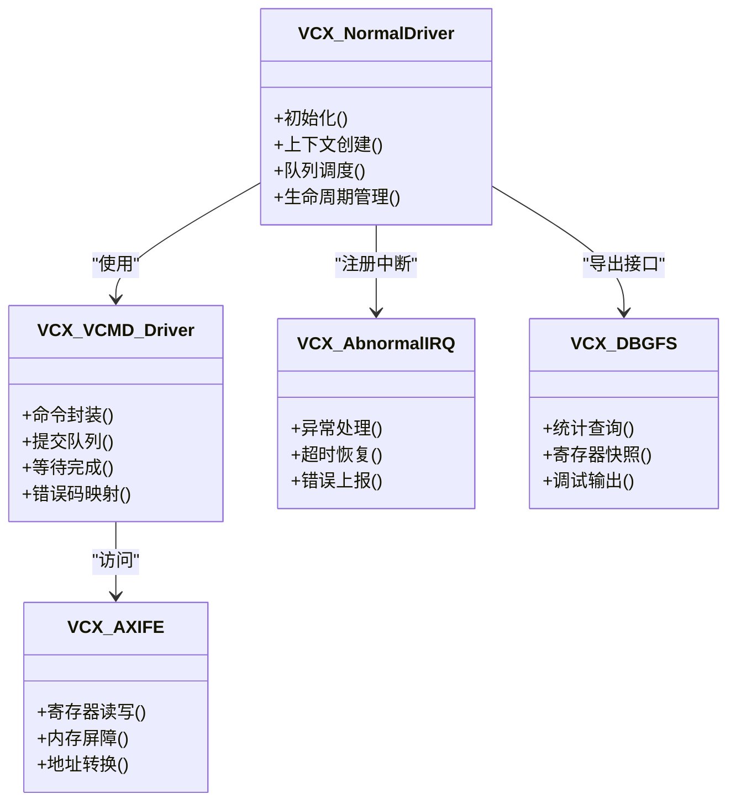
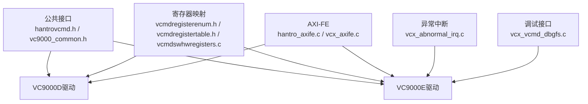

# 视频编解码器

<cite>
**本文引用的文件**   
- [hantro_dec.c](file://_work/src/usr/src/lisuangpu-dkms-262.2.0.56/video_codec/VC9000D/hantro_dec.c)
- [hantro_vcmd.c](file://_work/src/usr/src/lisuangpu-dkms-262.2.0.56/video_codec/VC9000D/hantro_vcmd.c)
- [hantro_axife.c](file://_work/src/usr/src/lisuangpu-dkms-262.2.0.56/video_codec/VC9000D/hantro_axife.c)
- [subsys.c](file://_work/src/usr/src/lisuangpu-dkms-262.2.0.56/video_codec/VC9000D/subsys.c)
- [vcx_normal_driver.c](file://_work/src/usr/src/lisuangpu-dkms-262.2.0.56/video_codec/VC9000E/vcx_normal_driver.c)
- [vcx_vcmd_driver.c](file://_work/src/usr/src/lisuangpu-dkms-262.2.0.56/video_codec/VC9000E/vcx_vcmd_driver.c)
- [vcx_axife.c](file://_work/src/usr/src/lisuangpu-dkms-262.2.0.56/video_codec/VC9000E/vcx_axife.c)
- [vcx_abnormal_irq.c](file://_work/src/usr/src/lisuangpu-dkms-262.2.0.56/video_codec/VC9000E/vcx_abnormal_irq.c)
- [vcx_vcmd_dbgfs.c](file://_work/src/usr/src/lisuangpu-dkms-262.2.0.56/video_codec/VC9000E/vcx_vcmd_dbgfs.c)
- [hantrovcmd.h](file://_work/src/usr/src/lisuangpu-dkms-262.2.0.56/include/video/hantrovcmd.h)
- [vc9000_common.h](file://_work/src/usr/src/lisuangpu-dkms-262.2.0.56/include/video/vc9000_common.h)
- [vcx_driver.h](file://_work/src/usr/src/lisuangpu-dkms-262.2.0.56/include/video/vcx_driver.h)
- [vcx_vcmd_cfg.h](file://_work/src/usr/src/lisuangpu-dkms-262.2.0.56/video_codec/VC9000E/vcx_vcmd_cfg.h)
- [vcx_normal_cfg.h](file://_work/src/usr/src/lisuangpu-dkms-262.2.0.56/video_codec/VC9000E/vcx_normal_cfg.h)
- [vcmdregisterenum.h](file://_work/src/usr/src/lisuangpu-dkms-262.2.0.56/video_codec/vcmdregisterenum.h)
- [vcmdregistertable.h](file://_work/src/usr/src/lisuangpu-dkms-262.2.0.56/video_codec/vcmdregistertable.h)
- [vcmdswhwregisters.c](file://_work/src/usr/src/lisuangpu-dkms-262.2.0.56/video_codec/vcmdswhwregisters.c)
</cite>

## 目录
1. [简介](#简介)
2. [项目结构](#项目结构)
3. [核心组件](#核心组件)
4. [架构总览](#架构总览)
5. [详细组件分析](#详细组件分析)
6. [依赖关系分析](#依赖关系分析)
7. [性能考虑](#性能考虑)
8. [故障排除指南](#故障排除指南)
9. [结论](#结论)
10. [附录](#附录)

## 简介
本文件面向丽山GPU视频编解码子系统，重点阐述VC9000D与VC9000E两款硬件编解码器的驱动实现、命令处理与状态管理。文档覆盖以下主题：
- 支持的编码格式与解码流程
- VCM（Video Command）通信机制
- 异常处理与调试接口
- 使用示例与故障排除建议
- 性能优化策略

该子系统通过统一的VCM接口向上层暴露编解码能力，底层针对VC9000D与VC9000E分别提供适配层，屏蔽硬件差异，保证一致的API语义与行为。

## 项目结构
视频编解码相关代码主要位于 video_codec 目录，按硬件平台划分为 VC9000D 与 VC9000E 两个子目录；公共头文件位于 include/video；通用VCM寄存器定义位于 video_codec 根目录。

图表来源
- [hantrovcmd.h](file://_work/src/usr/src/lisuangpu-dkms-262.2.0.56/include/video/hantrovcmd.h)
- [vc9000_common.h](file://_work/src/usr/src/lisuangpu-dkms-262.2.0.56/include/video/vc9000_common.h)
- [vcx_driver.h](file://_work/src/usr/src/lisuangpu-dkms-262.2.0.56/include/video/vcx_driver.h)
- [vcmdregisterenum.h](file://_work/src/usr/src/lisuangpu-dkms-262.2.0.56/video_codec/vcmdregisterenum.h)
- [vcmdregistertable.h](file://_work/src/usr/src/lisuangpu-dkms-262.2.0.56/video_codec/vcmdregistertable.h)
- [vcmdswhwregisters.c](file://_work/src/usr/src/lisuangpu-dkms-262.2.0.56/video_codec/vcmdswhwregisters.c)

章节来源
- [hantro_dec.c](file://_work/src/usr/src/lisuangpu-dkms-262.2.0.56/video_codec/VC9000D/hantro_dec.c)
- [hantro_vcmd.c](file://_work/src/usr/src/lisuangpu-dkms-262.2.0.56/video_codec/VC9000D/hantro_vcmd.c)
- [hantro_axife.c](file://_work/src/usr/src/lisuangpu-dkms-262.2.0.56/video_codec/VC9000D/hantro_axife.c)
- [subsys.c](file://_work/src/usr/src/lisuangpu-dkms-262.2.0.56/video_codec/VC9000D/subsys.c)
- [vcx_normal_driver.c](file://_work/src/usr/src/lisuangpu-dkms-262.2.0.56/video_codec/VC9000E/vcx_normal_driver.c)
- [vcx_vcmd_driver.c](file://_work/src/usr/src/lisuangpu-dkms-262.2.0.56/video_codec/VC9000E/vcx_vcmd_driver.c)
- [vcx_axife.c](file://_work/src/usr/src/lisuangpu-dkms-262.2.0.56/video_codec/VC9000E/vcx_axife.c)
- [vcx_abnormal_irq.c](file://_work/src/usr/src/lisuangpu-dkms-262.2.0.56/video_codec/VC9000E/vcx_abnormal_irq.c)
- [vcx_vcmd_dbgfs.c](file://_work/src/usr/src/lisuangpu-dkms-262.2.0.56/video_codec/VC9000E/vcx_vcmd_dbgfs.c)
- [vcmdregisterenum.h](file://_work/src/usr/src/lisuangpu-dkms-262.2.0.56/video_codec/vcmdregisterenum.h)
- [vcmdregistertable.h](file://_work/src/usr/src/lisuangpu-dkms-262.2.0.56/video_codec/vcmdregistertable.h)
- [vcmdswhwregisters.c](file://_work/src/usr/src/lisuangpu-dkms-262.2.0.56/video_codec/vcmdswhwregisters.c)

## 核心组件
- VC9000D 解码路径
  - hantro_dec.c：解码入口、帧缓冲管理、参数下发与状态同步
  - hantro_vcmd.c：VCM命令封装、队列提交与结果回读
  - hantro_axife.c：AXI-FE（前端总线）访问封装，用于寄存器读写与内存屏障
  - subsys.c：子系统初始化、资源分配与电源/时钟管理

- VC9000E 驱动栈
  - vcx_normal_driver.c：正常模式驱动入口，负责设备生命周期、上下文与队列调度
  - vcx_vcmd_driver.c：VCM命令驱动，统一命令下发、等待与错误码映射
  - vcx_axife.c：AXI-FE访问封装，寄存器与内存操作
  - vcx_abnormal_irq.c：异常中断处理，包括超时、校验失败等
  - vcx_vcmd_dbgfs.c：debugfs接口，便于运行时诊断与统计

- 公共接口与配置
  - hantrovcmd.h：VCM命令结构体、枚举与通用API
  - vc9000_common.h：VC9000系列公共宏、寄存器位域与能力描述
  - vcx_driver.h：VCX系列驱动抽象接口
  - vcmdregisterenum.h / vcmdregistertable.h / vcmdswhwregisters.c：VCM寄存器枚举、表项与SW-HW寄存器映射

章节来源
- [hantro_dec.c](file://_work/src/usr/src/lisuangpu-dkms-262.2.0.56/video_codec/VC9000D/hantro_dec.c)
- [hantro_vcmd.c](file://_work/src/usr/src/lisuangpu-dkms-262.2.0.56/video_codec/VC9000D/hantro_vcmd.c)
- [hantro_axife.c](file://_work/src/usr/src/lisuangpu-dkms-262.2.0.56/video_codec/VC9000D/hantro_axife.c)
- [subsys.c](file://_work/src/usr/src/lisuangpu-dkms-262.2.0.56/video_codec/VC9000D/subsys.c)
- [vcx_normal_driver.c](file://_work/src/usr/src/lisuangpu-dkms-262.2.0.56/video_codec/VC9000E/vcx_normal_driver.c)
- [vcx_vcmd_driver.c](file://_work/src/usr/src/lisuangpu-dkms-262.2.0.56/video_codec/VC9000E/vcx_vcmd_driver.c)
- [vcx_axife.c](file://_work/src/usr/src/lisuangpu-dkms-262.2.0.56/video_codec/VC9000E/vcx_axife.c)
- [vcx_abnormal_irq.c](file://_work/src/usr/src/lisuangpu-dkms-262.2.0.56/video_codec/VC9000E/vcx_abnormal_irq.c)
- [vcx_vcmd_dbgfs.c](file://_work/src/usr/src/lisuangpu-dkms-262.2.0.56/video_codec/VC9000E/vcx_vcmd_dbgfs.c)
- [hantrovcmd.h](file://_work/src/usr/src/lisuangpu-dkms-262.2.0.56/include/video/hantrovcmd.h)
- [vc9000_common.h](file://_work/src/usr/src/lisuangpu-dkms-262.2.0.56/include/video/vc9000_common.h)
- [vcx_driver.h](file://_work/src/usr/src/lisuangpu-dkms-262.2.0.56/include/video/vcx_driver.h)
- [vcmdregisterenum.h](file://_work/src/usr/src/lisuangpu-dkms-262.2.0.56/video_codec/vcmdregisterenum.h)
- [vcmdregistertable.h](file://_work/src/usr/src/lisuangpu-dkms-262.2.0.56/video_codec/vcmdregistertable.h)
- [vcmdswhwregisters.c](file://_work/src/usr/src/lisuangpu-dkms-262.2.0.56/video_codec/vcmdswhwregisters.c)

## 架构总览
VC9000D与VC9000E共享VCM命令语义，但具体寄存器与中断处理存在差异。上层调用统一经由VCM接口进入对应平台的驱动实现，再由AXI-FE访问硬件寄存器与内存。

图表来源
- [hantrovcmd.h](file://_work/src/usr/src/lisuangpu-dkms-262.2.0.56/include/video/hantrovcmd.h)
- [hantro_vcmd.c](file://_work/src/usr/src/lisuangpu-dkms-262.2.0.56/video_codec/VC9000D/hantro_vcmd.c)
- [vcx_vcmd_driver.c](file://_work/src/usr/src/lisuangpu-dkms-262.2.0.56/video_codec/VC9000E/vcx_vcmd_driver.c)
- [hantro_axife.c](file://_work/src/usr/src/lisuangpu-dkms-262.2.0.56/video_codec/VC9000D/hantro_axife.c)
- [vcx_axife.c](file://_work/src/usr/src/lisuangpu-dkms-262.2.0.56/video_codec/VC9000E/vcx_axife.c)

## 详细组件分析

### VC9000D 解码路径
- hantro_dec.c：负责解码会话创建、输入输出缓冲管理、像素格式协商、帧级控制与完成通知。典型流程为：准备输入切片/帧→下发解码命令→等待完成→拉取输出帧。
- hantro_vcmd.c：将高层解码请求转换为VCM命令包，维护命令队列、提交与轮询/中断等待，解析返回状态并映射到标准错误码。
- hantro_axife.c：封装AXI-FE的寄存器读写、内存屏障与地址转换，确保一致性。
- subsys.c：子系统初始化、时钟/电源门控、中断注册与资源清理。

图表来源
- [hantro_dec.c](file://_work/src/usr/src/lisuangpu-dkms-262.2.0.56/video_codec/VC9000D/hantro_dec.c)
- [hantro_vcmd.c](file://_work/src/usr/src/lisuangpu-dkms-262.2.0.56/video_codec/VC9000D/hantro_vcmd.c)
- [hantro_axife.c](file://_work/src/usr/src/lisuangpu-dkms-262.2.0.56/video_codec/VC9000D/hantro_axife.c)
- [subsys.c](file://_work/src/usr/src/lisuangpu-dkms-262.2.0.56/video_codec/VC9000D/subsys.c)

章节来源
- [hantro_dec.c](file://_work/src/usr/src/lisuangpu-dkms-262.2.0.56/video_codec/VC9000D/hantro_dec.c)
- [hantro_vcmd.c](file://_work/src/usr/src/lisuangpu-dkms-262.2.0.56/video_codec/VC9000D/hantro_vcmd.c)
- [hantro_axife.c](file://_work/src/usr/src/lisuangpu-dkms-262.2.0.56/video_codec/VC9000D/hantro_axife.c)
- [subsys.c](file://_work/src/usr/src/lisuangpu-dkms-262.2.0.56/video_codec/VC9000D/subsys.c)

### VC9000E 驱动栈
- vcx_normal_driver.c：设备初始化、上下文创建、队列管理与生命周期控制。
- vcx_vcmd_driver.c：VCM命令驱动，统一命令封装、提交、等待与错误码映射。
- vcx_axife.c：AXI-FE访问封装，提供寄存器读写与内存一致性保障。
- vcx_abnormal_irq.c：异常中断处理，涵盖超时、校验失败、硬件错误等场景。
- vcx_vcmd_dbgfs.c：提供debugfs接口，用于查看命令队列、寄存器快照与统计信息。

图表来源
- [vcx_normal_driver.c](file://_work/src/usr/src/lisuangpu-dkms-262.2.0.56/video_codec/VC9000E/vcx_normal_driver.c)
- [vcx_vcmd_driver.c](file://_work/src/usr/src/lisuangpu-dkms-262.2.0.56/video_codec/VC9000E/vcx_vcmd_driver.c)
- [vcx_axife.c](file://_work/src/usr/src/lisuangpu-dkms-262.2.0.56/video_codec/VC9000E/vcx_axife.c)
- [vcx_abnormal_irq.c](file://_work/src/usr/src/lisuangpu-dkms-262.2.0.56/video_codec/VC9000E/vcx_abnormal_irq.c)
- [vcx_vcmd_dbgfs.c](file://_work/src/usr/src/lisuangpu-dkms-262.2.0.56/video_codec/VC9000E/vcx_vcmd_dbgfs.c)

章节来源
- [vcx_normal_driver.c](file://_work/src/usr/src/lisuangpu-dkms-262.2.0.56/video_codec/VC9000E/vcx_normal_driver.c)
- [vcx_vcmd_driver.c](file://_work/src/usr/src/lisuangpu-dkms-262.2.0.56/video_codec/VC9000E/vcx_vcmd_driver.c)
- [vcx_axife.c](file://_work/src/usr/src/lisuangpu-dkms-262.2.0.56/video_codec/VC9000E/vcx_axife.c)
- [vcx_abnormal_irq.c](file://_work/src/usr/src/lisuangpu-dkms-262.2.0.56/video_codec/VC9000E/vcx_abnormal_irq.c)
- [vcx_vcmd_dbgfs.c](file://_work/src/usr/src/lisuangpu-dkms-262.2.0.56/video_codec/VC9000E/vcx_vcmd_dbgfs.c)

### VCM 通信机制与寄存器映射
- hantrovcmd.h：定义VCM命令结构体、字段含义与通用API，确保跨平台一致。
- vcmdregisterenum.h / vcmdregistertable.h / vcmdswhwregisters.c：提供VCM寄存器枚举、表项与SW-HW映射，支撑命令构建与状态读取。
- 各平台驱动（VC9000D/E）基于上述公共定义进行差异化实现，屏蔽寄存器细节。

图表来源
- [hantrovcmd.h](file://_work/src/usr/src/lisuangpu-dkms-262.2.0.56/include/video/hantrovcmd.h)
- [vcmdregisterenum.h](file://_work/src/usr/src/lisuangpu-dkms-262.2.0.56/video_codec/vcmdregisterenum.h)
- [vcmdregistertable.h](file://_work/src/usr/src/lisuangpu-dkms-262.2.0.56/video_codec/vcmdregistertable.h)
- [vcmdswhwregisters.c](file://_work/src/usr/src/lisuangpu-dkms-262.2.0.56/video_codec/vcmdswhwregisters.c)
- [hantro_axife.c](file://_work/src/usr/src/lisuangpu-dkms-262.2.0.56/video_codec/VC9000D/hantro_axife.c)
- [vcx_axife.c](file://_work/src/usr/src/lisuangpu-dkms-262.2.0.56/video_codec/VC9000E/vcx_axife.c)

章节来源
- [hantrovcmd.h](file://_work/src/usr/src/lisuangpu-dkms-262.2.0.56/include/video/hantrovcmd.h)
- [vcmdregisterenum.h](file://_work/src/usr/src/lisuangpu-dkms-262.2.0.56/video_codec/vcmdregisterenum.h)
- [vcmdregistertable.h](file://_work/src/usr/src/lisuangpu-dkms-262.2.0.56/video_codec/vcmdregistertable.h)
- [vcmdswhwregisters.c](file://_work/src/usr/src/lisuangpu-dkms-262.2.0.56/video_codec/vcmdswhwregisters.c)

## 依赖关系分析
- VC9000D与VC9000E均依赖公共VCM接口与寄存器映射，降低耦合度，提高可移植性。
- AXI-FE模块作为总线访问抽象，被两套驱动复用，减少重复实现。
- 异常中断与调试接口在VC9000E中独立成模块，便于扩展与维护。

图表来源
- [hantrovcmd.h](file://_work/src/usr/src/lisuangpu-dkms-262.2.0.56/include/video/hantrovcmd.h)
- [vc9000_common.h](file://_work/src/usr/src/lisuangpu-dkms-262.2.0.56/include/video/vc9000_common.h)
- [vcmdregisterenum.h](file://_work/src/usr/src/lisuangpu-dkms-262.2.0.56/video_codec/vcmdregisterenum.h)
- [vcmdregistertable.h](file://_work/src/usr/src/lisuangpu-dkms-262.2.0.56/video_codec/vcmdregistertable.h)
- [vcmdswhwregisters.c](file://_work/src/usr/src/lisuangpu-dkms-262.2.0.56/video_codec/vcmdswhwregisters.c)
- [hantro_axife.c](file://_work/src/usr/src/lisuangpu-dkms-262.2.0.56/video_codec/VC9000D/hantro_axife.c)
- [vcx_axife.c](file://_work/src/usr/src/lisuangpu-dkms-262.2.0.56/video_codec/VC9000E/vcx_axife.c)
- [vcx_abnormal_irq.c](file://_work/src/usr/src/lisuangpu-dkms-262.2.0.56/video_codec/VC9000E/vcx_abnormal_irq.c)
- [vcx_vcmd_dbgfs.c](file://_work/src/usr/src/lisuangpu-dkms-262.2.0.56/video_codec/VC9000E/vcx_vcmd_dbgfs.c)

章节来源
- [hantro_dec.c](file://_work/src/usr/src/lisuangpu-dkms-262.2.0.56/video_codec/VC9000D/hantro_dec.c)
- [hantro_vcmd.c](file://_work/src/usr/src/lisuangpu-dkms-262.2.0.56/video_codec/VC9000D/hantro_vcmd.c)
- [vcx_normal_driver.c](file://_work/src/usr/src/lisuangpu-dkms-262.2.0.56/video_codec/VC9000E/vcx_normal_driver.c)
- [vcx_vcmd_driver.c](file://_work/src/usr/src/lisuangpu-dkms-262.2.0.56/video_codec/VC9000E/vcx_vcmd_driver.c)

## 性能考虑
- 命令批处理与队列深度：合理设置队列长度与批大小，减少上下文切换与总线开销。
- 内存对齐与缓存一致性：确保输入/输出缓冲对齐，必要时插入内存屏障，避免脏缓存导致的错误。
- 中断与轮询策略：高吞吐场景优先使用中断+批量完成；低延迟场景可采用短轮询。
- 功耗与时钟门控：空闲时关闭不必要模块，动态调节时钟频率以平衡功耗与性能。
- 流水线并行：多路解码/编码任务交错提交，提升整体吞吐。

[本节为通用指导，不直接分析具体文件]

## 故障排除指南
- 常见问题定位
  - 命令提交失败：检查VCM命令结构完整性、参数合法性与缓冲区有效性
  - 状态异常：读取状态寄存器，核对错误码映射，确认中断是否触发
  - 死锁/超时：观察队列堆积情况，调整等待策略与超时阈值
  - 图像异常：检查像素格式、分辨率、裁剪区域与缩放参数

- 调试接口使用
  - 通过debugfs查看命令队列、寄存器快照与统计计数
  - 启用日志开关，捕获关键路径的打印信息
  - 使用断点或内核跟踪工具定位崩溃点

- 异常处理流程
  - 捕获异常中断，记录上下文与寄存器状态
  - 尝试复位或重新初始化相关模块
  - 上报错误码并通知上层重试或降级

章节来源
- [vcx_abnormal_irq.c](file://_work/src/usr/src/lisuangpu-dkms-262.2.0.56/video_codec/VC9000E/vcx_abnormal_irq.c)
- [vcx_vcmd_dbgfs.c](file://_work/src/usr/src/lisuangpu-dkms-262.2.0.56/video_codec/VC9000E/vcx_vcmd_dbgfs.c)
- [hantro_vcmd.c](file://_work/src/usr/src/lisuangpu-dkms-262.2.0.56/video_codec/VC9000D/hantro_vcmd.c)
- [vcx_vcmd_driver.c](file://_work/src/usr/src/lisuangpu-dkms-262.2.0.56/video_codec/VC9000E/vcx_vcmd_driver.c)

## 结论
丽山GPU视频编解码子系统通过统一的VCM接口与模块化设计，实现了VC9000D与VC9000E的高效协同。公共接口与寄存器映射降低了平台差异带来的复杂度，AXI-FE抽象提升了总线访问效率。异常处理与调试接口完善了问题定位与修复能力。遵循本文的性能优化与故障排除建议，可在实际应用中取得稳定且高效的编解码体验。

[本节为总结性内容，不直接分析具体文件]

## 附录
- 使用示例（概念性步骤）
  - 初始化子系统与上下文
  - 配置输入/输出缓冲与像素格式
  - 构造VCM命令并提交
  - 等待完成并获取结果
  - 释放资源与清理上下文

- 参考文件路径
  - VC9000D解码入口与命令处理：[hantro_dec.c](file://_work/src/usr/src/lisuangpu-dkms-262.2.0.56/video_codec/VC9000D/hantro_dec.c)、[hantro_vcmd.c](file://_work/src/usr/src/lisuangpu-dkms-262.2.0.56/video_codec/VC9000D/hantro_vcmd.c)
  - VC9000E驱动栈：[vcx_normal_driver.c](file://_work/src/usr/src/lisuangpu-dkms-262.2.0.56/video_codec/VC9000E/vcx_normal_driver.c)、[vcx_vcmd_driver.c](file://_work/src/usr/src/lisuangpu-dkms-262.2.0.56/video_codec/VC9000E/vcx_vcmd_driver.c)
  - 公共接口与寄存器映射：[hantrovcmd.h](file://_work/src/usr/src/lisuangpu-dkms-262.2.0.56/include/video/hantrovcmd.h)、[vcmdregisterenum.h](file://_work/src/usr/src/lisuangpu-dkms-262.2.0.56/video_codec/vcmdregisterenum.h)、[vcmdregistertable.h](file://_work/src/usr/src/lisuangpu-dkms-262.2.0.56/video_codec/vcmdregistertable.h)、[vcmdswhwregisters.c](file://_work/src/usr/src/lisuangpu-dkms-262.2.0.56/video_codec/vcmdswhwregisters.c)

[本节为补充信息，不直接分析具体文件]