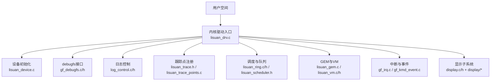
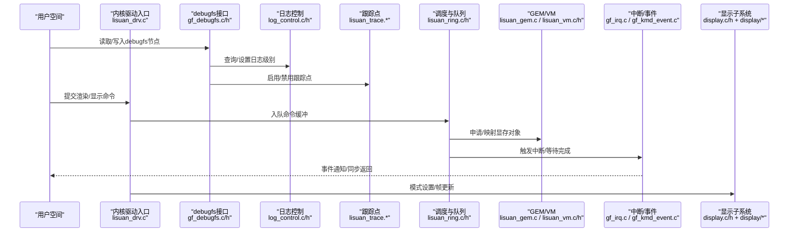
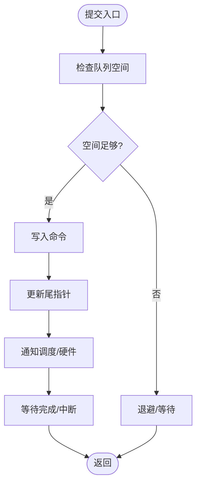
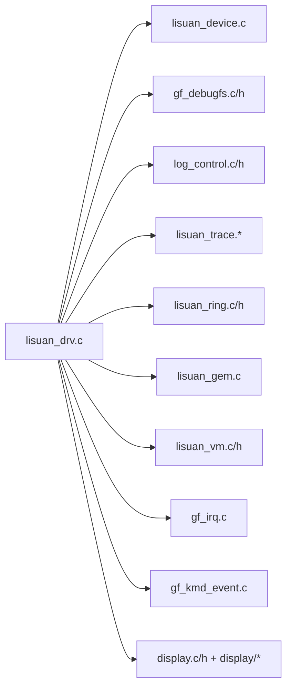

# 调试与监控

<cite>
**本文引用的文件**   
- [gf_debugfs.c](file://_work/src/usr/src/lisuan-pci-dkms-262.2.0.56/gf_debugfs.c)
- [gf_debugfs.h](file://_work/src/usr/src/lisuan-pci-dkms-262.2.0.56/gf_debugfs.h)
- [log_control.c](file://_work/src/usr/src/lisuan-pci-dkms-262.2.0.56/log_control.c)
- [log_control.h](file://_work/src/usr/src/lisuan-pci-dkms-262.2.0.56/log_control.h)
- [lisuan_trace.h](file://_work/src/usr/src/lisuan-pci-dkms-262.2.0.56/lisuan_trace.h)
- [lisuan_trace_points.c](file://_work/src/usr/src/lisuan-pci-dkms-262.2.0.56/lisuan_trace_points.c)
- [lisuan_drv.c](file://_work/src/usr/src/lisuan-pci-dkms-262.2.0.56/lisuan_drv.c)
- [lisuan_device.c](file://_work/src/usr/src/lisuan-pci-dkms-262.2.0.56/lisuan_device.c)
- [lisuan_ring.c](file://_work/src/usr/src/lisuan-pci-dkms-262.2.0.56/lisuan_ring.c)
- [lisuan_ring.h](file://_work/src/usr/src/lisuan-pci-dkms-262.2.0.56/lisuan_ring.h)
- [lisuan_gem.c](file://_work/src/usr/src/lisuan-pci-dkms-262.2.0.56/lisuan_gem.c)
- [lisuan_vm.c](file://_work/src/usr/src/lisuan-pci-dkms-262.2.0.56/lisuan_vm.c)
- [lisuan_vm.h](file://_work/src/usr/src/lisuan-pci-dkms-262.2.0.56/lisuan_vm.h)
- [lisuan_procid.c](file://_work/src/usr/src/lisuan-pci-dkms-262.2.0.56/lisuan_procid.c)
- [lisuan_procid.h](file://_work/src/usr/src/lisuan-pci-dkms-262.2.0.56/lisuan_procid.h)
- [lisuan_fb.c](file://_work/src/usr/src/lisuan-pci-dkms-262.2.0.56/lisuan_fb.c)
- [lisuan_sync.c](file://_work/src/usr/src/lisuan-pci-dkms-262.2.0.56/lisuan_sync.c)
- [lisuan_sched_main.c](file://_work/src/usr/src/lisuan-pci-dkms-262.2.0.56/lisuan_sched_main.c)
- [lisuan_scheduler.h](file://_work/src/usr/src/lisuan-pci-dkms-262.2.0.56/lisuan_scheduler.h)
- [lisuan_mailbox.c](file://_work/src/usr/src/lisuan-pci-dkms-262.2.0.56/lisuan_mailbox.c)
- [lisuan_mailbox.h](file://_work/src/usr/src/lisuan-pci-dkms-262.2.0.56/lisuan_mailbox.h)
- [lisuan_p2pdma.c](file://_work/src/usr/src/lisuan-pci-dkms-262.2.0.56/lisuan_p2pdma.c)
- [lisuan_p2pdma.h](file://_work/src/usr/src/lisuan-pci-dkms-262.2.0.56/lisuan_p2pdma.h)
- [display.c](file://_work/src/usr/src/lisuan-pci-dkms-262.2.0.56/display.c)
- [display.h](file://_work/src/usr/src/lisuan-pci-dkms-262.2.0.56/display.h)
- [disp_device.c](file://_work/src/usr/src/lisuan-pci-dkms-262.2.0.56/display/disp_device.c)
- [disp_connector.c](file://_work/src/usr/src/lisuan-pci-dkms-262.2.0.56/display/connector/disp_connector.c)
- [disp_crtc.c](file://_work/src/usr/src/lisuan-pci-dkms-262.2.0.56/display/crtc/disp_crtc.c)
- [disp_plane.c](file://_work/src/usr/src/lisuan-pci-dkms-262.2.0.56/display/crtc/disp_plane.c)
- [disp_encoder.c](file://_work/src/usr/src/lisuan-pci-dkms-262.2.0.56/display/encoder/disp_encoder.c)
- [disp_mode.c](file://_work/src/usr/src/lisuan-pci-dkms-262.2.0.56/display/connector/disp_mode.c)
- [disp_intr.c](file://_work/src/usr/src/lisuan-pci-dkms-262.2.0.56/display/intr/disp_intr.c)
- [gf_kmd_event.c](file://_work/src/usr/src/lisuan-pci-dkms-262.2.0.56/gf_kmd_event.c)
- [gf_irq.c](file://_work/src/usr/src/lisuan-pci-dkms-262.2.0.56/gf_irq.c)
- [gf_job.c](file://_work/src/usr/src/lisuan-pci-dkms-262.2.0.56/gf_job.c)
- [gf_ringbuffer.c](file://_work/src/usr/src/lisuan-pci-dkms-262.2.0.56/gf_ringbuffer.c)
- [gf_trans.c](file://_work/src/usr/src/lisuan-pci-dkms-262.2.0.56/gf_trans.c)
- [gf_hw_cmds.h](file://_work/src/usr/src/lisuan-pci-dkms-262.2.0.56/gf_hw_cmds.h)
- [gf_os_interface.c](file://_work/src/usr/src/lisuan-pci-dkms-262.2.0.56/gf_os_interface.c)
- [Makefile](file://_work/src/usr/src/lisuan-pci-dkms-262.2.0.56/Makefile)
- [dkms.conf](file://_work/src/usr/src/lisuan-pci-dkms-262.2.0.56/dkms.conf)
</cite>

## 目录
1. [简介](#简介)
2. [项目结构](#项目结构)
3. [核心组件](#核心组件)
4. [架构总览](#架构总览)
5. [详细组件分析](#详细组件分析)
6. [依赖关系分析](#依赖关系分析)
7. [性能考虑](#性能考虑)
8. [故障排除指南](#故障排除指南)
9. [结论](#结论)
10. [附录](#附录)

## 简介
本文件面向丽山GPU驱动与显示子系统的调试与监控，聚焦以下目标：
- 解释debugfs接口的使用方式、日志控制机制与跟踪点配置
- 说明性能分析工具、错误诊断方法与系统监控指标
- 指导调试符号的使用、内核追踪技术与性能瓶颈识别
- 提供可操作的调试场景与故障排除案例

文档内容基于仓库中的驱动源码与显示子系统实现，结合Linux内核的debugfs、tracepoint、perf等通用能力进行系统化说明。

## 项目结构
该仓库包含GPU驱动核心、显示子系统（KMS）、视频编解码、以及构建脚本等模块。与调试和监控密切相关的代码主要分布在以下位置：
- 驱动入口与设备管理：lisuan_drv.c、lisuan_device.c
- debugfs接口：gf_debugfs.c/h
- 日志控制：log_control.c/h
- 跟踪点：lisuan_trace.h、lisuan_trace_points.c
- 调度与队列：lisuan_ring.c/h、lisuan_scheduler.h、lisuan_sched_main.c
- GEM内存与VM：lisuan_gem.c、lisuan_vm.c/h
- 中断与事件：gf_irq.c、gf_kmd_event.c
- 显示子系统：display.c/h 及 display/* 子目录
- 构建与打包：Makefile、dkms.conf

**图表来源** 
- [lisuan_drv.c](file://_work/src/usr/src/lisuan-pci-dkms-262.2.0.56/lisuan_drv.c)
- [lisuan_device.c](file://_work/src/usr/src/lisuan-pci-dkms-262.2.0.56/lisuan_device.c)
- [gf_debugfs.c](file://_work/src/usr/src/lisuan-pci-dkms-262.2.0.56/gf_debugfs.c)
- [log_control.c](file://_work/src/usr/src/lisuan-pci-dkms-262.2.0.56/log_control.c)
- [lisuan_trace.h](file://__work/src/usr/src/lisuan-pci-dkms-262.2.0.56/lisuan_trace.h)
- [lisuan_trace_points.c](file://_work/src/usr/src/lisuan-pci-dkms-262.2.0.56/lisuan_trace_points.c)
- [lisuan_ring.c](file://_work/src/usr/src/lisuan-pci-dkms-262.2.0.56/lisuan_ring.c)
- [lisuan_scheduler.h](file://_work/src/usr/src/lisuan-pci-dkms-262.2.0.56/lisuan_scheduler.h)
- [lisuan_gem.c](file://_work/src/usr/src/lisuan-pci-dkms-262.2.0.56/lisuan_gem.c)
- [lisuan_vm.c](file://_work/src/usr/src/lisuan-pci-dkms-262.2.0.56/lisuan_vm.c)
- [gf_irq.c](file://_work/src/usr/src/lisuan-pci-dkms-262.2.0.56/gf_irq.c)
- [gf_kmd_event.c](file://_work/src/usr/src/lisuan-pci-dkms-262.2.0.56/gf_kmd_event.c)
- [display.c](file://_work/src/usr/src/lisuan-pci-dkms-262.2.0.56/display.c)

**章节来源**
- [Makefile](file://_work/src/usr/src/lisuan-pci-dkms-262.2.0.56/Makefile)
- [dkms.conf](file://_work/src/usr/src/lisuan-pci-dkms-262.2.0.56/dkms.conf)

## 核心组件
- debugfs接口：用于运行时动态查询与调整驱动状态、寄存器、队列指针、内存映射信息等
- 日志控制：通过宏或API开关不同模块的日志级别，支持热更新
- 跟踪点：在关键路径插入tracepoint，配合ftrace/perf/fdtdump等工具采集时序与统计
- 调度与队列：Ring Buffer与调度器协作，提交与执行GPU命令流
- GEM与VM：显存分配、页表管理与地址转换
- 中断与事件：中断处理、事件上报与应用层同步
- 显示子系统：CRTC/Plane/Encoder/Connector模式与时序管理

**章节来源**
- [gf_debugfs.c](file://_work/src/usr/src/lisuan-pci-dkms-262.2.0.56/gf_debugfs.c)
- [log_control.c](file://_work/src/usr/src/lisuan-pci-dkms-262.2.0.56/log_control.c)
- [lisuan_trace.h](file://_work/src/usr/src/lisuan-pci-dkms-262.2.0.56/lisuan_trace.h)
- [lisuan_trace_points.c](file://_work/src/usr/src/lisuan-pci-dkms-262.2.0.56/lisuan_trace_points.c)
- [lisuan_ring.c](file://_work/src/usr/src/lisuan-pci-dkms-262.2.0.56/lisuan_ring.c)
- [lisuan_gem.c](file://_work/src/usr/src/lisuan-pci-dkms-262.2.0.56/lisuan_gem.c)
- [lisuan_vm.c](file://_work/src/usr/src/lisuan-pci-dkms-262.2.0.56/lisuan_vm.c)
- [gf_irq.c](file://_work/src/usr/src/lisuan-pci-dkms-262.2.0.56/gf_irq.c)
- [gf_kmd_event.c](file://_work/src/usr/src/lisuan-pci-dkms-262.2.0.56/gf_kmd_event.c)
- [display.c](file://_work/src/usr/src/lisuan-pci-dkms-262.2.0.56/display.c)

## 架构总览
下图展示了从用户态到内核驱动的关键交互路径，包括debugfs、日志、跟踪点、调度、内存与显示子系统之间的关系。

**图表来源** 
- [lisuan_drv.c](file://_work/src/usr/src/lisuan-pci-dkms-262.2.0.56/lisuan_drv.c)
- [gf_debugfs.c](file://_work/src/usr/src/lisuan-pci-dkms-262.2.0.56/gf_debugfs.c)
- [log_control.c](file://_work/src/usr/src/lisuan-pci-dkms-262.2.0.56/log_control.c)
- [lisuan_trace.h](file://_work/src/usr/src/lisuan-pci-dkms-262.2.0.56/lisuan_trace.h)
- [lisuan_trace_points.c](file://_work/src/usr/src/lisuan-pci-dkms-262.2.0.56/lisuan_trace_points.c)
- [lisuan_ring.c](file://_work/src/usr/src/lisuan-pci-dkms-262.2.0.56/lisuan_ring.c)
- [lisuan_gem.c](file://_work/src/usr/src/lisuan-pci-dkms-262.2.0.56/lisuan_gem.c)
- [lisuan_vm.c](file://_work/src/usr/src/lisuan-pci-dkms-262.2.0.56/lisuan_vm.c)
- [gf_irq.c](file://_work/src/usr/src/lisuan-pci-dkms-262.2.0.56/gf_irq.c)
- [gf_kmd_event.c](file://_work/src/usr/src/lisuan-pci-dkms-262.2.0.56/gf_kmd_event.c)
- [display.c](file://_work/src/usr/src/lisuan-pci-dkms-262.2.0.56/display.c)

## 详细组件分析

### debugfs接口
- 功能要点
  - 暴露运行时节点，用于查看/修改驱动内部状态（如队列头尾指针、寄存器快照、内存映射信息）
  - 支持按模块或实例过滤输出，便于定位问题
  - 与日志控制联动，可在不重启的情况下调整输出粒度
- 典型操作
  - 列出可用节点并查看帮助
  - 读取当前队列状态、内存占用、中断计数
  - 临时开启某模块的详细日志
- 注意事项
  - 仅用于调试，生产环境建议关闭高开销节点
  - 写操作需谨慎，避免破坏运行状态

**章节来源**
- [gf_debugfs.c](file://_work/src/usr/src/lisuan-pci-dkms-262.2.0.56/gf_debugfs.c)
- [gf_debugfs.h](file://_work/src/usr/src/lisuan-pci-dkms-262.2.0.56/gf_debugfs.h)

### 日志控制机制
- 设计思路
  - 通过统一的日志控制模块，集中管理各模块的日志级别与开关
  - 支持运行时切换，减少重启成本
  - 与debugfs集成，提供便捷的控制入口
- 使用建议
  - 默认保持较低日志级别，仅在复现问题时提升
  - 针对热点路径谨慎开启详细日志，避免影响性能
  - 结合时间戳与上下文ID，便于关联多模块日志

**章节来源**
- [log_control.c](file://_work/src/usr/src/lisuan-pci-dkms-262.2.0.56/log_control.c)
- [log_control.h](file://_work/src/usr/src/lisuan-pci-dkms-262.2.0.56/log_control.h)

### 跟踪点配置与使用
- 跟踪点定义与注册
  - 在关键路径（提交、执行、完成、错误）插入跟踪点
  - 通过tracepoint框架导出给ftrace/perf等工具
- 常用工具
  - ftrace：记录函数调用时序与参数
  - perf：采样CPU/GPU相关事件，生成火焰图
  - trace-cmd：录制与分析trace数据
- 最佳实践
  - 按需启用跟踪点，避免过度采样
  - 结合时间戳与进程/线程ID，建立跨模块关联
  - 将关键指标导出为计数器，便于长期监控

**章节来源**
- [lisuan_trace.h](file://_work/src/usr/src/lisuan-pci-dkms-262.2.0.56/lisuan_trace.h)
- [lisuan_trace_points.c](file://_work/src/usr/src/lisuan-pci-dkms-262.2.0.56/lisuan_trace_points.c)

### 调度与队列（Ring Buffer）
- 职责
  - 维护命令缓冲环，负责提交、推进与回收
  - 与调度器协作，保证公平性与优先级
- 关键指标
  - 队列长度、提交延迟、执行耗时、回退次数
- 常见问题
  - 队列满导致提交阻塞
  - 指针越界或对齐错误
  - 中断丢失导致完成回调未触发

**图表来源** 
- [lisuan_ring.c](file://_work/src/usr/src/lisuan-pci-dkms-262.2.0.56/lisuan_ring.c)
- [lisuan_ring.h](file://_work/src/usr/src/lisuan-pci-dkms-262.2.0.56/lisuan_ring.h)

**章节来源**
- [lisuan_ring.c](file://_work/src/usr/src/lisuan-pci-dkms-262.2.0.56/lisuan_ring.c)
- [lisuan_ring.h](file://_work/src/usr/src/lisuan-pci-dkms-262.2.0.56/lisuan_ring.h)
- [lisuan_scheduler.h](file://_work/src/usr/src/lisuan-pci-dkms-262.2.0.56/lisuan_scheduler.h)
- [lisuan_sched_main.c](file://_work/src/usr/src/lisuan-pci-dkms-262.2.0.56/lisuan_sched_main.c)

### GEM与虚拟内存（VM）
- 职责
  - 显存对象的创建、映射、销毁
  - 页表构建与地址转换
- 关键指标
  - 内存占用、碎片率、页表大小、TLB命中率
- 常见问题
  - 地址冲突或未映射访问
  - 页表损坏导致崩溃
  - 内存泄漏或释放顺序错误

**章节来源**
- [lisuan_gem.c](file://_work/src/usr/src/lisuan-pci-dkms-262.2.0.56/lisuan_gem.c)
- [lisuan_vm.c](file://_work/src/usr/src/lisuan-pci-dkms-262.2.0.56/lisuan_vm.c)
- [lisuan_vm.h](file://_work/src/usr/src/lisuan-pci-dkms-262.2.0.56/lisuan_vm.h)

### 中断与事件
- 职责
  - 处理硬件中断，唤醒等待队列，上报事件
  - 与用户态同步机制（如syncfd）协作
- 关键指标
  - 中断频率、延迟、丢包率
- 常见问题
  - 中断风暴或丢失
  - 事件未正确消费导致死锁

**章节来源**
- [gf_irq.c](file://_work/src/usr/src/lisuan-pci-dkms-262.2.0.56/gf_irq.c)
- [gf_kmd_event.c](file://_work/src/usr/src/lisuan-pci-dkms-262.2.0.56/gf_kmd_event.c)

### 显示子系统（KMS）
- 职责
  - 模式设置、扫描出屏、平面混合、编码输出
- 关键指标
  - 刷新率、延迟、撕裂检测、带宽占用
- 常见问题
  - 模式不兼容或时序错误
  - 平面重叠或裁剪异常
  - 编码器配置失败

**章节来源**
- [display.c](file://_work/src/usr/src/lisuan-pci-dkms-262.2.0.56/display.c)
- [display.h](file://_work/src/usr/src/lisuan-pci-dkms-262.2.0.56/display.h)
- [disp_device.c](file://_work/src/usr/src/lisuan-pci-dkms-262.2.0.56/display/disp_device.c)
- [disp_connector.c](file://_work/src/usr/src/lisuan-pci-dkms-262.2.0.56/display/connector/disp_connector.c)
- [disp_crtc.c](file://_work/src/usr/src/lisuan-pci-dkms-262.2.0.56/display/crtc/disp_crtc.c)
- [disp_plane.c](file://_work/src/usr/src/lisuan-pci-dkms-262.2.0.56/display/crtc/disp_plane.c)
- [disp_encoder.c](file://_work/src/usr/src/lisuan-pci-dkms-262.2.0.56/display/encoder/disp_encoder.c)
- [disp_mode.c](file://_work/src/usr/src/lisuan-pci-dkms-262.2.0.56/display/connector/disp_mode.c)
- [disp_intr.c](file://_work/src/usr/src/lisuan-pci-dkms-262.2.0.56/display/intr/disp_intr.c)

## 依赖关系分析
驱动模块之间的耦合与内聚情况如下：
- 入口模块依赖设备、调度、内存、中断、显示等子系统
- debugfs与日志控制作为横切关注点，贯穿多个模块
- 跟踪点在各关键路径解耦地注入，便于独立启用/禁用

**图表来源** 
- [lisuan_drv.c](file://_work/src/usr/src/lisuan-pci-dkms-262.2.0.56/lisuan_drv.c)
- [lisuan_device.c](file://_work/src/usr/src/lisuan-pci-dkms-262.2.0.56/lisuan_device.c)
- [gf_debugfs.c](file://_work/src/usr/src/lisuan-pci-dkms-262.2.0.56/gf_debugfs.c)
- [log_control.c](file://_work/src/usr/src/lisuan-pci-dkms-262.2.0.56/log_control.c)
- [lisuan_trace.h](file://_work/src/usr/src/lisuan-pci-dkms-262.2.0.56/lisuan_trace.h)
- [lisuan_trace_points.c](file://_work/src/usr/src/lisuan-pci-dkms-262.2.0.56/lisuan_trace_points.c)
- [lisuan_ring.c](file://_work/src/usr/src/lisuan-pci-dkms-262.2.0.56/lisuan_ring.c)
- [lisuan_gem.c](file://_work/src/usr/src/lisuan-pci-dkms-262.2.0.56/lisuan_gem.c)
- [lisuan_vm.c](file://_work/src/usr/src/lisuan-pci-dkms-262.2.0.56/lisuan_vm.c)
- [gf_irq.c](file://_work/src/usr/src/lisuan-pci-dkms-262.2.0.56/gf_irq.c)
- [gf_kmd_event.c](file://_work/src/usr/src/lisuan-pci-dkms-262.2.0.56/gf_kmd_event.c)
- [display.c](file://_work/src/usr/src/lisuan-pci-dkms-262.2.0.56/display.c)

**章节来源**
- [lisuan_drv.c](file://_work/src/usr/src/lisuan-pci-dkms-262.2.0.56/lisuan_drv.c)

## 性能考虑
- 跟踪点与日志
  - 在生产环境中默认关闭高开销跟踪点与详细日志
  - 使用采样而非全量记录，降低对系统的影响
- 队列与调度
  - 合理设置队列深度，避免频繁阻塞与回退
  - 关注提交延迟与执行时延的分布，识别长尾任务
- 内存与VM
  - 监控显存碎片与页表大小，必要时合并或重建页表
  - 避免不必要的映射与拷贝，利用零拷贝路径
- 中断与事件
  - 优化中断处理路径，减少临界区与锁竞争
  - 确保事件及时消费，防止积压

[本节为通用指导，无需特定文件引用]

## 故障排除指南
- 常见症状与定位步骤
  - 提交卡顿：检查队列是否满、是否有长时间执行的任务、中断是否丢失
  - 画面撕裂或闪烁：检查模式设置、VSync、平面叠加顺序
  - 内存泄漏：使用debugfs查看对象计数与引用计数，结合内核leak检测工具
  - 崩溃或死锁：抓取寄存器快照与堆栈，结合跟踪点回放时序
- 实用工具链
  - dmesg与journalctl：查看内核与系统日志
  - ftrace与perf：采集函数调用与性能事件
  - gdb与kgdb：内核级断点与单步调试
  - 自定义debugfs节点：快速验证假设与收集现场数据

**章节来源**
- [gf_debugfs.c](file://_work/src/usr/src/lisuan-pci-dkms-262.2.0.56/gf_debugfs.c)
- [log_control.c](file://_work/src/usr/src/lisuan-pci-dkms-262.2.0.56/log_control.c)
- [lisuan_trace.h](file://_work/src/usr/src/lisuan-pci-dkms-262.2.0.56/lisuan_trace.h)
- [lisuan_trace_points.c](file://_work/src/usr/src/lisuan-pci-dkms-262.2.0.56/lisuan_trace_points.c)
- [lisuan_ring.c](file://_work/src/usr/src/lisuan-pci-dkms-262.2.0.56/lisuan_ring.c)
- [lisuan_gem.c](file://_work/src/usr/src/lisuan-pci-dkms-262.2.0.56/lisuan_gem.c)
- [lisuan_vm.c](file://_work/src/usr/src/lisuan-pci-dkms-262.2.0.56/lisuan_vm.c)
- [gf_irq.c](file://_work/src/usr/src/lisuan-pci-dkms-262.2.0.56/gf_irq.c)
- [gf_kmd_event.c](file://_work/src/usr/src/lisuan-pci-dkms-262.2.0.56/gf_kmd_event.c)
- [display.c](file://_work/src/usr/src/lisuan-pci-dkms-262.2.0.56/display.c)

## 结论
通过debugfs、日志控制与跟踪点的协同使用，可以高效定位丽山GPU驱动与显示子系统的问题。结合队列、内存、中断与显示子系统的监控指标，能够准确识别性能瓶颈与潜在风险。建议在开发阶段完善跟踪点与日志策略，在生产环境采用轻量化的监控方案，确保稳定性与可观测性。

[本节为总结性内容，无需特定文件引用]

## 附录
- 调试符号与构建
  - 使用DKMS构建内核模块，确保符号完整与版本匹配
  - 在编译选项中保留调试符号，便于gdb与perf分析
- 常用命令参考
  - 查看debugfs节点：ls /sys/kernel/debug/...
  - 启用ftrace：echo function > /sys/kernel/debug/tracing/current_tracer
  - 采样perf：perf record -e lisuan:* -- ./app
  - 查看dmesg：dmesg -T | grep lisuan

**章节来源**
- [Makefile](file://_work/src/usr/src/lisuan-pci-dkms-262.2.0.56/Makefile)
- [dkms.conf](file://_work/src/usr/src/lisuan-pci-dkms-262.2.0.56/dkms.conf)