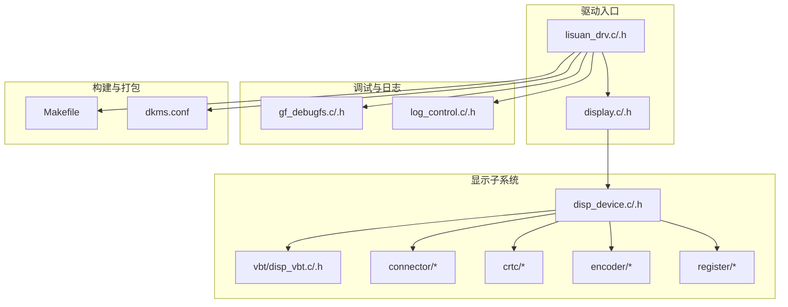
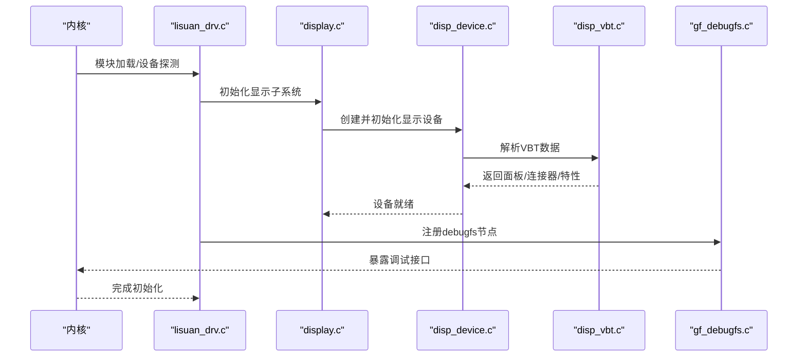
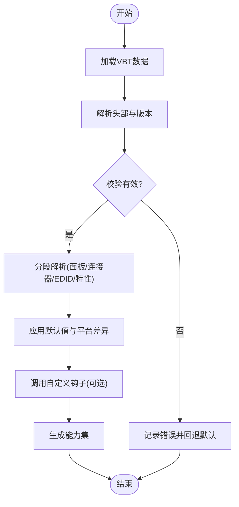
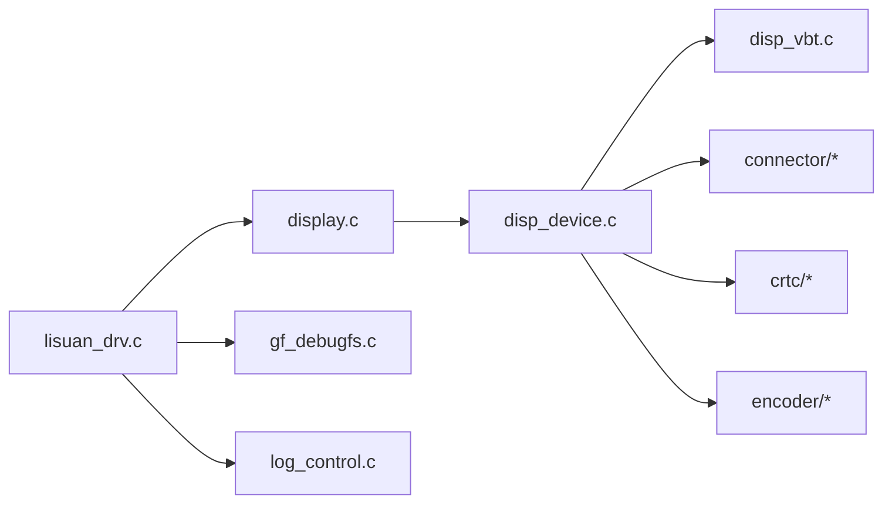

# 配置与定制

<cite>
**本文引用的文件**   
- [display.c](file://_work/src/usr/src/lisuan-dkms-262.2.0.56/display/display.c)
- [display.h](file://_work/src/usr/src/lisuan-dkms-262.2.0.56/display/display.h)
- [disp_device.c](file://_work/src/usr/src/lisuan-dkms-262.2.0.56/display/disp_device.c)
- [disp_device.h](file://_work/src/usr/src/lisuan-dkms-262.2.0.56/display/disp_device.h)
- [disp_vbt.c](file://_work/src/usr/src/lisuan-dkms-262.2.0.56/display/vbt/disp_vbt.c)
- [disp_vbt.h](file://_work/src/usr/src/lisuan-dkms-262.2.0.56/display/vbt/disp_vbt.h)
- [driver_settings.h](file://_work/src/usr/src/lisuan-dkms-262.2.0.56/include/driver_settings.h)
- [lisuan_drv.c](file://_work/src/usr/src/lisuan-dkms-262.2.0.56/lisuan_drv.c)
- [lisuan_drv.h](file://_work/src/usr/src/lisuan-dkms-262.2.0.56/lisuan_drv.h)
- [gf_debugfs.c](file://_work/src/usr/src/lisuan-dkms-262.2.0.56/gf_debugfs.c)
- [gf_debugfs.h](file://_work/src/usr/src/lisuan-dkms-262.2.0.56/gf_debugfs.h)
- [log_control.c](file://_work/src/usr/src/lisuan-dkms-262.2.0.56/log_control.c)
- [log_control.h](file://_work/src/usr/src/lisuan-dkms-262.2.0.56/log_control.h)
- [Makefile](file://_work/src/usr/src/lisuan-dkms-262.2.0.56/Makefile)
- [dkms.conf](file://_work/src/usr/src/lisuan-dkms-262.2.0.56/dkms.conf)
</cite>

## 目录
1. [简介](#简介)
2. [项目结构](#项目结构)
3. [核心组件](#核心组件)
4. [架构总览](#架构总览)
5. [详细组件分析](#详细组件分析)
6. [依赖关系分析](#依赖关系分析)
7. [性能考虑](#性能考虑)
8. [故障排查指南](#故障排查指南)
9. [结论](#结论)
10. [附录](#附录)

## 简介
本文件面向丽山GPU驱动的“配置与定制”主题，聚焦以下方面：
- 驱动参数的配置方法（模块参数、环境变量、配置文件）
- VBT数据的解析流程与自定义扩展点
- 不同硬件平台的适配策略与开关
- 性能调优选项与调试配置
- 常见配置场景示例与最佳实践

文档以代码级为依据，结合架构图、流程图和时序图帮助读者快速理解并落地配置。

## 项目结构
显示子系统位于 display/ 目录，按功能划分为 connector、crtc、encoder、vbt、register、common 等子模块；驱动入口与KMS集成在 lisuan_drv.*、display.* 中；VBT解析集中在 vbt/ 子目录；日志与调试通过 gf_debugfs.* 与 log_control.* 暴露。

图表来源
- [lisuan_drv.c](file://_work/src/usr/src/lisuan-dkms-262.2.0.56/lisuan_drv.c)
- [display.c](file://_work/src/usr/src/lisuan-dkms-262.2.0.56/display/display.c)
- [disp_device.c](file://_work/src/usr/src/lisuan-dkms-262.2.0.56/display/disp_device.c)
- [disp_vbt.c](file://_work/src/usr/src/lisuan-dkms-262.2.0.56/display/vbt/disp_vbt.c)
- [gf_debugfs.c](file://_work/src/usr/src/lisuan-dkms-262.2.0.56/gf_debugfs.c)
- [log_control.c](file://_work/src/usr/src/lisuan-dkms-262.2.0.56/log_control.c)
- [Makefile](file://_work/src/usr/src/lisuan-dkms-262.2.0.56/Makefile)
- [dkms.conf](file://_work/src/usr/src/lisuan-dkms-262.2.0.56/dkms.conf)

章节来源
- [display.c](file://_work/src/usr/src/lisuan-dkms-262.2.0.56/display/display.c)
- [display.h](file://_work/src/usr/src/lisuan-dkms-262.2.0.56/display/display.h)
- [disp_device.c](file://_work/src/usr/src/lisuan-dkms-262.2.0.56/display/disp_device.c)
- [disp_device.h](file://_work/src/usr/src/lisuan-dkms-262.2.0.56/display/disp_device.h)
- [disp_vbt.c](file://_work/src/usr/src/lisuan-dkms-262.2.0.56/display/vbt/disp_vbt.c)
- [disp_vbt.h](file://_work/src/usr/src/lisuan-dkms-262.2.0.56/display/vbt/disp_vbt.h)
- [gf_debugfs.c](file://_work/src/usr/src/lisuan-dkms-262.2.0.56/gf_debugfs.c)
- [gf_debugfs.h](file://_work/src/usr/src/lisuan-dkms-262.2.0.56/gf_debugfs.h)
- [log_control.c](file://_work/src/usr/src/lisuan-dkms-262.2.0.56/log_control.c)
- [log_control.h](file://_work/src/usr/src/lisuan-dkms-262.2.0.56/log_control.h)
- [Makefile](file://_work/src/usr/src/lisuan-dkms-262.2.0.56/Makefile)
- [dkms.conf](file://_work/src/usr/src/lisuan-dkms-262.2.0.56/dkms.conf)

## 核心组件
- 驱动入口与初始化：负责注册设备、加载显示子系统、挂载调试接口、读取模块参数与环境变量。
- 显示设备抽象：封装平台相关能力、资源分配、时钟/电源管理、模式设置流程。
- VBT解析器：从固件/VBT数据中提取面板、连接器、EDID、DP/HDMI特性及厂商私有字段。
- 调试与日志：提供debugfs节点与动态日志控制，便于问题定位与性能分析。
- 构建与打包：DKMS与Makefile用于在不同内核版本下编译安装。

章节来源
- [lisuan_drv.c](file://_work/src/usr/src/lisuan-dkms-262.2.0.56/lisuan_drv.c)
- [lisuan_drv.h](file://_work/src/usr/src/lisuan-dkms-262.2.0.56/lisuan_drv.h)
- [display.c](file://_work/src/usr/src/lisuan-dkms-262.2.0.56/display/display.c)
- [display.h](file://_work/src/usr/src/lisuan-dkms-262.2.0.56/display/display.h)
- [disp_device.c](file://_work/src/usr/src/lisuan-dkms-262.2.0.56/display/disp_device.c)
- [disp_device.h](file://_work/src/usr/src/lisuan-dkms-262.2.0.56/display/disp_device.h)
- [disp_vbt.c](file://_work/src/usr/src/lisuan-dkms-262.2.0.56/display/vbt/disp_vbt.c)
- [disp_vbt.h](file://_work/src/usr/src/lisuan-dkms-262.2.0.56/display/vbt/disp_vbt.h)
- [gf_debugfs.c](file://_work/src/usr/src/lisuan-dkms-262.2.0.56/gf_debugfs.c)
- [gf_debugfs.h](file://_work/src/usr/src/lisuan-dkms-262.2.0.56/gf_debugfs.h)
- [log_control.c](file://_work/src/usr/src/lisuan-dkms-262.2.0.56/log_control.c)
- [log_control.h](file://_work/src/usr/src/lisuan-dkms-262.2.0.56/log_control.h)

## 架构总览
下图展示驱动初始化到显示子系统启动的关键路径，以及VBT解析的参与位置。

图表来源
- [lisuan_drv.c](file://_work/src/usr/src/lisuan-dkms-262.2.0.56/lisuan_drv.c)
- [display.c](file://_work/src/usr/src/lisuan-dkms-262.2.0.56/display/display.c)
- [disp_device.c](file://_work/src/usr/src/lisuan-dkms-262.2.0.56/display/disp_device.c)
- [disp_vbt.c](file://_work/src/usr/src/lisuan-dkms-262.2.0.56/display/vbt/disp_vbt.c)
- [gf_debugfs.c](file://_work/src/usr/src/lisuan-dkms-262.2.0.56/gf_debugfs.c)

## 详细组件分析

### 驱动参数与环境变量
- 模块参数：通过驱动入口定义可配置的布尔/整型参数，例如启用/禁用特定功能、限制最大分辨率或刷新率、选择默认输出等。这些参数在模块加载时生效，影响后续显示子系统的行为。
- 环境变量：可在运行时通过环境变量覆盖部分默认行为，如开启调试、指定日志级别、切换测试模式等。建议在容器或init脚本中统一注入。
- 配置文件：若存在外部配置文件（例如udev规则或驱动专属配置），应在系统启动阶段加载，确保驱动初始化前可用。

建议实践
- 将关键开关集中到模块参数，便于审计与回滚。
- 使用环境变量进行非侵入式调试，避免修改二进制或源码。
- 对每个参数提供最小/最大边界校验与默认值保护。

章节来源
- [lisuan_drv.c](file://_work/src/usr/src/lisuan-dkms-262.2.0.56/lisuan_drv.c)
- [lisuan_drv.h](file://_work/src/usr/src/lisuan-dkms-262.2.0.56/lisuan_drv.h)
- [display.c](file://_work/src/usr/src/lisuan-dkms-262.2.0.56/display/display.c)
- [display.h](file://_work/src/usr/src/lisuan-dkms-262.2.0.56/display/display.h)

### VBT数据解析与自定义
VBT（Video BIOS Table）包含面板型号、连接器能力、EDID片段、DP/HDMI特性及厂商私有字段。解析流程如下：

图表来源
- [disp_vbt.c](file://_work/src/usr/src/lisuan-dkms-262.2.0.56/display/vbt/disp_vbt.c)
- [disp_vbt.h](file://_work/src/usr/src/lisuan-dkms-262.2.0.56/display/vbt/disp_vbt.h)

关键点
- 分段解析：面板、连接器、EDID、DP/HDMI特性各自独立段，便于扩展。
- 默认与覆盖：先应用默认能力，再根据VBT与平台差异覆盖。
- 自定义钩子：预留扩展点，供OEM/ODM注入私有字段处理逻辑。

章节来源
- [disp_vbt.c](file://_work/src/usr/src/lisuan-dkms-262.2.0.56/display/vbt/disp_vbt.c)
- [disp_vbt.h](file://_work/src/usr/src/lisuan-dkms-262.2.0.56/display/vbt/disp_vbt.h)

### 平台适配与能力枚举
显示设备层负责抽象不同平台的能力差异，包括：
- 支持的连接器类型（eDP、HDMI、DP、DVO等）
- 时钟/PLL配置范围与时序约束
- 电源管理与功耗限制
- 特殊寄存器访问与复位序列

适配策略
- 能力表：以平台为键维护能力表，驱动初始化时根据硬件ID选择。
- 条件编译：通过宏开关裁剪不必要的功能，减小体积。
- 运行时检测：在必要时进行硬件探测，动态调整行为。

章节来源
- [disp_device.c](file://_work/src/usr/src/lisuan-dkms-262.2.0.56/display/disp_device.c)
- [disp_device.h](file://_work/src/usr/src/lisuan-dkms-262.2.0.56/display/disp_device.h)

### 调试与日志
- debugfs接口：提供运行时查看/修改驱动状态、触发dump、切换功能开关的节点。
- 日志控制：支持分级日志、模块过滤、动态开关，便于生产环境按需开启。

常用操作
- 查看当前能力与状态：通过debugfs节点查询。
- 开启详细日志：设置日志级别与模块过滤。
- 触发问题复现：使用特定节点触发dump或重放时序。

章节来源
- [gf_debugfs.c](file://_work/src/usr/src/lisuan-dkms-262.2.0.56/gf_debugfs.c)
- [gf_debugfs.h](file://_work/src/usr/src/lisuan-dkms-262.2.0.56/gf_debugfs.h)
- [log_control.c](file://_work/src/usr/src/lisuan-dkms-262.2.0.56/log_control.c)
- [log_control.h](file://_work/src/usr/src/lisuan-dkms-262.2.0.56/log_control.h)

### 构建与打包（DKMS）
- Makefile：定义编译目标、依赖、交叉编译选项与安装路径。
- dkms.conf：声明模块名、版本、内核头依赖、构建脚本，便于自动重建。

建议实践
- 固定内核头路径，避免构建失败。
- 使用签名机制保证模块安全加载。
- 在CI中验证多内核版本兼容性。

章节来源
- [Makefile](file://_work/src/usr/src/lisuan-dkms-262.2.0.56/Makefile)
- [dkms.conf](file://_work/src/usr/src/lisuan-dkms-262.2.0.56/dkms.conf)

## 依赖关系分析
显示子系统内部模块之间的依赖关系如下：

图表来源
- [lisuan_drv.c](file://_work/src/usr/src/lisuan-dkms-262.2.0.56/lisuan_drv.c)
- [display.c](file://_work/src/usr/src/lisuan-dkms-262.2.0.56/display/display.c)
- [disp_device.c](file://_work/src/usr/src/lisuan-dkms-262.2.0.56/display/disp_device.c)
- [disp_vbt.c](file://_work/src/usr/src/lisuan-dkms-262.2.0.56/display/vbt/disp_vbt.c)
- [gf_debugfs.c](file://_work/src/usr/src/lisuan-dkms-262.2.0.56/gf_debugfs.c)
- [log_control.c](file://_work/src/usr/src/lisuan-dkms-262.2.0.56/log_control.c)

章节来源
- [lisuan_drv.c](file://_work/src/usr/src/lisuan-dkms-262.2.0.56/lisuan_drv.c)
- [display.c](file://_work/src/usr/src/lisuan-dkms-262.2.0.56/display/display.c)
- [disp_device.c](file://_work/src/usr/src/lisuan-dkms-262.2.0.56/display/disp_device.c)
- [disp_vbt.c](file://_work/src/usr/src/lisuan-dkms-262.2.0.56/display/vbt/disp_vbt.c)
- [gf_debugfs.c](file://_work/src/usr/src/lisuan-dkms-262.2.0.56/gf_debugfs.c)
- [log_control.c](file://_work/src/usr/src/lisuan-dkms-262.2.0.56/log_control.c)

## 性能考虑
- 时钟与PLL：合理设置时钟分频与倍频，避免过高的抖动与功耗。
- 带宽与压缩：启用DSC/压缩技术以降低带宽压力，提升高分辨率/高刷新率稳定性。
- 电源管理：按需关闭未使用的连接器与编码器，降低待机功耗。
- 日志开销：生产环境关闭冗余日志，仅保留关键事件。
- 内存与缓存：减少频繁分配/释放，复用缓冲区，降低碎片化。

[本节为通用指导，不直接分析具体文件]

## 故障排查指南
常见问题与步骤
- 无法识别显示器：检查VBT解析是否成功、EDID读取是否正常、连接器能力是否匹配。
- 黑屏或闪烁：确认时序与PLL参数、电源上电顺序、复位序列是否正确。
- 性能不达标：检查是否启用了压缩、带宽限制、日志级别过高导致吞吐下降。
- 模块加载失败：核对DKMS构建、内核头版本、签名与依赖。

诊断工具
- 使用debugfs节点查看当前状态、能力与错误码。
- 动态调整日志级别，捕获关键路径信息。
- 对比不同模块参数组合，定位回归点。

章节来源
- [gf_debugfs.c](file://_work/src/usr/src/lisuan-dkms-262.2.0.56/gf_debugfs.c)
- [gf_debugfs.h](file://_work/src/usr/src/lisuan-dkms-262.2.0.56/gf_debugfs.h)
- [log_control.c](file://_work/src/usr/src/lisuan-dkms-262.2.0.56/log_control.c)
- [log_control.h](file://_work/src/usr/src/lisuan-dkms-262.2.0.56/log_control.h)

## 结论
丽山GPU驱动的配置与定制围绕“参数化+可扩展”的设计展开：通过模块参数与环境变量实现灵活配置，借助VBT解析与平台能力表完成硬件适配，利用debugfs与日志系统进行高效调试。遵循本文的最佳实践，可在不同平台上稳定地启用高级特性并优化性能。

[本节为总结性内容，不直接分析具体文件]

## 附录

### 配置项速查
- 模块参数
  - 功能开关：布尔型，启用/禁用某项特性
  - 数值限制：整型，设定上限/下限
  - 默认值：无输入时的安全默认
- 环境变量
  - 调试开关：开启详细日志或dump
  - 行为覆盖：临时改变默认策略
- 配置文件
  - 启动前加载：确保驱动初始化可用
  - 格式规范：键值对或结构化文本

章节来源
- [driver_settings.h](file://_work/src/usr/src/lisuan-dkms-262.2.0.56/include/driver_settings.h)
- [lisuan_drv.c](file://_work/src/usr/src/lisuan-dkms-262.2.0.56/lisuan_drv.c)
- [display.c](file://_work/src/usr/src/lisuan-dkms-262.2.0.56/display/display.c)

### 常见场景示例
- 启用高分辨率输出
  - 设置模块参数允许更高像素时钟
  - 确认VBT中面板能力支持
  - 开启压缩以降低带宽压力
- 禁用未用连接器
  - 通过参数屏蔽特定连接器
  - 降低功耗与干扰
- 调试黑屏问题
  - 打开详细日志
  - 使用debugfs查看时序与状态
  - 逐步缩小参数范围定位根因

章节来源
- [disp_vbt.c](file://_work/src/usr/src/lisuan-dkms-262.2.0.56/display/vbt/disp_vbt.c)
- [disp_device.c](file://_work/src/usr/src/lisuan-dkms-262.2.0.56/display/disp_device.c)
- [gf_debugfs.c](file://_work/src/usr/src/lisuan-dkms-262.2.0.56/gf_debugfs.c)
- [log_control.c](file://_work/src/usr/src/lisuan-dkms-262.2.0.56/log_control.c)