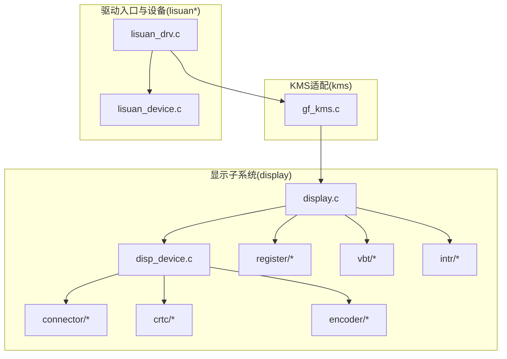
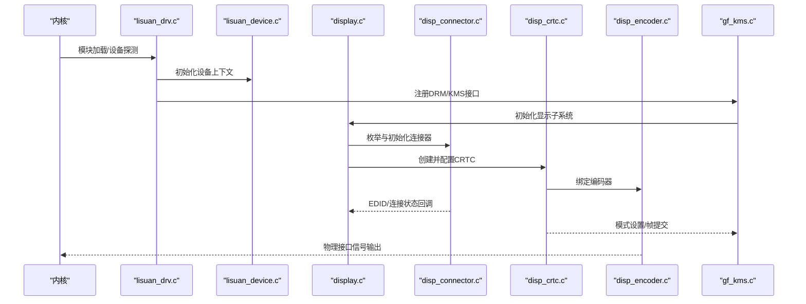
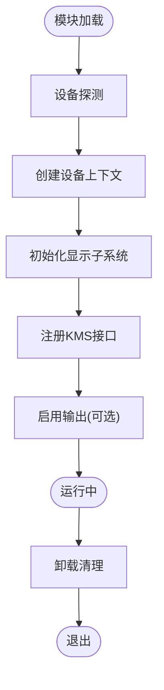
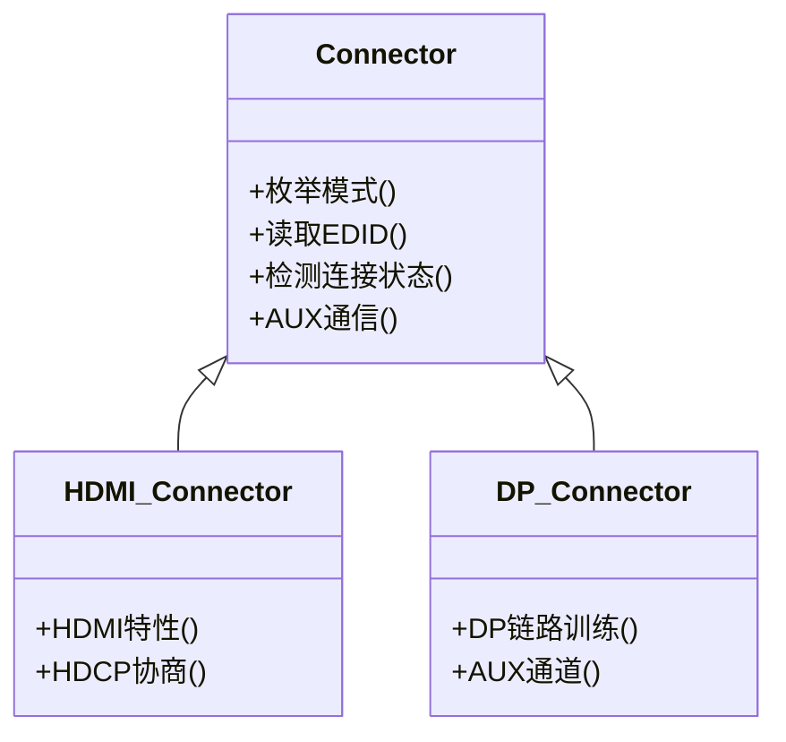
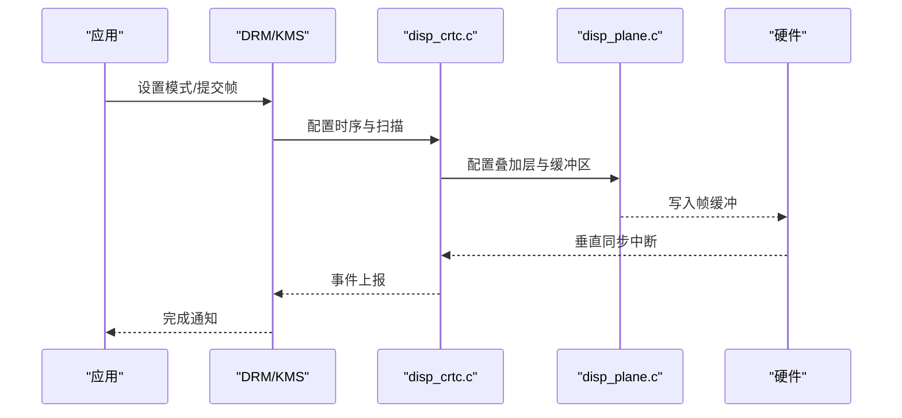
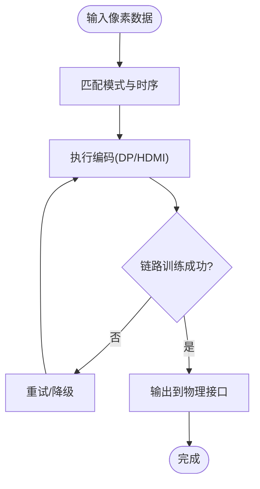
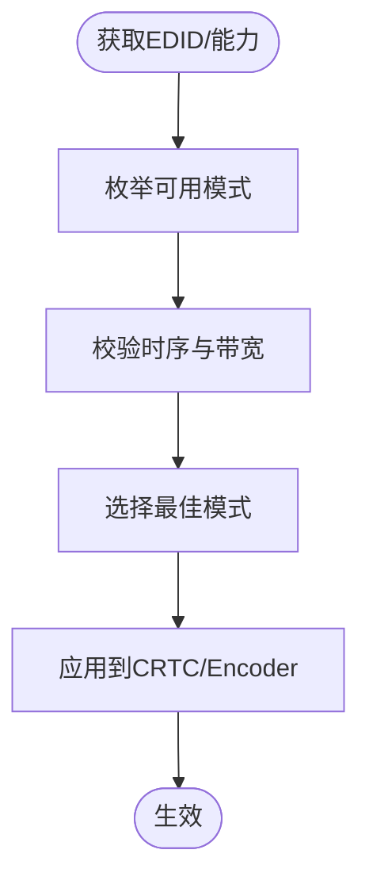
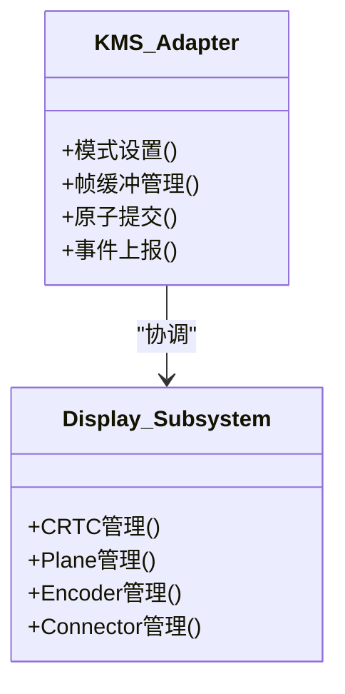
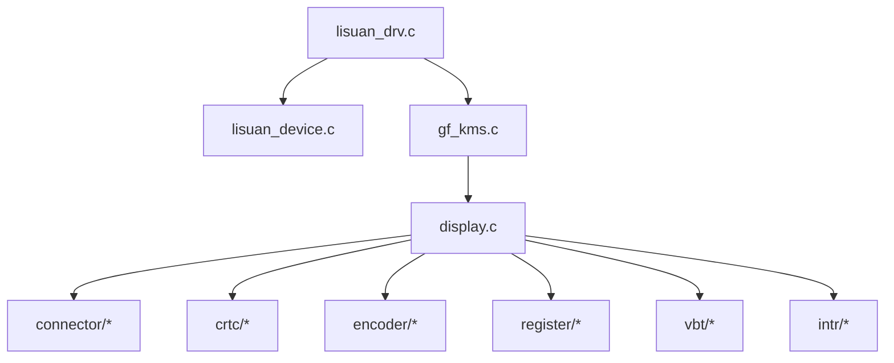

# 项目概览

<cite>
**本文引用的文件**   
- [display.c](file://_work/src/usr/src/lisuangpu-dkms-262.2.0.56/display/display.c)
- [display.h](file://_work/src/usr/src/lisuangpu-dkms-262.2.0.56/display/display.h)
- [disp_device.c](file://_work/src/usr/src/lisuangpu-dkms-262.2.0.56/display/disp_device.c)
- [disp_device.h](file://_work/src/usr/src/lisuangpu-dkms-262.2.0.56/display/disp_device.h)
- [disp_connector.c](file://_work/src/usr/src/lisuangpu-dkms-262.2.0.56/display/connector/disp_connector.c)
- [disp_connector.h](file://_work/src/usr/src/lisuangpu-dkms-262.2.0.56/display/connector/disp_connector.h)
- [disp_dp_connector.c](file://_work/src/usr/src/lisuangpu-dkms-262.2.0.56/display/connector/disp_dp_connector.c)
- [disp_hdmi_connector.c](file://_work/src/usr/src/lisuangpu-dkms-262.2.0.56/display/connector/disp_hdmi_connector.c)
- [disp_mode.c](file://_work/src/usr/src/lisuangpu-dkms-262.2.0.56/display/connector/disp_mode.c)
- [disp_mode.h](file://_work/src/usr/src/lisuangpu-dkms-262.2.0.56/display/connector/disp_mode.h)
- [disp_crtc.c](file://_work/src/usr/src/lisuangpu-dkms-262.2.0.56/display/crtc/disp_crtc.c)
- [disp_crtc.h](file://_work/src/usr/src/lisuangpu-dkms-262.2.0.56/display/crtc/disp_crtc.h)
- [disp_pipe.c](file://_work/src/usr/src/lisuangpu-dkms-262.2.0.56/display/crtc/disp_pipe.c)
- [disp_plane.c](file://_work/src/usr/src/lisuangpu-dkms-262.2.0.56/display/crtc/disp_plane.c)
- [disp_encoder.c](file://_work/src/usr/src/lisuangpu-dkms-262.2.0.56/display/encoder/disp_encoder.c)
- [disp_encoder.h](file://_work/src/usr/src/lisuangpu-dkms-262.2.0.56/display/encoder/disp_encoder.h)
- [disp_dp_encoder.c](file://_work/src/usr/src/lisuangpu-dkms-262.2.0.56/display/encoder/disp_dp_encoder.c)
- [disp_hdmi_encoder.c](file://_work/src/usr/src/lisuangpu-dkms-262.2.0.56/display/encoder/disp_hdmi_encoder.c)
- [gf_kms.c](file://_work/src/usr/src/lisuangpu-dkms-262.2.0.56/kms/gf_kms.c)
- [gf_kms.h](file://_work/src/usr/src/lisuangpu-dkms-262.2.0.56/kms/gf_kms.h)
- [lisuan_drv.c](file://_work/src/usr/src/lisuangpu-dkms-262.2.0.56/lisuan_drv.c)
- [lisuan_drv.h](file://_work/src/usr/src/lisuangpu-dkms-262.2.0.56/lisuan_drv.h)
- [lisuan_device.c](file://_work/src/usr/src/lisuangpu-dkms-262.2.0.56/lisuan_device.c)
- [lisuan_device.h](file://_work/src/usr/src/lisuangpu-dkms-262.2.0.56/lisuan_device.h)
- [Makefile](file://_work/src/usr/src/lisuangpu-dkms-262.2.0.56/Makefile)
</cite>

## 目录
1. [简介](#简介)
2. [项目结构](#项目结构)
3. [核心组件](#核心组件)
4. [架构总览](#架构总览)
5. [详细组件分析](#详细组件分析)
6. [依赖关系分析](#依赖关系分析)
7. [性能考虑](#性能考虑)
8. [故障排查指南](#故障排查指南)
9. [结论](#结论)
10. [附录](#附录)

## 简介
本概览面向丽山GPU显示驱动项目，目标是帮助初学者快速理解项目的目的与整体架构，同时为有经验的开发者提供深入的技术细节、配置选项和使用模式。项目围绕Linux DRM/KMS显示栈构建，提供对丽山GPU的显示管线（CRTC/Plane/Encoder/Connector）支持，涵盖HDMI、DisplayPort等接口，并集成音频编解码、中断、寄存器访问、VBT解析等子系统。文档将使用与代码库一致的术语，并通过图表说明关键概念和数据流。

## 项目结构
项目采用按功能域划分的目录组织方式：
- display：显示子系统核心，包含设备初始化、连接器、CRTC、编码器、模式与时序、中断、寄存器定义、VBT解析等。
- kms：KMS框架适配层，对接DRM/KMS接口。
- include：公共头文件与共享定义。
- video_codec：视频编解码相关实现。
- 根目录：驱动入口、设备管理、调度、内存管理、调试与日志控制等。

**图示来源** 
- [display.c:1-200](file://_work/src/usr/src/lisuangpu-dkms-262.2.0.56/display/display.c#L1-L200)
- [disp_device.c:1-200](file://_work/src/usr/src/lisuangpu-dkms-262.2.0.56/display/disp_device.c#L1-L200)
- [gf_kms.c:1-200](file://_work/src/usr/src/lisuangpu-dkms-262.2.0.56/kms/gf_kms.c#L1-L200)
- [lisuan_drv.c:1-200](file://_work/src/usr/src/lisuangpu-dkms-262.2.0.56/lisuan_drv.c#L1-L200)

**章节来源**
- [display.c:1-200](file://_work/src/usr/src/lisuangpu-dkms-262.2.0.56/display/display.c#L1-L200)
- [disp_device.c:1-200](file://_work/src/usr/src/lisuangpu-dkms-262.2.0.56/display/disp_device.c#L1-L200)
- [gf_kms.c:1-200](file://_work/src/usr/src/lisuangpu-dkms-262.2.0.56/kms/gf_kms.c#L1-L200)
- [lisuan_drv.c:1-200](file://_work/src/usr/src/lisuangpu-dkms-262.2.0.56/lisuan_drv.c#L1-L200)

## 核心组件
- 显示设备与生命周期管理：负责GPU显示设备的发现、初始化、资源分配与释放。
- 连接器（Connector）：抽象物理输出接口（如HDMI、DP），处理EDID读取、连接状态检测、辅助通道通信等。
- CRTC与平面（Plane）：负责扫描转换、像素混合、叠加层管理与帧缓冲提交。
- 编码器（Encoder）：将像素数据转换为特定物理接口信号（如DP/HDMI编码）。
- 模式与时序（Mode）：定义分辨率、刷新率、时序参数，并进行验证与选择。
- 中断与事件：处理显示相关中断、同步与事件上报。
- 寄存器与硬件抽象：封装寄存器读写、时钟/PLL配置、电源管理等。
- KMS适配：对接DRM/KMS框架，暴露标准接口给上层图形栈。
- 驱动入口：模块加载、设备探测、子系统注册与卸载。

**章节来源**
- [disp_connector.c:1-200](file://_work/src/usr/src/lisuangpu-dkms-262.2.0.56/display/connector/disp_connector.c#L1-L200)
- [disp_crtc.c:1-200](file://_work/src/usr/src/lisuangpu-dkms-262.2.0.56/display/crtc/disp_crtc.c#L1-L200)
- [disp_plane.c:1-200](file://_work/src/usr/src/lisuangpu-dkms-262.2.0.56/display/crtc/disp_plane.c#L1-L200)
- [disp_encoder.c:1-200](file://_work/src/usr/src/lisuangpu-dkms-262.2.0.56/display/encoder/disp_encoder.c#L1-L200)
- [disp_mode.c:1-200](file://_work/src/usr/src/lisuangpu-dkms-262.2.0.56/display/connector/disp_mode.c#L1-L200)
- [gf_kms.c:1-200](file://_work/src/usr/src/lisuangpu-dkms-262.2.0.56/kms/gf_kms.c#L1-L200)
- [lisuan_drv.c:1-200](file://_work/src/usr/src/lisuangpu-dkms-262.2.0.56/lisuan_drv.c#L1-L200)

## 架构总览
下图展示了从驱动入口到显示管线的调用关系与数据流向，体现DRM/KMS框架与丽山GPU显示子系统的交互。

**图示来源** 
- [lisuan_drv.c:1-200](file://_work/src/usr/src/lisuangpu-dkms-262.2.0.56/lisuan_drv.c#L1-L200)
- [lisuan_device.c:1-200](file://_work/src/usr/src/lisuangpu-dkms-262.2.0.56/lisuan_device.c#L1-L200)
- [display.c:1-200](file://_work/src/usr/src/lisuangpu-dkms-262.2.0.56/display/display.c#L1-L200)
- [disp_connector.c:1-200](file://_work/src/usr/src/lisuangpu-dkms-262.2.0.56/display/connector/disp_connector.c#L1-L200)
- [disp_crtc.c:1-200](file://_work/src/usr/src/lisuangpu-dkms-262.2.0.56/display/crtc/disp_crtc.c#L1-L200)
- [disp_encoder.c:1-200](file://_work/src/usr/src/lisuangpu-dkms-262.2.0.56/display/encoder/disp_encoder.c#L1-L200)
- [gf_kms.c:1-200](file://_work/src/usr/src/lisuangpu-dkms-262.2.0.56/kms/gf_kms.c#L1-L200)

## 详细组件分析

### 显示设备与生命周期
- 职责：设备探测、资源分配、子系统初始化、电源与中断管理、清理。
- 关键点：与KMS框架的生命周期对齐，确保在模块加载时完成注册，在卸载时正确释放。
- 典型流程：探测设备→创建上下文→初始化显示→注册KMS→启用输出。

**图示来源** 
- [lisuan_drv.c:1-200](file://_work/src/usr/src/lisuangpu-dkms-262.2.0.56/lisuan_drv.c#L1-L200)
- [lisuan_device.c:1-200](file://_work/src/usr/src/lisuangpu-dkms-262.2.0.56/lisuan_device.c#L1-L200)
- [display.c:1-200](file://_work/src/usr/src/lisuangpu-dkms-262.2.0.56/display/display.c#L1-L200)

**章节来源**
- [lisuan_drv.c:1-200](file://_work/src/usr/src/lisuangpu-dkms-262.2.0.56/lisuan_drv.c#L1-L200)
- [lisuan_device.c:1-200](file://_work/src/usr/src/lisuangpu-dkms-262.2.0.56/lisuan_device.c#L1-L200)
- [display.c:1-200](file://_work/src/usr/src/lisuangpu-dkms-262.2.0.56/display/display.c#L1-L200)

### 连接器（Connector）
- 职责：表示物理输出端口，处理EDID读取、连接状态检测、辅助通道（如DP AUX）、接口能力协商。
- 常见类型：HDMI、DisplayPort、DVO等。
- 关键操作：查询模式、读取EDID、热插拔事件上报。

**图示来源** 
- [disp_connector.c:1-200](file://_work/src/usr/src/lisuangpu-dkms-262.2.0.56/display/connector/disp_connector.c#L1-L200)
- [disp_hdmi_connector.c:1-200](file://_work/src/usr/src/lisuangpu-dkms-262.2.0.56/display/connector/disp_hdmi_connector.c#L1-L200)
- [disp_dp_connector.c:1-200](file://_work/src/usr/src/lisuangpu-dkms-262.2.0.56/display/connector/disp_dp_connector.c#L1-L200)

**章节来源**
- [disp_connector.c:1-200](file://_work/src/usr/src/lisuangpu-dkms-262.2.0.56/display/connector/disp_connector.c#L1-L200)
- [disp_hdmi_connector.c:1-200](file://_work/src/usr/src/lisuangpu-dkms-262.2.0.56/display/connector/disp_hdmi_connector.c#L1-L200)
- [disp_dp_connector.c:1-200](file://_work/src/usr/src/lisuangpu-dkms-262.2.0.56/display/connector/disp_dp_connector.c#L1-L200)

### CRTC与平面（Plane）
- CRTC：负责扫描转换、时序生成、帧缓冲更新。
- Plane：叠加层，支持多平面合成、缩放、裁剪、格式转换。
- 关键流程：模式设置→平面配置→帧提交→垂直同步。

**图示来源** 
- [disp_crtc.c:1-200](file://_work/src/usr/src/lisuangpu-dkms-262.2.0.56/display/crtc/disp_crtc.c#L1-L200)
- [disp_plane.c:1-200](file://_work/src/usr/src/lisuangpu-dkms-262.2.0.56/display/crtc/disp_plane.c#L1-L200)

**章节来源**
- [disp_crtc.c:1-200](file://_work/src/usr/src/lisuangpu-dkms-262.2.0.56/display/crtc/disp_crtc.c#L1-L200)
- [disp_plane.c:1-200](file://_work/src/usr/src/lisuangpu-dkms-262.2.0.56/display/crtc/disp_plane.c#L1-L200)

### 编码器（Encoder）
- 职责：将像素数据转换为特定物理接口信号（如DP/HDMI编码），处理链路训练、DSC压缩等。
- 关键操作：模式匹配、编码参数配置、链路训练、错误恢复。

**图示来源** 
- [disp_encoder.c:1-200](file://_work/src/usr/src/lisuangpu-dkms-262.2.0.56/display/encoder/disp_encoder.c#L1-L200)
- [disp_dp_encoder.c:1-200](file://_work/src/usr/src/lisuangpu-dkms-262.2.0.56/display/encoder/disp_dp_encoder.c#L1-L200)
- [disp_hdmi_encoder.c:1-200](file://_work/src/usr/src/lisuangpu-dkms-262.2.0.56/display/encoder/disp_hdmi_encoder.c#L1-L200)

**章节来源**
- [disp_encoder.c:1-200](file://_work/src/usr/src/lisuangpu-dkms-262.2.0.56/display/encoder/disp_encoder.c#L1-L200)
- [disp_dp_encoder.c:1-200](file://_work/src/usr/src/lisuangpu-dkms-262.2.0.56/display/encoder/disp_dp_encoder.c#L1-L200)
- [disp_hdmi_encoder.c:1-200](file://_work/src/usr/src/lisuangpu-dkms-262.2.0.56/display/encoder/disp_hdmi_encoder.c#L1-L200)

### 模式与时序（Mode）
- 职责：定义分辨率、刷新率、时序参数，进行验证与选择最优模式。
- 关键操作：模式枚举、校验、动态切换。

**图示来源** 
- [disp_mode.c:1-200](file://_work/src/usr/src/lisuangpu-dkms-262.2.0.56/display/connector/disp_mode.c#L1-L200)
- [disp_mode.h:1-200](file://_work/src/usr/src/lisuangpu-dkms-262.2.0.56/display/connector/disp_mode.h#L1-L200)

**章节来源**
- [disp_mode.c:1-200](file://_work/src/usr/src/lisuangpu-dkms-262.2.0.56/display/connector/disp_mode.c#L1-L200)
- [disp_mode.h:1-200](file://_work/src/usr/src/lisuangpu-dkms-262.2.0.56/display/connector/disp_mode.h#L1-L200)

### KMS适配层
- 职责：实现DRM/KMS接口，向上层暴露标准API，协调显示子系统各组件。
- 关键点：模式设置、帧缓冲管理、原子提交、事件上报。

**图示来源** 
- [gf_kms.c:1-200](file://_work/src/usr/src/lisuangpu-dkms-262.2.0.56/kms/gf_kms.c#L1-L200)
- [gf_kms.h:1-200](file://_work/src/usr/src/lisuangpu-dkms-262.2.0.56/kms/gf_kms.h#L1-L200)

**章节来源**
- [gf_kms.c:1-200](file://_work/src/usr/src/lisuangpu-dkms-262.2.0.56/kms/gf_kms.c#L1-L200)
- [gf_kms.h:1-200](file://_work/src/usr/src/lisuangpu-dkms-262.2.0.56/kms/gf_kms.h#L1-L200)

## 依赖关系分析
- 驱动入口依赖设备管理、KMS适配与显示子系统。
- 显示子系统依赖连接器、CRTC、编码器、模式与时序、中断、寄存器与VBT。
- KMS适配层依赖显示子系统以暴露DRM/KMS接口。

**图示来源** 
- [lisuan_drv.c:1-200](file://_work/src/usr/src/lisuangpu-dkms-262.2.0.56/lisuan_drv.c#L1-L200)
- [lisuan_device.c:1-200](file://_work/src/usr/src/lisuangpu-dkms-262.2.0.56/lisuan_device.c#L1-L200)
- [gf_kms.c:1-200](file://_work/src/usr/src/lisuangpu-dkms-262.2.0.56/kms/gf_kms.c#L1-L200)
- [display.c:1-200](file://_work/src/usr/src/lisuangpu-dkms-262.2.0.56/display/display.c#L1-L200)

**章节来源**
- [lisuan_drv.c:1-200](file://_work/src/usr/src/lisuangpu-dkms-262.2.0.56/lisuan_drv.c#L1-L200)
- [lisuan_device.c:1-200](file://_work/src/usr/src/lisuangpu-dkms-262.2.0.56/lisuan_device.c#L1-L200)
- [gf_kms.c:1-200](file://_work/src/usr/src/lisuangpu-dkms-262.2.0.56/kms/gf_kms.c#L1-L200)
- [display.c:1-200](file://_work/src/usr/src/lisuangpu-dkms-262.2.0.56/display/display.c#L1-L200)

## 性能考虑
- 模式选择与带宽评估：避免超出接口或链路带宽限制，减少重协商开销。
- 中断与事件：合理配置中断阈值与批量处理，降低CPU占用。
- 帧缓冲与内存：优先使用零拷贝路径，减少内存复制；合理使用DMA与缓存一致性。
- 电源管理：按需启用/关闭显示引擎与接口，降低功耗。
- 并行化：在安全范围内并行处理非关键路径任务（如EDID读取、模式枚举）。

[本节为通用指导，不直接分析具体文件]

## 故障排查指南
- 无输出：检查连接器状态、EDID读取、链路训练结果与编码器配置。
- 闪烁/撕裂：确认垂直同步、帧提交顺序与平面配置是否正确。
- 黑屏/分辨率异常：检查模式校验与时序参数，确认带宽与兼容性。
- 中断风暴：检查中断屏蔽与处理逻辑，避免重复触发。
- 日志与调试：启用驱动日志与调试接口，定位问题阶段。

**章节来源**
- [disp_connector.c:1-200](file://_work/src/usr/src/lisuangpu-dkms-262.2.0.56/display/connector/disp_connector.c#L1-L200)
- [disp_crtc.c:1-200](file://_work/src/usr/src/lisuangpu-dkms-262.2.0.56/display/crtc/disp_crtc.c#L1-L200)
- [disp_encoder.c:1-200](file://_work/src/usr/src/lisuangpu-dkms-262.2.0.56/display/encoder/disp_encoder.c#L1-L200)
- [display.c:1-200](file://_work/src/usr/src/lisuangpu-dkms-262.2.0.56/display/display.c#L1-L200)

## 结论
丽山GPU显示驱动通过模块化设计清晰分离了设备管理、显示子系统与KMS适配层，提供了对多种接口的稳定支持。遵循DRM/KMS标准接口，便于上层图形栈集成。建议在开发中重点关注模式与时序校验、中断与事件处理、内存与带宽优化，以及电源管理策略，以提升性能与稳定性。

[本节为总结性内容，不直接分析具体文件]

## 附录
- 构建与安装：参考项目根目录的Makefile与DKMS配置，完成驱动编译与安装。
- 常用命令：使用系统工具查看显示状态、模式与事件（如dmesg、drm信息工具）。
- 扩展点：如需新增接口或功能，可在对应目录下添加实现并接入显示子系统与KMS适配层。

**章节来源**
- [Makefile:1-200](file://_work/src/usr/src/lisuangpu-dkms-262.2.0.56/Makefile#L1-L200)