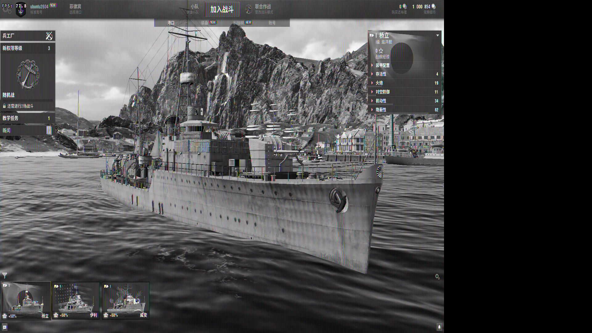

# 《战舰世界》在砺算 7G100 上的硬件加速

> 状态：**已验证港口场景硬件加速**。DXVK HUD 约 77.7 FPS，游戏 CPU 从软件渲染时约 1180% 降至约 134%，llvmpipe 活跃线程为 0。战斗场景未逐项验收。

## 至砺算：官方实现什么后，本方案可退役

1. 在 Steam Runtime / pressure-vessel 容器内提供标准 gf Vulkan ICD 发现路径，不依赖 `/sys/bus/pci`。
2. 取消 `/etc/os-release` 发行版白名单，或将 Steam Runtime 识别为受支持环境。
3. 将 ICD loader interface version 提升到 5，并补齐 `VK_KHR_external_semaphore_capabilities` 等实例扩展。
4. 补齐 `VK_KHR_maintenance5`，使 DXVK 2.5/2.7/3.x 能直接使用 gf。
5. 让 `libSC.so` 可被驱动在容器内自解析，无需用户目录副本和预加载。
6. 提供 32 位用户态驱动；本游戏为 64 位，当前不涉及该限制。

## 环境

- Ubuntu 24.04
- 砺算 7G100，PCI `4c54:5006`
- `lisuangpu-dkms` / `lisuangpu-lib` 262.2.0.56
- 用户态 Vulkan 报告 `gf 22.0.4`
- Steam + Proton 11.0
- Steam Linux Runtime 4 / pressure-vessel
- 《战舰世界》AppID `552990`
- 当前验证客户端版本 `15.10.0.13533378`

## 目录内容

| 路径 | 说明 |
| --- | --- |
| `setup-wows-gf.sh` | 部署 gf 运行时、编译 shim、部署 DXVK 2.3，可离线写入 Steam 启动选项 |
| `run-wows-gf.sh` | 单次启动器，默认直接经 Steam Runtime + Proton 启动 |
| `uninstall-wows-gf.sh` | 停用游戏目录内 DXVK、恢复 shim 备份，不删除游戏或存档 |
| `assets/libvulkan_gf_shim.c` | ICD 协商/扩展过滤垫片源码，包含 `libSC.so` 预加载修复 |
| `assets/osrelease_redirect.c` | os-release 重定向与低 4GB 映射 hook 源码 |
| `assets/gf_icd.json` | 自定义 gf ICD 清单 |
| `assets/os-release` | 用于绕过容器发行版白名单的 Ubuntu 标识 |
| `steam-launch-options.txt` | 由 setup 生成，可复制到 Steam 游戏属性 |
| `images/wows-gf-port.png` | 已验证的港口截图 |

游戏本体、DXVK DLL、`libvulkan_gf.so`、`libSC.so` 均不放入本目录。

## 快速使用

```bash
# 1. 部署（不复制游戏文件）
./world-of-warships/setup-wows-gf.sh

# 2. 直接启动
./world-of-warships/run-wows-gf.sh

# 或通过已配置 LaunchOptions 的 Steam 客户端启动
./world-of-warships/run-wows-gf.sh --steam

# 体检
./world-of-warships/setup-wows-gf.sh --status

# 回滚
./world-of-warships/uninstall-wows-gf.sh
```

## 根因

低帧率不是画质过高，而是 DXVK 回退到 llvmpipe 软件渲染：

1. Steam Runtime 容器内原版 gf ICD 枚举失败，返回 `-3`、设备数 0。
2. 容器 `/etc/os-release` 为 Steam Runtime，触发 gf 发行版白名单。
3. 新版 Vulkan loader 与 gf 的旧式 ICD 协商/扩展能力不兼容。
4. Proton 11 自带 DXVK 2.7.1 要求 `VK_KHR_maintenance5`，gf 不满足，DXVK 跳过 7G100。
5. 多 ICD 环境仍提供 llvmpipe，最终游戏使用 CPU 软件渲染。

仅看到进程加载 `libvulkan_gf.so` 或打开 `/dev/dri/renderD128` 不能证明硬件加速。

## 最终渲染路径

```text
WorldOfWarships64.exe
  -> 游戏目录内 DXVK 2.3 (d3d11.dll / dxgi.dll)
  -> Wine Vulkan WSI
  -> 自定义 gf_icd.json
  -> libvulkan_gf_shim.so
       -> 先 dlopen libSC.so (RTLD_GLOBAL)
       -> 再 dlopen libvulkan_gf.so
  -> LISUAN 7G100 Series Graphics
```

## 部署

### 1. 准备独立运行时目录

运行时位于：

```text
~/.local/share/worldofwarships-gf-accel/
```

目录内容：

```text
gf_icd.json
os-release
lib/
  libvulkan_gf.so
  libSC.so
  libvulkan_gf_shim.so
  osrelease_redirect.so
```

`libvulkan_gf.so` 和 `libSC.so` 来自宿主 `lisuangpu-lib`，不纳入 Git。

### 2. 编译 gf shim

复用本目录源码：

```text
world-of-warships/assets/libvulkan_gf_shim.c
world-of-warships/assets/osrelease_redirect.c
world-of-warships/assets/gf_icd.json
world-of-warships/assets/os-release
```

`setup-wows-gf.sh` 会通过 `-DGF_RUNTIME_DIR=...` 重写硬编码运行时路径，并以 `-DGF_SHIM_TRACE=0` 关闭逐调用文件日志。

关键修复：在 shim 的 `init_real()` 中先加载 `libSC.so`，再加载真实驱动：

```c
static void init_real(void) {
    if (real_gap) return;
    dlopen("/home/ubuntu/.local/share/worldofwarships-gf-accel/lib/libSC.so",
           RTLD_NOW | RTLD_GLOBAL);
    real_h = dlopen("/home/ubuntu/.local/share/worldofwarships-gf-accel/lib/libvulkan_gf.so",
                    RTLD_NOW | RTLD_LOCAL);
    if (real_h)
        real_gap = (gap_fn)dlsym(real_h, "vk_icdGetInstanceProcAddr");
}
```

只给 shim 添加 RPATH 或只设置 `LD_LIBRARY_PATH` 在本机不足以让驱动后续找到 `libSC.so`。

### 3. 部署 DXVK 2.3

Proton 启动时会覆盖前缀 `drive_c/windows/system32` 中的 DXVK DLL，因此把 DXVK 2.3 放到游戏主 exe 同目录：

```text
~/.local/share/Steam/steamapps/common/World of Warships/bin/13533378/bin64/
  d3d11.dll
  dxgi.dll
```

DLL 来源：

```text
~/.local/share/Steam/steamapps/common/Proton 8.0/dist/lib64/wine/dxvk/
```

游戏更新后构建号目录可能变化，需要重新定位主 exe 目录。

### 4. Steam 启动选项

在《战舰世界》属性中选择 Proton 11.0，并设置：

```text
DXVK_HUD=fps LD_PRELOAD=/home/ubuntu/.local/share/worldofwarships-gf-accel/lib/osrelease_redirect.so LD_LIBRARY_PATH=/home/ubuntu/.local/share/worldofwarships-gf-accel/lib __GLX_VENDOR_LIBRARY_NAME=mesa LIBGL_ALWAYS_SOFTWARE=1 VK_ICD_FILENAMES=/home/ubuntu/.local/share/worldofwarships-gf-accel/gf_icd.json VK_DRIVER_FILES=/home/ubuntu/.local/share/worldofwarships-gf-accel/gf_icd.json VK_LOADER_LAYERS_DISABLE=VK_LAYER_VALVE_steam_overlay_64,VK_LAYER_VALVE_steam_overlay_32 %command%
```

诊断时可临时追加：

```text
PROTON_LOG=1 DXVK_LOG_LEVEL=info DXVK_LOG_PATH=/home/ubuntu/.local/share/worldofwarships-gf-accel
```

`setup-wows-gf.sh` 会生成 `steam-launch-options.txt`。可复制到《战舰世界》属性，或运行：

```bash
./world-of-warships/setup-wows-gf.sh --configure-steam
```

`--configure-steam` 要求 Steam 客户端完全停止，并会自动备份 `localconfig.vdf`。

`localconfig.vdf` 在 Steam 运行中直接编辑可能被内存配置覆盖；优先通过 Steam GUI，或完全停止客户端后离线修改。

### 5. 启动

```bash
./world-of-warships/run-wows-gf.sh
# 或
./world-of-warships/run-wows-gf.sh --steam
```

首次使用新渲染路径会进行着色器和资源加载，CPU 偏高不能直接判定卡死。

## 验证

### 容器内枚举 gf

```bash
RT="$HOME/.local/share/Steam/steamapps/common/SteamLinuxRuntime_4"
GF="$HOME/.local/share/worldofwarships-gf-accel"
PROBE="$PWD/.qoder/skills/lisuan-gpu-workflow/scripts/vk_probe.py"

LD_PRELOAD="$GF/lib/osrelease_redirect.so" \
VK_ICD_FILENAMES="$GF/gf_icd.json" \
VK_DRIVER_FILES="$GF/gf_icd.json" \
"$RT/_v2-entry-point" --verb=waitforexitandrun -- \
  /run/host/usr/bin/python3 "$PROBE" --json
```

预期设备：`LISUAN 7G100 Series Graphics`。

### DXVK 日志

```text
Game: WorldOfWarships64.exe
DXVK: v2.3-21-...
LISUAN 7G100 Series Graphics:
Driver: gf 22.0.4
```

不能出现 `Skipping ... maintenance5` 或 `No adapters found`。

### 进程诊断

```bash
python3 .qoder/skills/lisuan-gpu-workflow/scripts/diagnose_process.py <pid> --interval 3
```

预期：

- `libSC.so`、`libvulkan_gf_shim.so`、`libvulkan_gf.so` 已加载。
- llvmpipe 活跃线程为 0。
- 无 `libvulkan_lvp.so` / `libLLVM` 渲染信号。

### 实测性能

| 项目 | 软件渲染 | gf 硬件加速 |
| --- | ---: | ---: |
| 港口 FPS | 低，用户反馈卡顿 | 约 77.7 |
| 游戏进程 CPU | 约 1180% | 约 134% |
| llvmpipe 线程 | 16 个活跃线程 | 0 |
| 渲染设备 | llvmpipe | LISUAN 7G100 |



## 回滚

历史手工备份位置：

```text
~/.local/share/worldofwarships-gf-accel/lib/libvulkan_gf_shim.so.bak-prelibsc
~/.local/share/Steam/steamapps/compatdata/552990/pfx/drive_c/windows/system32/.dxvk27-backup/
~/.local/share/Steam/userdata/<user>/config/localconfig.vdf.bak-wows-gf
```

回滚脚本：

```bash
./world-of-warships/uninstall-wows-gf.sh
```

脚本会：

1. 恢复 `libvulkan_gf_shim.so.bak-wows-setup`（若存在）。
2. 把游戏目录内 `d3d11.dll`、`dxgi.dll` 移到 `.dxvk23-disabled/`，让 Proton 恢复自带版本。
3. 保留游戏、存档和运行时目录，不做删除。

如需同时恢复 Steam 配置，在 Steam 完全停止后运行：

```bash
./world-of-warships/uninstall-wows-gf.sh --restore-steam-config
```

## 已知边界

- 当前只验收亚洲服港口，未逐项测试战斗、录像和排位。
- 游戏更新可能改变 `bin/<build>/bin64` 路径，DXVK DLL 需要重新部署。
- Proton 更新可能改变环境变量和 DLL 同步行为，需要重新核对日志。
- 当前 Steam LaunchOptions 保留了 FPS HUD 和诊断日志；稳定后可移除 `PROTON_LOG`、`DXVK_LOG_LEVEL`、`DXVK_LOG_PATH`。
- 不引入看门狗、自动重启或失败自动回退。
